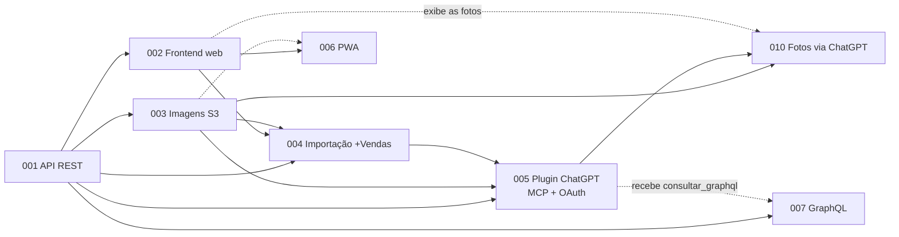

# Documentação do Ambrosio

> Índice da documentação: análises e arquitetura, e histórias de usuário.

**Created:** 2026-10-25
**Last Updated:** 2026-10-25

---

## Análises e arquitetura

| Doc | Descrição |
|---|---|
| [01 — Análise do sistema +Vendas](01-analise-sistema-mais-vendas.md) | Levantamento somente leitura do +Vendas (Somalabs): telas, rotas, dados disponíveis e pontos de atenção |
| [02 — Modelo de dados](02-modelo-de-dados.md) | Modelo PostgreSQL proposto, que espelha o +Vendas (fase 1) e prepara o foco em clientes (fase 2) |
| [03 — Bot Playwright](03-bot-playwright.md) | Bot de coleta somente leitura que extrai vendas e clientes do +Vendas para a base, com regras de segurança |
| [04 — MCP para consultas com LLM](04-mcp-consultas-llm.md) | Servidor MCP somente leitura sobre a base, com as tools sugeridas para consultar vendas e clientes |

---

## Histórias de usuário

| ID | História | Status | Spec |
|---|---|---|---|
| [001](historias/001-api-cadastro-clientes-pedidos.md) | [API de cadastro e consulta de clientes e pedidos](historias/001-api-cadastro-clientes-pedidos.md) | Implementada | [`specs/001-api-cadastro-clientes-pedidos/`](../specs/001-api-cadastro-clientes-pedidos/) |
| [002](historias/002-frontend-web-perfil-cliente-pedidos.md) | [Frontend web: perfil do cliente e pedidos (somente exibição)](historias/002-frontend-web-perfil-cliente-pedidos.md) | Implementada | [`specs/002-frontend-web-clientes-pedidos/`](../specs/002-frontend-web-clientes-pedidos/) |
| [003](historias/003-armazenamento-imagens-s3.md) | [Armazenamento de imagens em storage compatível com S3](historias/003-armazenamento-imagens-s3.md) | Implementada | [`specs/004-s3-image-storage/`](../specs/004-s3-image-storage/) |
| [004](historias/004-bot-migracao-mais-vendas.md) | [Importação do +Vendas pelo frontend (pedidos, clientes e fotos)](historias/004-bot-migracao-mais-vendas.md) | Implementada | [`specs/006-mais-vendas-import/`](../specs/006-mais-vendas-import/) |
| [005](historias/005-plugin-chatgpt-mcp.md) | [Plugin do Ambrosio no ChatGPT (MCP com toda a API e login OAuth)](historias/005-plugin-chatgpt-mcp.md) | Planejada (próxima) | — |
| [006](historias/006-frontend-pwa.md) | [Frontend como PWA](historias/006-frontend-pwa.md) | Planejada | — |
| [007](historias/007-graphql-clientes-pedidos.md) | [GraphQL para consultas de clientes e pedidos](historias/007-graphql-clientes-pedidos.md) | Planejada | — |
| [008](historias/008-oauth-mcp-chatgpt.md) | [OAuth 2.1 para usar o MCP no ChatGPT](historias/008-oauth-mcp-chatgpt.md) | Incorporada à 005 | — |
| [009](historias/009-mcp-app-chatgpt.md) | [MCP do Ambrosio como app no ChatGPT](historias/009-mcp-app-chatgpt.md) | Incorporada à 005 | — |
| [010](historias/010-banco-imagens-clientes-chatgpt.md) | [Banco de imagens de clientes alimentado pelo ChatGPT](historias/010-banco-imagens-clientes-chatgpt.md) | Planejada | — |

### Endereços de produção

Definidos em 25/10/2026. Tudo fica no mesmo domínio, em subpastas, com cada serviço como processo próprio atrás do nginx ([002, roteamento](historias/002-frontend-web-perfil-cliente-pedidos.md#roteamento-em-produção)).

| Endereço | Serviço | HUs |
|---|---|---|
| `https://ambrosioai.site` | Frontend web e PWA | [002](historias/002-frontend-web-perfil-cliente-pedidos.md), [006](historias/006-frontend-pwa.md) |
| `https://ambrosioai.site/api` | API REST (inclui o login da 001 em `/api/auth/*`) e GraphQL em `/api/graphql` | [001](historias/001-api-cadastro-clientes-pedidos.md), [007](historias/007-graphql-clientes-pedidos.md) |
| `https://ambrosioai.site/auth` | Authorization server OAuth 2.1 (OpenIddict). O issuer é exatamente esse valor | [005](historias/005-plugin-chatgpt-mcp.md) |
| `https://ambrosioai.site/mcp` | Servidor MCP do plugin. O `resource` canônico é exatamente esse valor | [005](historias/005-plugin-chatgpt-mcp.md), [010](historias/010-banco-imagens-clientes-chatgpt.md) |
| `https://ambrosioai.site/.well-known/*` | Descoberta OAuth e desafio de domínio da submissão do plugin, roteados pelo nginx para o AS ou para o MCP | [005](historias/005-plugin-chatgpt-mcp.md) |

Frontend e API ficam na mesma origem, então não há CORS em produção. O storage de imagens ([003](historias/003-armazenamento-imagens-s3.md)) usa o endpoint do próprio provedor, sem domínio próprio. Se a descoberta OAuth com caminho falhar nos testes do ChatGPT, a 005 prevê o uso de subdomínios `auth.` e `mcp.`.

A stack (Tailwind CSS 4.x e shadcn/ui no frontend, HotChocolate 14.x no backend) segue a constituição 3.0.0.

### Dependências entre histórias

Seta contínua: dependência obrigatória. Seta tracejada: uso opcional ou só para exibição.

### Ordem sugerida de implementação

| Ordem | HU | Motivo |
|---|---|---|
| 1 | [001](historias/001-api-cadastro-clientes-pedidos.md) | Implementada |
| 2 | [002](historias/002-frontend-web-perfil-cliente-pedidos.md) | Implementada |
| 3 | [003](historias/003-armazenamento-imagens-s3.md) | Implementada (spec `004-s3-image-storage`) |
| 4 | [004](historias/004-bot-migracao-mais-vendas.md) | Implementada (spec `006-mais-vendas-import`) |
| 5 | [005](historias/005-plugin-chatgpt-mcp.md) | **Próxima.** Plugin no ChatGPT: MCP com toda a API (leitura e escrita), login do Ambrosio por OAuth 2.1 e publicação. Incorpora a 008 e a 009. Não depende do GraphQL |
| 6 | [006](historias/006-frontend-pwa.md) | Evolução da 002. Fica melhor depois da 003 (cache de imagens) |
| 7 | [007](historias/007-graphql-clientes-pedidos.md) | Consultas flexíveis. Entrega também a tool `consultar_graphql` no MCP da 005 |
| — | [008](historias/008-oauth-mcp-chatgpt.md) | Incorporada à 005 |
| — | [009](historias/009-mcp-app-chatgpt.md) | Incorporada à 005 |
| 8 | [010](historias/010-banco-imagens-clientes-chatgpt.md) | Depende da 003 e da 005 |

A importação (004) roda a partir do frontend, com a sessão normal da usuária (JWT de `POST /auth/login`, spec [`003-email-password-jwt-auth`](../specs/003-email-password-jwt-auth/)). Ela não depende do OAuth do plugin (005).

### Como incluir uma nova história

1. Use o próximo ID livre com 3 dígitos (a próxima é **011**), o mesmo da pasta em `specs/NNN-<slug>/`.
2. Crie `docs/historias/NNN-<slug>.md` com o mesmo `<slug>` da spec, usando o [doc 001](historias/001-api-cadastro-clientes-pedidos.md) como modelo de seções.
3. Acrescente uma linha na tabela acima. Status sugeridos: `Planejada`, `Em andamento`, `Implementada`.
