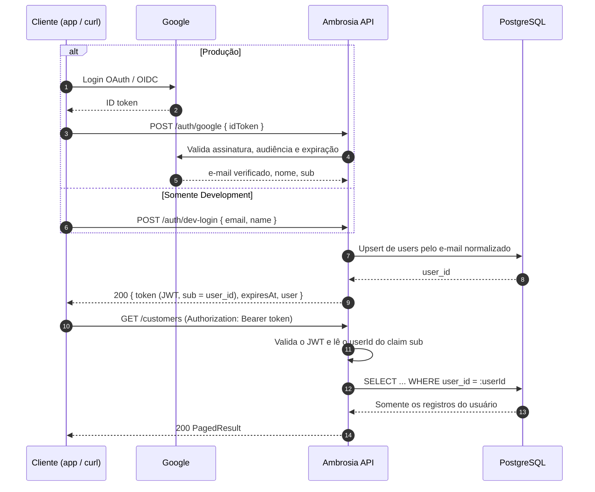
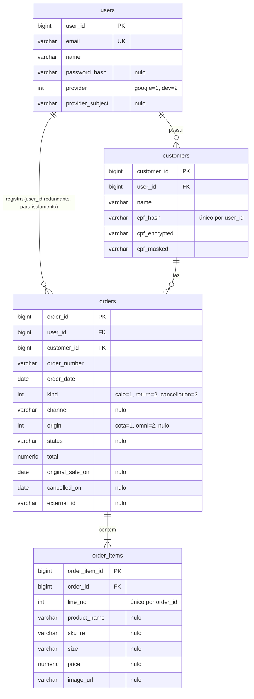

# 001 — API de cadastro e consulta de clientes e pedidos

> Documento da história de usuário 001: o que foi entregue no `backend/`, como rodar e testar, e o que ainda falta.

**Created:** 2026-10-25
**Last Updated:** 2026-10-25

| Campo | Valor |
|---|---|
| ID | 001 |
| Status | Implementada (com pendências, ver [seção 10](#10-pendências--divergências)) |
| Spec | [`specs/001-api-cadastro-clientes-pedidos/`](../../specs/001-api-cadastro-clientes-pedidos/) |
| Código | [`backend/`](../../backend/) |
| Contrato | [`contracts/openapi.yaml`](../../specs/001-api-cadastro-clientes-pedidos/contracts/openapi.yaml) |

> **Nota (003):** a autenticação descrita neste documento é o registro do que foi entregue na época.
> Foi substituída pela spec [`003-email-password-jwt-auth`](../../specs/003-email-password-jwt-auth/):
> cadastro e login com e-mail e senha. A entrada de desenvolvimento `POST /auth/dev-login` saiu de
> **todos** os ambientes (hoje responde 404 e não aparece no Swagger); no lugar dela vieram
> `POST /auth/register` (nome, e-mail e senha → `201` com o mesmo `LoginResult` do login, ou `409` se
> o e-mail já existe) e `POST /auth/login` (`200` com o JWT; credencial inválida → `401` com a mensagem
> única "E-mail ou senha inválidos"). A senha fica só como hash PBKDF2 em `users.password_hash`. As
> menções a `/auth/dev-login` abaixo foram preservadas como histórico, sem revisão.

---

## 1. História

**Como** vendedora, **quero** cadastrar e consultar meus clientes e pedidos (com itens) por uma API autenticada, **para** manter uma base própria de vendas nos moldes do +Vendas, sem que outra vendedora veja os meus dados.

## 2. Contexto e objetivo

- Primeira entrega do Ambrosia: **somente a API** (.NET 8, EF Core 9, PostgreSQL). Não inclui front-end, bot Playwright ([doc 03](../03-bot-playwright.md)) nem MCP ([doc 04](../04-mcp-consultas-llm.md)).
- Modelo inspirado no [doc 02](../02-modelo-de-dados.md), adaptado à constituição do projeto: o conceito de `salesperson` virou **usuário** autenticado.
- A spec divide a entrega em 4 sub-histórias, todas P1: US1 (autenticação), US2 (clientes), US3 (pedidos) e US4 (isolamento por usuário).

---

## 3. Critérios de aceite

Situação conferida no código em `backend/`. "Atendido" significa que o comportamento existe no código. Esta revisão não executou os testes.

### US1: Autenticação e identificação

| # | Critério | Situação |
|---|---|---|
| 1.1 | O primeiro login OAuth cria o usuário com e-mail e nome vindos do provedor | Atendido (`AuthService.UpsertAsync`) |
| 1.2 | Um novo login com o mesmo e-mail entra na mesma conta, sem duplicar | Atendido (e-mail normalizado e índice único `ux_users_email`) |
| 1.3 | Requisição sem credencial, ou com credencial inválida ou expirada, recebe 401 | Atendido (`[Authorize]` nos controllers). Os testes HTTP cobrem só `/users/me` |
| 1.4 | O perfil mostra e-mail e nome, nunca a senha | Atendido (`UserInfo` não tem campo de senha) |

### US2: Clientes

| # | Critério | Situação |
|---|---|---|
| 2.1 | Cadastrar cliente com nome e CPF válidos, vinculado ao usuário | Atendido |
| 2.2 | O mesmo CPF para o mesmo usuário é recusado com 409 | Atendido (verificação prévia e índice `ux_customers_user_cpf`) |
| 2.3 | Listagem paginada com busca por trecho do nome | Atendido |
| 2.4 | O detalhe traz o resumo de compras (quantidade, total líquido, última compra) | Atendido (inclui também `daysSinceLastPurchase`) |
| 2.5 | Atualizar o nome do cliente | Atendido |

### US3: Pedidos com itens

| # | Critério | Situação |
|---|---|---|
| 3.1 | Cadastrar pedido com itens numerados | Atendido (`Order.AddItem` atribui `lineNo` 1, 2, …) |
| 3.2 | Total positivo em venda e negativo em devolução ou cancelamento | Atendido (`OrderTotalSignRule`) |
| 3.3 | Mesmo número, data e tipo para o mesmo usuário é recusado com 409. O número sozinho não é chave | Atendido |
| 3.4 | Filtros por período, tipo, canal, cliente e texto, com paginação e ordem por data decrescente | Atendido |
| 3.5 | O detalhe traz cliente e todos os itens | Atendido |
| 3.6 | O cancelamento registra a data da venda original e a data do cancelamento | Atendido |
| 3.7 | Atualizar status e total | Atendido (o total é revalidado contra o `kind` gravado) |

### US4: Isolamento por usuário

| # | Critério | Situação |
|---|---|---|
| 4.1 | B lista e vê só os próprios dados | Atendido no código (`Where(x => x.UserId == userId)`). Falta teste HTTP dedicado |
| 4.2 | Recurso de A acessado por B responde 404, sem revelar que existe | Atendido no código (mesma mensagem para "não existe" e "é de outro usuário"). Falta teste HTTP dedicado |
| 4.3 | B não consegue criar pedido para cliente de A | Atendido no código (404 "Cliente não encontrado."). Falta teste HTTP dedicado |
| 4.4 | O mesmo CPF em A e em B gera dois clientes independentes | Atendido no código (unicidade por `(user_id, cpf_hash)`). Falta teste HTTP dedicado |

### Casos de borda da spec

| Caso | Situação |
|---|---|
| CPF com formato ou dígito verificador inválido é recusado | Atendido (`Cpf.IsValid`, mensagem "CPF inválido.") |
| Pedido sem itens é recusado | Atendido |
| Soma dos itens diferente do total é aceita | Atendido (não existe regra que compare os dois) |
| Data de pedido no futuro é recusada | Atendido. "Hoje" é calculado em UTC (ver seção 10) |
| Página além do fim devolve lista vazia | Atendido (`items: []` com `totalCount` correto) |
| OAuth sem e-mail é recusado | Atendido (o e-mail também precisa estar verificado) |
| Exclusão de cliente com pedidos é recusada | Não há endpoint de exclusão. A FK `ClientSetNull` protege no banco |
| Canal fora da lista conhecida é aceito | Atendido (canal é texto livre) |

---

## 4. Regras de negócio

| Tema | Regra |
|---|---|
| Identidade | O `userId` vem **somente** do claim `sub` do JWT. Nenhum DTO de entrada tem `userId` |
| E-mail | Normalizado com `Trim().ToLowerInvariant()` e único por usuário. Se o provedor não mandar nome, usa-se a parte local do e-mail |
| Senha | `password_hash` existe no modelo, é opcional e nunca é exposta. Não há login por senha nesta entrega |
| CPF: validação | Considera só os dígitos, exige 11, recusa sequências repetidas e confere os 2 dígitos verificadores (módulo 11) |
| CPF: proteção | `cpf_hash` = HMAC-SHA256 com *pepper* (usado na busca e na unicidade). `cpf_encrypted` = AES-256-GCM. `cpf_masked` = `***.982.247-**` |
| CPF: exibição | Listagens e o cliente dentro de um pedido mostram só `cpfMasked`. O CPF completo, já formatado, aparece apenas em `GET /customers/{id}` |
| CPF: imutável | `PUT /customers/{id}` altera só o nome |
| Nome do cliente | Obrigatório, de 2 a 200 caracteres |
| Pedido: sinal do total | `sale` > 0. `return` e `cancellation` < 0. Zero nunca é aceito |
| Pedido: unicidade | `(user_id, order_number, order_date, kind)` |
| Pedido: data | Obrigatória e nunca futura. `cancelledOn` não pode ser anterior a `originalSaleOn` |
| Pedido: `kind` | Imutável. Cancelar é criar um novo pedido negativo, como no +Vendas |
| Itens | Pelo menos 1 item. Cada item precisa de `productName` ou `skuRef`. `imageUrl`, quando informada, deve ser absoluta http/https. O preço não tem regra de sinal |
| Resumo do cliente | `purchases` = nº de vendas. `netTotal` = soma de todos os totais. `lastPurchase` = data da venda mais recente |
| Paginação | `page` ≥ 1 e `pageSize` entre 1 e 100 (padrão 20) |
| Erros | `{ "sucesso": false, "mensagem": "...", "erros": [{ "campo", "mensagem" }] }`, em português. 400 validação, 404 não encontrado, 409 duplicidade, 500 erro interno |
| Configuração | A API não sobe se a connection string estiver vazia, se o `JwtSecret` tiver menos de 32 bytes, se o `Pepper` estiver vazio ou se a `EncryptionKey` não for base64 de exatamente 32 bytes |

---

## 5. Endpoints

Base: `http://localhost:5000`. Swagger em `/swagger`, com o botão **Authorize** (Bearer).

| Método | Rota | Autenticação | Resumo | Respostas |
|---|---|---|---|---|
| POST | `/auth/google` | Anônima | Troca um ID token do Google por um JWT do Ambrosia | 200, 400 |
| POST | `/auth/dev-login` | Anônima, **só em Development** | Emite um JWT a partir de e-mail e nome, sem Google. Fora de Development responde 404 e some do Swagger | 200, 400, 404 |
| GET | `/users/me` | Bearer | Perfil do usuário (`id`, `email`, `name`, `provider`, `createdAt`) | 200, 401, 404 |
| GET | `/customers` | Bearer | Lista paginada (`search`, `page`, `pageSize`) com CPF mascarado | 200, 400, 401 |
| POST | `/customers` | Bearer | Cadastra cliente (`name`, `cpf`) | 201, 400, 401, 409 |
| GET | `/customers/{id}` | Bearer | Detalhe com CPF completo e `summary` | 200, 401, 404 |
| PUT | `/customers/{id}` | Bearer | Atualiza o nome | 200, 400, 401, 404 |
| GET | `/orders` | Bearer | Lista (`from`, `to`, `kind`, `channel`, `customerId`, `search`, `page`, `pageSize`) ordenada por data decrescente | 200, 400, 401 |
| POST | `/orders` | Bearer | Cadastra pedido com itens | 201, 400, 401, 404, 409 |
| GET | `/orders/{id}` | Bearer | Detalhe com cliente (CPF mascarado) e itens | 200, 401, 404 |
| PUT | `/orders/{id}` | Bearer | Atualiza `status` e `total` | 200, 400, 401, 404 |

Enums são serializados como string minúscula: `sale`, `return`, `cancellation`, `cota`, `omni`, `google`, `dev`.

### Autenticação

JWT HS256 emitido pela própria API, com claims `sub`, `email` e `name`, `iss` e `aud` iguais a `ambrosia` e validade de 480 minutos (configurável).



---

## 6. Modelo de dados (resumo)

Detalhes em [`data-model.md`](../../specs/001-api-cadastro-clientes-pedidos/data-model.md). Convenções: snake_case, PK `{entidade}_id` bigint identity, FKs `ClientSetNull` (nunca cascade), `timestamp without time zone` em UTC.



Todas as tabelas, exceto `order_items`, têm `created_at` e `updated_at`. Migração: `backend/Ambrosia.Infra/Migrations/20261025215230_InitialCreate.cs`.

---

## 7. Como rodar

Pré-requisitos: .NET SDK 8, `dotnet-ef` 9 e PostgreSQL acessível em `localhost:5432` com o banco `ambrosia_dev`. O `appsettings.Development.json` já traz os segredos de desenvolvimento.

| Passo | Comando (PowerShell, a partir de `backend/`) |
|---|---|
| 1. Banco | `powershell -File scripts/ensure-postgres.ps1` sobe o container `ambrosia-postgres` no Docker do WSL2 e mantém o WSL ativo. Para liberar: `-Release` |
| 2. Build | `dotnet build` |
| 3. Migração | `dotnet ef database update --project Ambrosia.Infra --startup-project Ambrosia.API` |
| 4. API | `powershell -File scripts/run-api.ps1` roda em background (`--no-build`), espera o Swagger responder e grava o log em `backend/logs/`. Alternativa interativa: `dotnet run --project Ambrosia.API` |
| 5. Parar | `powershell -File scripts/stop-api.ps1` encerra também o host filho, que trava as DLLs |

Para testar em Production: `scripts/run-api.ps1 -EnvironmentName Production`. Nesse modo `/auth/dev-login` deve responder 404.

Os cenários manuais com `curl` (autenticação, clientes, pedidos e isolamento) estão em [`quickstart.md`](../../specs/001-api-cadastro-clientes-pedidos/quickstart.md).

---

## 8. Como testar

```powershell
cd backend
dotnet test Ambrosia.Tests                      # unitários, não precisam da API
powershell -File scripts/run-api.ps1            # API no ar em Development
dotnet test Ambrosia.ApiTests                   # HTTP, autenticam via /auth/dev-login
powershell -File scripts/stop-api.ps1
```

`Ambrosia.ApiTests` lê `ApiBaseUrl` de `appsettings.Test.json`, que pode ser sobrescrito por variável de ambiente. O fixture cria dois usuários por sessão (Ana e Bia).

---

## 9. Testes existentes

### Unitários: `backend/Ambrosia.Tests` (xUnit, Moq, EF InMemory)

| Arquivo | Cobertura | Casos* |
|---|---|---|
| `Domain/ValueObjects/CpfTest.cs` | Validação, normalização, máscara e formatação | 9 |
| `Domain/Validators/DevLoginInfoValidatorTest.cs` | Dev-login e Google login | 9 |
| `Domain/Validators/CustomerInsertInfoValidatorTest.cs` | Inserção, atualização e listagem de clientes | 16 |
| `Domain/Validators/OrderInsertInfoValidatorTest.cs` | Pedido, itens, atualização e listagem | 35 |
| `Domain/Models/OrderTest.cs` | `AddItem`, sinal do total, `UpdateStatusAndTotal` | 10 |
| `Domain/Services/AuthServiceTest.cs` | Upsert, e-mail não verificado, token inválido | 8 |
| `Domain/Services/UserServiceTest.cs` | Perfil sem senha, usuário inexistente | 3 |
| `Domain/Services/CustomerServiceTest.cs` | Proteção do CPF, duplicidade, 404, resumo | 14 |
| `Domain/Services/OrderServiceTest.cs` | Cliente de outro usuário, duplicidade, sinal na atualização | 18 |
| `Infra/AppServices/JwtTokenAppServiceTest.cs` | Claims, expiração, assinatura | 6 |
| `Infra/AppServices/CpfProtectionAppServiceTest.cs` | Hash, round-trip AES-GCM, adulteração | 12 |
| `Infra/Repository/CustomerRepositoryTest.cs` | Isolamento, busca, paginação, resumo | 15 |
| `Infra/Repository/OrderRepositoryTest.cs` | Isolamento, filtros, ordenação, unicidade | 13 |

\* Quantidade de atributos `[Fact]`/`[Theory]`. Um `[Theory]` pode gerar vários casos.

### HTTP: `backend/Ambrosia.ApiTests` (xUnit, Flurl, FluentAssertions)

| Arquivo | Testes |
|---|---|
| `Controllers/AuthControllerTests.cs` | Dev-login novo e repetido, e-mail inválido, ID token do Google inválido ou ausente (5) |
| `Controllers/UsersControllerTests.cs` | Perfil sem senha, sem token, token adulterado, perfis distintos por usuário (4) |
| `Controllers/CustomersControllerTests.cs` | 201 com Location, CPF inválido, 409, busca com CPF mascarado, página além do fim, detalhe, 404, atualização, validações (10) |
| `Controllers/OrdersControllerTests.cs` | Venda, cancelamento negativo, sinal errado, sem itens, data futura, 409, canal desconhecido, filtros, detalhe, atualização, resumo do cliente (12) |

---

## 10. Pendências / divergências

### Não implementado (consta na spec ou em `tasks.md`)

| Item | Referência | Impacto |
|---|---|---|
| Testes de isolamento entre usuários (`IsolationTests.cs`) | T088, US4 | Os critérios 4.1 a 4.4 não têm prova automatizada ponta a ponta. Há só cobertura indireta nos testes de repositório e serviço |
| Testes de 401 em todas as rotas protegidas (`UnauthorizedAccessTests.cs`) | T089, SC-004 | Só `/users/me` tem teste de 401 |
| Teste de contrato de isolamento por reflexão (`RepositoryIsolationContractTest.cs`) | T087 | Nada impede, por teste, um novo método de repositório sem `userId` |
| Auditoria de repositórios e controllers | T090, T091 | Não está registrada como concluída |
| Script de carga `backend/scripts/seed-load-test.sql` e medição de desempenho | T095, T096, SC-003 | A meta de < 1 s com 10.000 pedidos não foi medida |
| Comparação entre `swagger.json` e `contracts/openapi.yaml` | T094 | As rotas batem, mas schemas e códigos de status não foram conferidos |
| Revisão de segurança | T097, SC-005 | Pendente |
| `backend/README.md` | T098 | Não existe |
| Execução completa do quickstart e do checklist de aceite | T099 | Os itens do checklist estão desmarcados |
| Proposta de emenda da constituição (`constitution-amendment.md`) | T100 | `TODO(AUTH_SCHEME)` continua aberto na constituição |

### Divergências entre spec/artefatos e código

| Divergência | Detalhe |
|---|---|
| `tasks.md` desatualizado | As tarefas T071 a T086 (US3) estão desmarcadas, mas o código e os testes da US3 existem (`OrdersController`, `OrderService`, `OrderRepository`, validators, `OrderTest`, `OrderServiceTest`, `OrderRepositoryTest`, `OrdersControllerTests`) |
| `tasks.md` com codificação corrompida | O arquivo tem acentuação quebrada (ex.: `história`, `—`) e BOM duplicado. O `scripts/mark-tasks.ps1` foi criado justamente para evitar isso |
| PostgreSQL via Docker | O quickstart e a constituição pedem PostgreSQL local, sem Docker. O `scripts/ensure-postgres.ps1` sobe um container no Docker do WSL2 |
| Referência a script inexistente | O `ensure-postgres.ps1` cita `release-postgres.ps1`, que não existe. O equivalente é `ensure-postgres.ps1 -Release` |
| `v_customer_summary` | O doc 02 e a spec citam uma view. O código faz a agregação em LINQ no `CustomerRepository` (decisão registrada no research §10) |
| Nome do cliente com mínimo de 2 caracteres | A spec só exige que o nome seja obrigatório. O código exige de 2 a 200 caracteres (regra vinda do `data-model.md`) |

### Observações de comportamento

| Ponto | Detalhe |
|---|---|
| "Hoje" em UTC | `SystemClock.Today` usa UTC. Entre 21h e 0h no horário de Brasília, um pedido com a data do dia seguinte (horário local) é aceito |
| `GoogleClientId` vazio | A API sobe normalmente e `POST /auth/google` sempre responde 400 "Token do Google inválido ou expirado." |
| Falha de rede ao validar no Google | Responde 400 (erro no campo `idToken`), não 5xx |
| Testes não executados nesta revisão | Os status acima vêm da leitura do código. Rode a seção 8 para confirmar |
