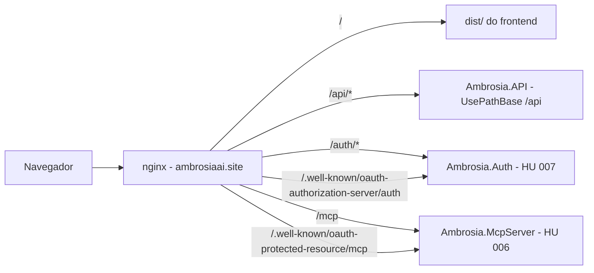
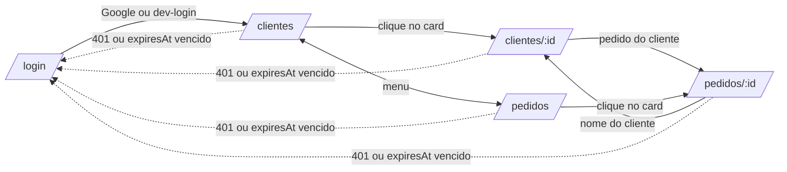

# 002 — Frontend web: perfil do cliente e pedidos (somente exibição)

> Documento da história de usuário 002: frontend React, só de leitura, que mostra o perfil do cliente e os pedidos usando a API da HU 001.

**Created:** 2026-10-25
**Last Updated:** 2026-10-25

| Campo | Valor |
|---|---|
| ID | 002 |
| Status | Planejada |
| Spec | — |
| Depende de | [001](001-api-cadastro-clientes-pedidos.md) (API e autenticação) |
| Habilita | [004](004-frontend-pwa.md) (PWA) e a exibição de fotos da [010](010-banco-imagens-clientes-chatgpt.md) |
| Código previsto | `frontend/` (novo) |

---

## 1. História

**Como** vendedora, **quero** abrir no navegador (inclusive no celular) o perfil dos meus clientes e os meus pedidos, **para** consultar rapidamente quem comprou o quê, quanto e quando, sem precisar do Swagger nem do +Vendas.

## 2. Contexto e objetivo

- A HU 001 entregou só a API. Hoje a consulta exige Swagger ou `curl`.
- Esta HU cria o primeiro frontend, **somente para exibição**. Não há telas de cadastro nem de edição: os dados entram pela API, pelo bot ([009](009-bot-migracao-mais-vendas.md)) ou pelo MCP ([006](006-mcp-servidor-completo.md)).
- O +Vendas é mobile-first, com listas de cards ([doc 01, seção 1](../01-analise-sistema-mais-vendas.md#1-visão-geral)). O Ambrosia segue a mesma linha, porque a vendedora usa o celular na loja.
- O frontend consome a API REST atual. O GraphQL ([005](005-graphql-clientes-pedidos.md)) fica para depois e não é pré-requisito.
- A stack visual (Tailwind CSS 4.x e shadcn/ui) já está na constituição 3.0.0 (Princípio II, emendada em 25/10/2026). Não há emenda pendente para esta HU.
- Endereços de produção: o frontend fica em `https://ambrosiaai.site` e a API numa subpasta do mesmo domínio, `https://ambrosiaai.site/api`. Como os dois ficam na **mesma origem**, o navegador não faz chamadas *cross-origin* e não há CORS em produção.

---

## 3. Escopo

### Dentro do escopo

| Tela | Rota | Fonte na API | Conteúdo |
|---|---|---|---|
| Login | `/login` | `POST /auth/google` e, só em Development, `POST /auth/dev-login` | Botão "Entrar com Google" (Google Identity Services, que devolve o ID token). Formulário de dev-login visível só em build de desenvolvimento |
| Cabeçalho | (todas) | `GET /users/me` | Nome e e-mail do usuário e botão Sair |
| Lista de clientes | `/clientes` | `GET /customers?search&page&pageSize` | Cards com nome e `cpfMasked`, busca por trecho do nome e paginação |
| Perfil do cliente | `/clientes/:id` | `GET /customers/{id}` e `GET /orders?customerId=` | Dados (nome, CPF), resumo (`purchases`, `netTotal`, `lastPurchase`, `daysSinceLastPurchase`), foto quando existir e pedidos do cliente |
| Lista de pedidos | `/pedidos` | `GET /orders?from&to&kind&channel&search&page&pageSize` | Cards com cliente, número, data, canal, tipo e total. Filtros por período, tipo, canal e texto |
| Detalhe do pedido | `/pedidos/:id` | `GET /orders/{id}` | Cliente (CPF mascarado), status, datas (venda original e cancelamento, quando houver) e itens (`lineNo`, nome, `skuRef`, tamanho, preço e imagem) |
| Erros e vazios | (todas) | — | Estados de carregando, lista vazia, 404 ("não encontrado") e falha de rede |

As rotas da coluna "Fonte na API" são relativas à base da API (`VITE_API_URL`). Em produção, `POST /auth/google` fica em `https://ambrosiaai.site/api/auth/google`. Essas rotas `/api/auth/*` são do login da 001 e não colidem com o authorization server OAuth da [007](007-oauth-mcp-chatgpt.md), que fica em `https://ambrosiaai.site/auth` (sem o prefixo `/api`).

### Fora do escopo

- Telas de cadastro e edição de clientes ou pedidos.
- Upload de fotos. As fotos chegam pela [010](010-banco-imagens-clientes-chatgpt.md) e são guardadas pela [003](003-armazenamento-imagens-s3.md).
- PWA, instalação e uso offline ([004](004-frontend-pwa.md)).
- Consumo do GraphQL ([005](005-graphql-clientes-pedidos.md)).
- Dashboards de cota, supercota, PA, VA e TMA. A API da 001 não tem `sales_period` nem `period_kpi` ([doc 02](../02-modelo-de-dados.md)).
- Outros idiomas além de PT-BR. O i18next é configurado, mas só com `pt-BR`.

---

## 4. Critérios de aceite (a cumprir)

| # | Critério | Como verificar |
|---|---|---|
| 1 | Sem token válido, qualquer rota protegida redireciona para `/login` | Abrir `/clientes` em aba anônima |
| 2 | O login com Google chama `POST /auth/google` com o ID token e guarda `token` e `expiresAt` | DevTools > Application > localStorage |
| 3 | Em build de produção o formulário de dev-login não aparece e não é incluído no bundle | `vite build` e busca por `dev-login` no `dist/` |
| 4 | Uma resposta 401 da API limpa a sessão e volta ao login com o aviso "Sua sessão expirou" | Adulterar o token no localStorage |
| 5 | A sessão expira localmente em `expiresAt`, mesmo sem chamada à API | Reduzir `ExpirationMinutes` na API de dev |
| 6 | A lista de clientes pagina (padrão 20) e busca por trecho do nome, com debounce | Base com mais de 20 clientes |
| 7 | A lista de clientes nunca mostra o CPF completo, só `cpfMasked` | Inspecionar a tela e o payload |
| 8 | O perfil mostra o resumo de compras com valores em `R$` (pt-BR) e datas `dd/mm/aaaa` | Comparar com `GET /customers/{id}` |
| 9 | Sem foto, o perfil mostra um avatar com as iniciais. Com foto (campo vindo da [010](010-banco-imagens-clientes-chatgpt.md)), mostra a imagem | Cliente com e sem foto |
| 10 | Pedidos de devolução e cancelamento aparecem com valor negativo e destaque visual próprio, como no +Vendas | Pedido `cancellation` de teste |
| 11 | Os filtros de pedidos (período, tipo, canal e texto) viram query string, e recarregar a página mantém o filtro | Recarregar `/pedidos?kind=sale` |
| 12 | Uma data `order_date` (`AAAA-MM-DD`) aparece no mesmo dia em qualquer fuso, sem deslocamento de UTC | Testar com o navegador em outro fuso |
| 13 | O recurso de outro usuário mostra "não encontrado", igual a um id inexistente | Usuários Ana e Bia do `Ambrosia.ApiTests` |
| 14 | O layout funciona a partir de 360 px de largura e passa nas verificações básicas de acessibilidade (contraste, foco visível, rótulos) | DevTools em modo dispositivo e axe |
| 15 | Nenhuma tela tem botão de criar, editar ou excluir | Revisão visual |

---

## 5. Regras de exibição

| Tema | Regra |
|---|---|
| Moeda | `Intl.NumberFormat('pt-BR', { style: 'currency', currency: 'BRL' })`. Negativos como `-R$ 1.234,56` |
| Datas | `order_date`, `originalSaleOn` e `cancelledOn` são datas sem hora. Interpretar `AAAA-MM-DD` como data local, nunca com `new Date(iso)` |
| CPF | Listas e pedidos usam `cpfMasked`. No perfil, a proposta é mostrar o CPF mascarado com um botão "mostrar" (ver perguntas em aberto) |
| Tipo do pedido | `sale` = Venda, `return` = Devolução e `cancellation` = Cancelamento |
| Origem | `cota` e `omni` aparecem como etiqueta. O canal é texto livre e é exibido como veio |
| Imagem do item | `imageUrl` é a URL de origem do +Vendas ([doc 02](../02-modelo-de-dados.md), `order_item.image_url`). Carregar com `loading="lazy"`, `referrerpolicy="no-referrer"` e um placeholder quando falhar |
| Erros da API | Mostrar `mensagem` do `ErrorResult` (`sucesso`, `mensagem`, `erros`) num toast |

---

## 6. Decisões técnicas propostas

| Tema | Proposta |
|---|---|
| Stack | React 18, TypeScript 5, Vite 6, React Router 6, Tailwind CSS 4.x e shadcn/ui (stack fixa da constituição 3.0.0), i18next (só `pt-BR`), toasts com `sonner` (skill `react-alert`) |
| Arquitetura | Skill `react-architecture`: `types/`, `Services/`, `Contexts/` e `hooks/` por entidade (`User`, `Customer`, `Order`) e registro dos providers em `main.tsx`. Casing dos diretórios conforme o Princípio III da constituição |
| Estado | Context API (constituição: sem Redux nem Zustand) |
| HTTP | Fetch API com um `apiClient` que injeta `Authorization: Bearer` e trata 401 de forma centralizada |
| Sessão | localStorage, como manda a constituição (Princípio VI): nada de cookies |
| Login Google | Google Identity Services no navegador. `VITE_GOOGLE_CLIENT_ID` precisa ser o mesmo valor de `Auth:GoogleClientId` da API, que valida a audiência. No cliente OAuth do Google Cloud, `https://ambrosiaai.site` precisa estar entre as origens JavaScript autorizadas |
| Variáveis | `VITE_API_URL` (produção: `https://ambrosiaai.site/api`, ou só `/api`, relativo à origem), `VITE_GOOGLE_CLIENT_ID`, `VITE_SITE_BASENAME` (opcional; em produção o app fica na raiz). Prefixo `VITE_` obrigatório |
| Design | Direção visual pela skill `frontend-design` ou pelo agente `ux-designer`. Tema claro e escuro via tokens do shadcn |
| Hospedagem | Build estático (`dist/`) servido por nginx em `https://ambrosiaai.site`. O mesmo nginx faz o *reverse proxy* de `/api/` para a API, de `/auth/` para o authorization server da [007](007-oauth-mcp-chatgpt.md), de `/mcp` para o servidor MCP da [006](006-mcp-servidor-completo.md) e de cada documento em `/.well-known/` para o serviço dono dele. Mesma origem, então sem CORS em produção (ver dependências) |
| Dev | Em `vite dev`, o `server.proxy` do Vite repassa `/api` para a API local, reproduzindo a mesma origem de produção. Assim o CORS `AllowAnyOrigin` de Development deixa de ser necessário para o frontend |

### Roteamento em produção

Cada um é um processo próprio atrás do mesmo nginx. As rotas `/api`, `/auth`, `/mcp` e `/.well-known` são declaradas antes do fallback do SPA.

### Fluxo de telas

---

## 7. Dependências

| HU | Tipo | Motivo |
|---|---|---|
| [001](001-api-cadastro-clientes-pedidos.md) | Obrigatória | Endpoints REST e autenticação |
| Ajuste no backend (subpasta `/api`) | Obrigatória para produção | Frontend e API ficam na mesma origem (`https://ambrosiaai.site`), então **não é preciso CORS em produção** (a política `AllowAnyOrigin` continua só em Development, como manda a constituição). O ajuste passa a ser: `UsePathBase("/api")` e `UseForwardedHeaders` (`X-Forwarded-Proto` e `X-Forwarded-Host`, com o proxy na lista de confiáveis) no ASP.NET Core, para que rotas, redirecionamentos e Swagger usem `https://ambrosiaai.site/api`. A mudança é de código e fica com o `dotnet-senior-developer` |
| Infraestrutura (nginx) | Obrigatória para produção | `location` para `/api/`, `/auth/`, `/mcp` e `/.well-known/` com `proxy_pass` mantendo o prefixo, `try_files` com fallback para `index.html` só nas demais rotas, e DNS e TLS de `ambrosiaai.site` |
| [010](010-banco-imagens-clientes-chatgpt.md) | Opcional | Fornece a foto principal do cliente. Até lá, o perfil usa iniciais |

---

## 8. Riscos

| Risco | Impacto | Mitigação |
|---|---|---|
| A chave do localStorage na constituição (mantida na 3.0.0) é `"login-with-metamask:auth"`, herdada de outro projeto | Nome confuso. O risco de colisão é baixo, porque o localStorage é por origem e `https://ambrosiaai.site` é exclusiva do Ambrosia | Usar a chave da constituição ou propor `ambrosia:auth` numa emenda futura (ver perguntas) |
| `PathBase` ou *forwarded headers* mal configurados | Rotas 404 atrás do proxy, redirecionamentos para `http://` ou Swagger apontando para a raiz | Teste de fumaça em homologação com `https://ambrosiaai.site/api/swagger` e `GET /api/users/me` |
| O fallback do SPA (`try_files … /index.html`) captura `/api`, `/auth`, `/mcp` ou `/.well-known` | A API, o MCP ou a descoberta OAuth devolvem HTML em vez de JSON, e o ChatGPT não conecta | `location` desses prefixos declarados antes do fallback, e o mesmo cuidado no service worker da [004](004-frontend-pwa.md) |
| Token em localStorage fica exposto a XSS | Sequestro de sessão por 480 minutos. Na mesma origem, um XSS no SPA também consegue fazer requisições às páginas do authorization server em `/auth` e ao MCP em `/mcp` | CSP restritiva (`connect-src 'self'` e os serviços do Google), nada de `dangerouslySetInnerHTML` e dependências auditadas |
| As imagens dos itens vêm do domínio do +Vendas | Podem exigir sessão, expirar ou ser bloqueadas por hotlink. Também têm direito autoral da marca ([doc 02](../02-modelo-de-dados.md#armazenamento-de-fotos)) | Placeholder em caso de falha. Copiar para o S3 numa HU futura ([003](003-armazenamento-imagens-s3.md)) |
| `GET /customers/{id}` devolve o CPF completo | Exposição de dado pessoal na tela | Mascarar por padrão (ver perguntas) |
| O "hoje" da API é UTC ([doc 001, seção 10](001-api-cadastro-clientes-pedidos.md#observações-de-comportamento)) | Filtros "hoje" e "esta semana" podem divergir entre 21h e 0h | Calcular o período no fuso `America/Sao_Paulo` no frontend e enviar datas explícitas |

---

## 9. Perguntas em aberto

1. O perfil deve mostrar o CPF completo (com "mostrar") ou só o mascarado? O REST devolve o completo.
2. O botão de dev-login deve existir também no ambiente `Docker`, ou só em `vite dev`?
3. A lista de pedidos deve ter um seletor de "mês de cota" (26 a 25, [doc 01, seção 3](../01-analise-sistema-mais-vendas.md#3-tela-cota-cotapiloto)) além do período livre?
4. A chave do localStorage continua `"login-with-metamask:auth"` (como está na constituição 3.0.0) ou passa a `ambrosia:auth` numa emenda futura?

Resolvidas em 25/10/2026: a hospedagem (frontend em `https://ambrosiaai.site` e API na subpasta `https://ambrosiaai.site/api`, na mesma origem e sem CORS em produção) e a troca de Bootstrap por Tailwind CSS e shadcn/ui (constituição 3.0.0).
