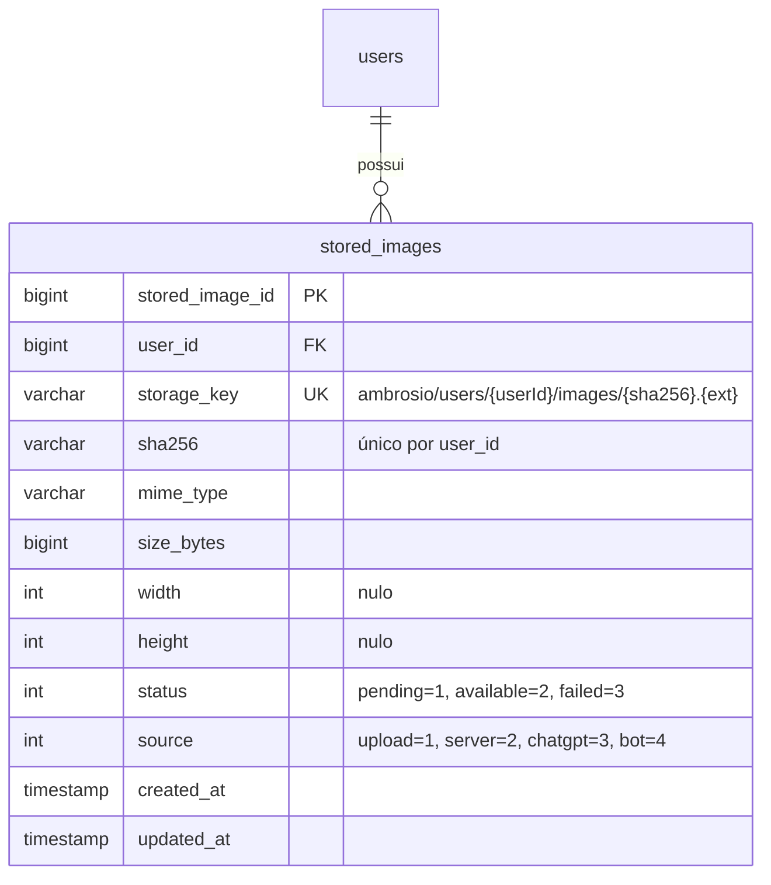
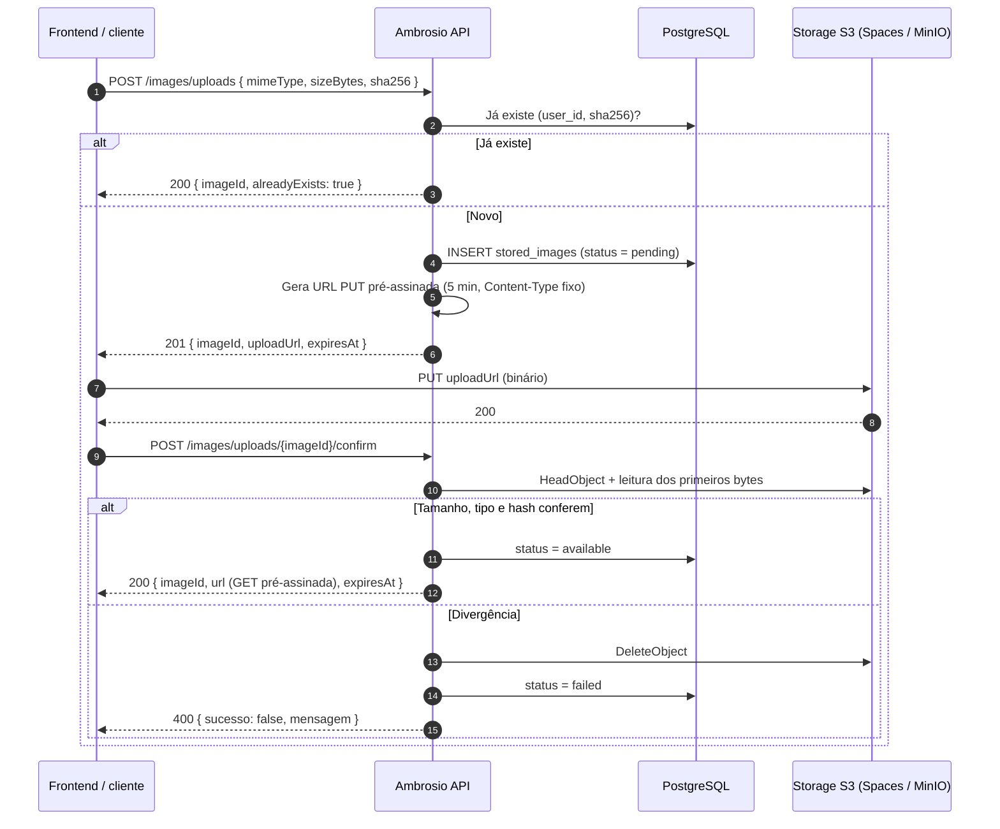

# 003 — Armazenamento de imagens em storage compatível com S3

> Documento da história de usuário 003: infraestrutura única de armazenamento de imagens (S3 compatível, provavelmente DigitalOcean Spaces), com bucket privado, URLs pré-assinadas e metadados no PostgreSQL.

**Created:** 2026-10-25
**Last Updated:** 2026-10-25

| Campo | Valor |
|---|---|
| ID | 003 |
| Status | Implementada |
| Spec | [`specs/004-s3-image-storage/`](../../specs/004-s3-image-storage/) |
| Depende de | [001](001-api-cadastro-clientes-pedidos.md) (API, usuários e isolamento) |
| Habilita | [006](006-frontend-pwa.md) (cache de imagens) e [010](010-banco-imagens-clientes-chatgpt.md) (banco de fotos) |
| Código previsto | `backend/` (Infra, Domain e Application) e `docker-compose` de dev com MinIO |

---

## 1. História

**Como** responsável técnico do Ambrosio, **quero** que toda imagem do sistema fique num storage compatível com S3, com acesso só por URLs temporárias, **para** não guardar binários no banco, não depender de um provedor específico e não expor fotos pessoais por links públicos.

## 2. Contexto e objetivo

- O [doc 02](../02-modelo-de-dados.md#armazenamento-de-fotos) já decidiu que o banco guarda **só metadados e o `storage_key`**, com deduplicação por `sha256`. Ele sugeria começar com disco local e migrar depois para S3.
- **Mudança registrada:** o Ambrosio passa a usar storage S3 compatível desde o início. Disco local fica descartado, inclusive em dev, onde o MinIO faz o papel do S3.
- O provedor provável é o **DigitalOcean Spaces**, mas o código não pode depender dele: só o SDK S3 com endpoint configurável.
- Esta HU entrega a **infraestrutura** (abstração, configuração, tabela de metadados, URLs pré-assinadas e validação). Quem usa são as HUs [010](010-banco-imagens-clientes-chatgpt.md) (fotos de clientes) e, no futuro, as imagens de produto do bot ([004](004-bot-migracao-mais-vendas.md)).

---

## 3. Escopo

### Dentro do escopo

- Serviço de storage na Infra com o `AWSSDK.S3`, configurado por `ServiceURL`, `ForcePathStyle`, região, bucket e credenciais.
- Bucket **privado**. Nenhum objeto com ACL pública.
- URL pré-assinada de **leitura** (`GET`) com validade curta e configurável.
- URL pré-assinada de **upload** (`PUT`) com `Content-Type` fixado, seguida de uma confirmação no servidor que confere tamanho, tipo e hash.
- Upload feito pelo servidor (stream), para quando o próprio backend baixa o arquivo, como na [010](010-banco-imagens-clientes-chatgpt.md).
- Tabela de metadados `stored_images` (chave, mime, tamanho, hash, dimensões e dono).
- Validação de mime pelos *magic bytes* e de tamanho máximo.
- Configuração via `appsettings` e variáveis de ambiente (`.env`), com validação no startup, como já acontece com `JwtSecret` e `EncryptionKey`.
- MinIO no `docker-compose` de desenvolvimento (skills `docker-compose-config` e `wsl-docker`).
- Exclusão física do objeto e do metadado, base para o direito de exclusão da LGPD.

### Fora do escopo

- Vincular imagens a clientes, foto principal e tags ([010](010-banco-imagens-clientes-chatgpt.md)).
- Copiar as imagens de produto do +Vendas ([doc 03, etapa 5b](../03-bot-playwright.md#etapa-5b-fotos-das-peças)). Fica para uma HU futura, que vai reutilizar esta infraestrutura.
- Miniaturas e redimensionamento. O doc 02 marca como opcional e fica como pergunta em aberto.
- CDN na frente do bucket e domínio próprio para as imagens (ver decisão sobre o endpoint na seção 6).
- Telas de upload no frontend (a [002](002-frontend-web-perfil-cliente-pedidos.md) só exibe).

---

## 4. Critérios de aceite (a cumprir)

| # | Critério | Como verificar |
|---|---|---|
| 1 | Trocar de MinIO para DigitalOcean Spaces exige só configuração, sem mudar código | Rodar a mesma suíte HTTP contra os dois |
| 2 | A API não sobe se `Bucket`, `ServiceUrl`, `AccessKey` ou `SecretKey` estiverem vazios, ou se as validades estiverem fora da faixa permitida | Startup com configuração incompleta |
| 3 | Um objeto recém-gravado não pode ser lido sem assinatura (403 do storage) | `curl` direto na URL sem query string |
| 4 | A URL pré-assinada de leitura expira no prazo configurado (padrão 15 min) | `curl` depois do prazo |
| 5 | A URL de upload só aceita o `Content-Type` declarado no pedido | `PUT` com outro tipo responde 403 |
| 6 | A confirmação do upload recusa um objeto maior que `MaxUploadBytes`, com tipo fora da lista ou com hash diferente do declarado, e apaga o objeto | Upload adulterado |
| 7 | O tipo é validado pelos *magic bytes*, não só pela extensão ou pelo header | Arquivo `.jpg` que na verdade é PDF |
| 8 | O mesmo arquivo (mesmo `sha256`) enviado duas vezes pelo mesmo usuário gera um único objeto e um único metadado | Enviar duas vezes |
| 9 | Um usuário não obtém URL de leitura de imagem de outro usuário (404) | Usuários Ana e Bia |
| 10 | A exclusão remove o objeto do bucket e o metadado | `HeadObject` depois da exclusão responde 404 |
| 11 | Chaves e segredos não aparecem em log, resposta de erro nem Swagger | Revisão de log |
| 12 | `docker compose up` em dev sobe o MinIO com o bucket criado e a política de CORS aplicada | Seguir o quickstart da spec |

---

## 5. Regras de negócio

| Tema | Regra |
|---|---|
| Fonte de verdade | O banco guarda **só metadados** (chave, mime, tamanho, hash, dimensões). O binário nunca vai para o PostgreSQL ([doc 02](../02-modelo-de-dados.md#armazenamento-de-fotos)) |
| Chave do objeto | `ambrosio/users/{userId}/images/{sha256}.{ext}`. O prefixo por usuário facilita isolamento, exclusão em massa (LGPD) e auditoria. O hash no nome garante deduplicação |
| Deduplicação | Única por `(user_id, sha256)`. Entre usuários diferentes não há deduplicação, para não criar vínculo entre dados pessoais de contas distintas |
| Tipos aceitos | `image/jpeg`, `image/png` e `image/webp` (configurável). HEIC fica como pergunta em aberto |
| Tamanho | `MaxUploadBytes` configurável. Padrão proposto: 10 MB |
| Validade das URLs | Leitura: 15 min (faixa de 1 a 60). Upload: 5 min (faixa de 1 a 15) |
| URL pré-assinada | Nunca é gravada no banco. É gerada a cada resposta |
| Metadado de EXIF | Remover EXIF (principalmente GPS) antes de gravar, quando o servidor processa o arquivo |
| Isolamento | Toda consulta de metadado filtra por `user_id` vindo do claim `sub`, como na 001 |

### Tabela proposta (convenções da constituição, Princípio V)

---

## 6. Decisões técnicas propostas

| Tema | Proposta |
|---|---|
| SDK | `AWSSDK.S3` com `AmazonS3Config { ServiceURL, ForcePathStyle, AuthenticationRegion }`. Sem SDK específico de provedor |
| Checksums do SDK | As versões recentes do SDK da AWS calculam checksums por padrão (*flexible checksums*), o que quebra alguns serviços compatíveis. Configurar `RequestChecksumCalculation` e `ResponseChecksumValidation` como `WHEN_REQUIRED` e testar contra Spaces e MinIO |
| Abstração | `IObjectStorageAppService` em `Infra.Interfaces` (`PutAsync`, `GetPresignedReadUrl`, `GetPresignedUploadUrl`, `HeadAsync`, `DeleteAsync`, `DeletePrefixAsync`), implementado em `Infra`. Seguir a skill `dotnet-architecture` |
| Upload pelo navegador | Fluxo em duas etapas: `POST /images/uploads` (o cliente declara mime, tamanho e sha256 e recebe `uploadUrl` e `imageId`). Depois, `POST /images/uploads/{imageId}/confirm`, em que o servidor faz `HeadObject`, baixa o início do arquivo para conferir os *magic bytes* e marca `available` |
| Upload pelo servidor | `PutObject` com stream, depois de validar tipo, tamanho e hash em memória ou em arquivo temporário |
| Leitura | O DTO de quem usa a imagem (por exemplo, a foto do cliente na 010) devolve `url` pré-assinada e `expiresAt`. Não há endpoint público de proxy |
| CORS do bucket | Liberar `GET` e `PUT` só para a origem exata do frontend: `https://ambrosioai.site` em produção e a origem local do Vite em dev. Necessário para o cache da [006](006-frontend-pwa.md) (resposta não opaca) |
| Endpoint público | Sem domínio próprio nem CDN nesta fase. Com bucket privado e URL pré-assinada, o endpoint do provedor basta (por exemplo, `https://ambrosia-prod.nyc3.digitaloceanspaces.com`). Um domínio como `img.ambrosioai.site` só faria sentido com CDN, e CDN com bucket privado exige URL assinada pelo próprio CDN, o que muda o fluxo desta HU. Fica para quando o custo de egress pedir |
| CSP do frontend | O `img-src` (e o `connect-src`, para o `PUT`) da CSP de `https://ambrosioai.site` precisa incluir o endpoint do bucket |
| Limpeza | Job periódico que apaga objetos `pending` com mais de 1 hora (upload nunca confirmado) |

### Configuração

| Chave (`appsettings`) | Variável de ambiente | Exemplo Spaces | Exemplo MinIO (dev) |
|---|---|---|---|
| `ObjectStorage:ServiceUrl` | `ObjectStorage__ServiceUrl` | `https://nyc3.digitaloceanspaces.com` | `http://localhost:9000` |
| `ObjectStorage:Region` | `ObjectStorage__Region` | `nyc3` | `us-east-1` |
| `ObjectStorage:Bucket` | `ObjectStorage__Bucket` | `ambrosia-prod` | `ambrosio-dev` |
| `ObjectStorage:ForcePathStyle` | `ObjectStorage__ForcePathStyle` | `false` | `true` |
| `ObjectStorage:AccessKey` | `ObjectStorage__AccessKey` | (segredo) | `minioadmin` |
| `ObjectStorage:SecretKey` | `ObjectStorage__SecretKey` | (segredo) | `minioadmin` |
| `ObjectStorage:PresignedReadMinutes` | `ObjectStorage__PresignedReadMinutes` | `15` | `15` |
| `ObjectStorage:PresignedUploadMinutes` | `ObjectStorage__PresignedUploadMinutes` | `5` | `5` |
| `ObjectStorage:MaxUploadBytes` | `ObjectStorage__MaxUploadBytes` | `10485760` | `10485760` |
| `ObjectStorage:AllowedMimeTypes` | `ObjectStorage__AllowedMimeTypes__0` … | `image/jpeg`, `image/png`, `image/webp` | idem |

Os segredos ficam no `.env` (fora do git) e no `appsettings.Development.json` só os valores de dev do MinIO, seguindo a skill `dotnet-env`.

### Fluxo de upload pelo navegador

---

## 7. Dependências

| HU | Tipo | Motivo |
|---|---|---|
| [001](001-api-cadastro-clientes-pedidos.md) | Obrigatória | Usuário autenticado, `user_id` e padrão de isolamento |
| Conta no provedor | Obrigatória para produção | Bucket no DigitalOcean Spaces (ou outro), chave de acesso com permissão só no bucket |

---

## 8. Riscos

| Risco | Impacto | Mitigação |
|---|---|---|
| Incompatibilidades entre provedores (checksums, `x-amz-checksum-*`, POST policy, virtual-host vs path-style) | Upload falha só em produção | Suíte de testes de integração rodando contra MinIO e contra um bucket de homologação no Spaces |
| URL `PUT` pré-assinada não limita o tamanho do corpo | Alguém sobe um arquivo enorme dentro do prazo | Prazo curto, confirmação obrigatória com `HeadObject` e exclusão do que não confere, além do job de limpeza |
| Vazamento de URL pré-assinada | Acesso à foto enquanto a URL vale | Validade curta e nunca registrar URLs completas em log |
| Credencial com permissão ampla demais | Acesso a outros buckets da conta | Chave limitada ao bucket (Spaces permite chaves com escopo por bucket, a confirmar no painel) |
| Custos de egress | Conta cresce com o uso do PWA | Cache de imagens na [006](006-frontend-pwa.md) e miniaturas no futuro |

---

## 9. Perguntas em aberto

1. Provedor e região definitivos: DigitalOcean Spaces em qual região (`nyc3`, `sfo3`, `ams3`)? Existe exigência de manter os dados no Brasil?
2. O Spaces aceita `x-amz-checksum-sha256` em `PUT` pré-assinado? Se aceitar, o hash pode ser exigido pelo próprio storage.
3. Gerar miniatura (por exemplo, 400 px) já nesta HU ou só quando o volume pedir?
4. Aceitar HEIC (padrão do iPhone), convertendo para JPEG no servidor?
5. Qual retenção para backups do bucket, e como a exclusão LGPD se propaga para eles?

Resolvida em 25/10/2026: CDN e domínio próprio ficam fora desta HU. Com URL pré-assinada, o endpoint do provedor basta (seção 6, "Endpoint público").
