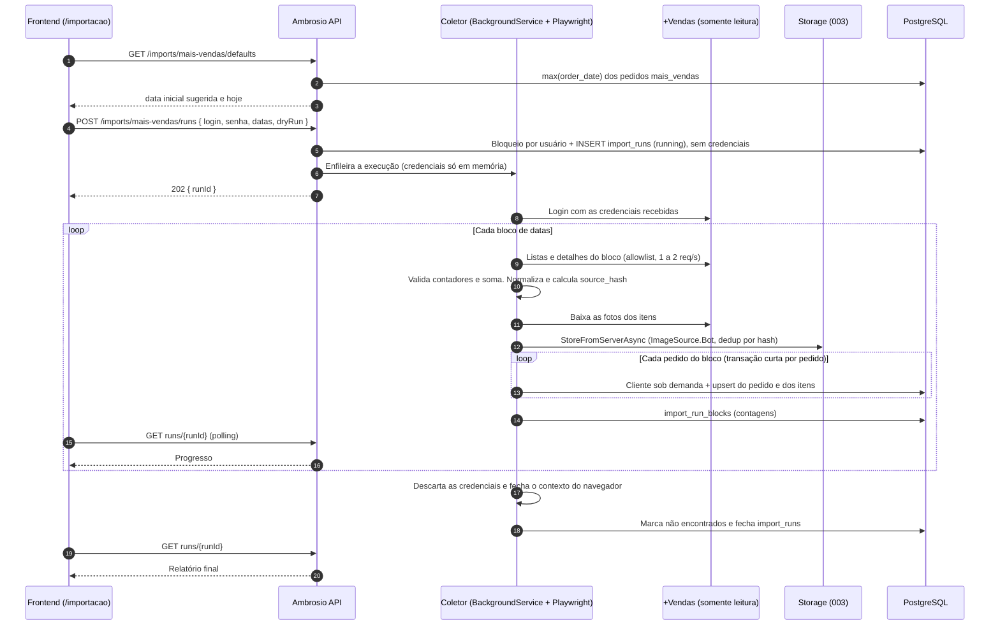

# 004 — Importação do +Vendas pelo frontend (pedidos, clientes e fotos)

> Documento da história de usuário 004: tela no frontend em que a vendedora informa o login e a senha do +Vendas e o período desejado, e o servidor importa os pedidos em blocos, de forma idempotente, cadastrando os clientes sob demanda e copiando as fotos dos produtos para o storage.

**Created:** 2026-10-25
**Last Updated:** 2026-10-27

| Campo | Valor |
|---|---|
| ID | 004 |
| Status | Implementada (primeira importação real validada em 27/10/2026) |
| Spec | [`006-mais-vendas-import`](../../specs/006-mais-vendas-import/) |
| Depende de | [001](001-api-cadastro-clientes-pedidos.md) (API, modelo e proteção do CPF), [002](002-frontend-web-perfil-cliente-pedidos.md) (frontend e sessão) e [003](003-armazenamento-imagens-s3.md) (storage de imagens, spec [`004-s3-image-storage`](../../specs/004-s3-image-storage/)) |
| Base | [Doc 01](../01-analise-sistema-mais-vendas.md) (análise do +Vendas), [doc 02](../02-modelo-de-dados.md) (modelo) e [doc 03](../03-bot-playwright.md) (bot) |
| Código previsto | `frontend/` (tela de importação), `backend/` (endpoints de importação e o coletor Playwright, rodando no servidor) |

---

## 1. História

**Como** vendedora, **quero** abrir uma tela no Ambrosio, informar o meu login e senha do +Vendas e o período que desejo trazer, **para** importar os meus pedidos, clientes e fotos dos produtos sem duplicar nada e sem que o Ambrosio guarde a minha senha.

## 2. Contexto e objetivo

- O [doc 03](../03-bot-playwright.md) define a coleta: Playwright, somente leitura, allowlist, ritmo lento, etapas de coleta e validação por contadores.
- O [doc 01](../01-analise-sistema-mais-vendas.md#3-tela-cota-cotapiloto) mostra que o +Vendas **altera vendas** até o fim do primeiro dia útil depois do fechamento, e que o mês de cota **fecha no dia 25**. Por isso a importação precisa ser **idempotente**: pode ser repetida sobre o mesmo período sem duplicar registros, atualizando só o que mudou.
- O Ambrosio da 001 já tem a chave natural de pedido `(user_id, order_number, order_date, kind)` e a unicidade de cliente `(user_id, cpf_hash)`, alinhadas ao [doc 02, princípio de idempotência](../02-modelo-de-dados.md#princípios) e ao [doc 01, ponto 4](../01-analise-sistema-mais-vendas.md#7-pontos-em-aberto) (número do pedido sozinho não é chave).
- O storage de imagens da 003 já está pronto: `IImageService.StoreFromServerAsync` grava em `ambrosio/users/{userId}/images/{sha256}.{ext}` com deduplicação por hash, e `ImageSource.Bot` já está reservado para esta HU.
- **Mudança em relação à versão anterior desta HU:** a importação deixa de ser um CLI agendado com credenciais no `.env`. Ela passa a ser disparada **pela própria vendedora no frontend**, que informa as credenciais a cada execução.

### O que se reaproveita do doc 03 sem mudança

| Tema | Decisão do doc 03 |
|---|---|
| Segurança | Nunca clicar em "Novo carrinho", "Sair" ou botões que criem ou alterem dados. Allowlist de rotas e seletores. Não seguir o menu BOX (`somabox`) |
| Ritmo | 1 a 2 requisições por segundo no máximo, com pausas aleatórias |
| Termos de uso | Conferir os termos da Somalabs antes de automatizar |
| Etapa 0 | Escutar `POST /salesperson/orders/client-data` e usar a resposta quando ela trouxer os dados, raspando o DOM só para o que faltar |
| Coleta | Etapas 1 a 5 (login, períodos, lista da Cota, lista Omni e detalhe) e 5b (fotos das peças) |
| Validação | O contador da aba deve bater com as linhas lidas e o total exibido com a soma. Se divergir, o bloco falha |
| Normalização | Valores `R$` para decimal, CPF só com dígitos, ano deduzido pelo período e confirmado pela URL |
| Erros | Retry com backoff para "Erro ao carregar …" e abortar o bloco depois de 3 falhas |

O que **não** se reaproveita: credenciais em `.env` e `auth/state.json` (substituídos pelas credenciais informadas na tela, só em memória) e o agendamento por Task Scheduler/cron (sem senha guardada não há execução sem a vendedora).

---

## 3. Escopo

### Dentro do escopo

- **Tela de importação no frontend** (rota `/importacao`, no menu autenticado), com:
  - login e senha do +Vendas (campo de senha mascarado, sem "lembrar");
  - data inicial e data final;
  - opção "Simular (não gravar)" para o dry-run;
  - acompanhamento do progresso por bloco e relatório final.
- **Credenciais só em memória:** enviadas no corpo da requisição que abre a execução, usadas na sessão do Playwright e descartadas quando a execução termina. Nunca gravadas em banco, arquivo, log, relatório, storage ou cache do navegador.
- **Período por parâmetro:** a importação traz os pedidos com data entre a data inicial e a data final (inclusive).
- **Datas sugeridas na tela:** data inicial = data do último pedido importado do +Vendas da usuária; data final = hoje.
- **Importação em blocos:** o período é dividido em blocos menores, cada um coletado, validado e gravado, com progresso visível. O bloco **não é desfeito** quando falha: cada pedido é gravado de forma idempotente, então o que já entrou fica, e basta rodar o mesmo bloco de novo para completá-lo.
- **Clientes sob demanda:** o cliente é cadastrado (ou atualizado) quando aparece no primeiro pedido importado em que consta. Não há coleta separada da lista de clientes.
- **Fotos dos produtos:** cada foto de item é baixada e gravada no storage da 003 (`ImageSource.Bot`), com deduplicação por hash, e ligada ao item do pedido.
- Gravação idempotente (upsert por chave natural, detecção de mudança por `source_hash`).
- Pedidos de venda, devolução e cancelamento, com itens e cliente.
- Registro de cada execução e de cada bloco no banco (relatório consultável pela tela).
- Bloqueio de execuções simultâneas para o mesmo usuário.

### Fora do escopo

- KPIs de cota, supercota, PA, VA e TMA (`sales_period`, `period_kpi` do doc 02). Ficam para uma HU futura.
- Execução agendada ou sem a vendedora presente (exigiria guardar a senha).
- Guardar sessão ou cookies do +Vendas entre execuções.
- Pedidos Extras (lista vazia no levantamento) e Carrinhos.
- Qualquer escrita no +Vendas.

---

## 4. Critérios de aceite (a cumprir)

### Tela e parâmetros

| # | Critério | Como verificar |
|---|---|---|
| 1 | A tela `/importacao` só abre para usuário autenticado e tem login, senha, data inicial, data final e "Simular" | Teste de componente e navegação sem sessão (redireciona ao login) |
| 2 | Ao abrir a tela, a data inicial vem preenchida com a data do último pedido importado do +Vendas da usuária, e a data final com a data de hoje | Usuária com pedidos importados até 20/10: tela abre com 20/10 a hoje |
| 3 | Sem nenhum pedido importado ainda, a data inicial vem vazia e é obrigatória | Usuária nova |
| 4 | Data inicial depois da final, data final no futuro, ou login/senha vazios bloqueiam o envio com mensagem no campo; a API também recusa (400) | Teste de componente e teste de API |
| 5 | Período acima do limite configurado (proposta: 366 dias) é recusado com mensagem clara | Teste de API |

### Credenciais

| # | Critério | Como verificar |
|---|---|---|
| 6 | O login e a senha do +Vendas não aparecem em nenhuma tabela, log, relatório, arquivo do servidor nem no storage | Busca pelo valor de teste no banco, em `logs/` e no bucket depois de uma execução |
| 7 | A senha não é persistida no navegador (sem `localStorage`, `sessionStorage`, cookie ou `autocomplete` de senha salva pelo app) e o campo é limpo ao terminar | Inspeção do storage do navegador e teste de componente |
| 8 | A resposta de qualquer endpoint de importação nunca devolve o login ou a senha | Teste de API sobre todas as rotas |
| 9 | Login inválido no +Vendas termina a execução como "falhou" com motivo "credenciais recusadas pelo +Vendas", sem gravar nada | Execução com senha errada |

### Blocos e idempotência

| # | Critério | Como verificar |
|---|---|---|
| 10 | O período é dividido em blocos (proposta: 7 dias), e a tela mostra o bloco em andamento, quantos já terminaram e as contagens parciais | Período de 30 dias gera 5 blocos visíveis |
| 11 | Falha no meio de um bloco não desfaz nada: os pedidos já gravados (daquele bloco e dos anteriores) continuam, a execução para, e o relatório mostra o bloco que falhou, o motivo e quantos pedidos dele chegaram a ser gravados | Forçar erro no 15º pedido do 3º bloco |
| 12 | Rodar de novo o mesmo bloco que falhou completa a importação: os pedidos já gravados voltam como "inalterados" e os que faltavam são inseridos, sem duplicar nada. O resultado final é igual ao de uma execução que nunca falhou | Repetir o bloco do critério 11 e comparar com uma execução limpa |
| 13 | No relatório de uma execução com falha, a tela oferece "Repetir este bloco", que preenche as datas do bloco que falhou (as credenciais precisam ser informadas de novo) | Teste de componente |
| 14 | Repetir a mesma importação sem mudança na origem não cria nem altera nada (tudo "inalterado") | Relatório da 2ª execução |
| 15 | Um pedido com valor ou status alterado na origem é atualizado e aparece como "atualizado", com os campos que mudaram | Simular mudança no payload capturado |
| 16 | O mesmo número de pedido em datas diferentes gera pedidos diferentes | Pedido `41900001` em 28/set e 05/out |
| 17 | Uma venda e o cancelamento dela geram dois registros (`sale` positivo e `cancellation` negativo), como no +Vendas | Pedido cancelado |
| 18 | Se o contador da aba divergir das linhas lidas ou o total divergir da soma, o bloco falha antes de gravar qualquer pedido dele (a validação acontece depois da coleta do bloco e antes da gravação) | Forçar divergência em teste |
| 19 | Em "Simular", nada é gravado (pedidos, clientes nem imagens), e o relatório mostra o que seria inserido, atualizado e mantido | Comparar contagens antes e depois |
| 20 | Duas execuções simultâneas da mesma usuária não acontecem: a segunda recebe 409 "já existe importação em andamento" | Abrir em duas abas |
| 21 | Pedidos que sumiram da origem dentro do período não são apagados. Aparecem no relatório como "não encontrados nesta execução". Só entram nessa conta os blocos que terminaram sem falha | Simular ausência |
| 22 | O total líquido do Ambrosio no período 26/09 a 25/10/2026 confere com a tela do +Vendas: R$ 123.300,58 em 49 pedidos | `GET /orders` |

### Clientes

| # | Critério | Como verificar |
|---|---|---|
| 23 | Um CPF que ainda não existe na base da usuária é cadastrado no primeiro pedido em que aparece, com a mesma proteção da 001 (`cpf_hash`, `cpf_encrypted`, `cpf_masked`) | Pedido de cliente novo |
| 24 | O mesmo CPF em vários pedidos (no mesmo bloco ou em blocos diferentes) gera um único cliente | Cliente com várias compras |
| 25 | O nome do cliente é atualizado se mudar na origem; os demais dados manuais não são apagados | Alterar nome no payload |
| 26 | Em "Simular", o relatório mostra quantos clientes seriam criados, sem criá-los | Relatório |

### Fotos dos produtos

| # | Critério | Como verificar |
|---|---|---|
| 27 | Cada foto de item é baixada e gravada no storage em `ambrosio/users/{userId}/images/`, com `source = bot`, e o item fica ligado à imagem | Item com foto: `GET /images/{id}` devolve URL de leitura |
| 28 | A mesma foto em vários pedidos é gravada uma única vez (deduplicação por hash da 003) | Produto repetido |
| 29 | Falha ao baixar uma foto não falha o bloco: o pedido é gravado, o item fica sem imagem, e o relatório lista a foto como "imagem com erro"; uma nova execução tenta de novo | Simular 404 na URL da foto |
| 30 | Foto de tipo fora dos aceitos pela 003 ou acima do limite de tamanho é ignorada e reportada | Foto GIF ou muito grande |

### Segurança da coleta e relatório

| # | Critério | Como verificar |
|---|---|---|
| 31 | O coletor nunca acessa rota fora da allowlist e nunca clica em seletor fora dela | Log de navegação e teste com rota proibida |
| 32 | O CPF nunca aparece em log ou relatório (só mascarado) | Busca por padrão de CPF nos logs e no relatório |
| 33 | Cada execução tem relatório com id, modo, período, blocos, contagens por bloco, canal e tipo (inseridos, atualizados, inalterados, não encontrados, com erro), clientes criados, imagens gravadas e com erro, duração e resultado | `GET /imports/mais-vendas/runs/{runId}` e tela |
| 34 | Fechar a aba não interrompe a execução; ao voltar à tela, ela mostra a execução em andamento ou o último relatório | Fechar e reabrir a aba durante a importação |

---

## 5. Idempotência e blocos

| Elemento | Regra |
|---|---|
| Chave natural do pedido | `(user_id, order_number, order_date, kind)`, a mesma unicidade da 001 |
| Chave natural do cliente | `(user_id, cpf_hash)`. O nome é atualizado se mudar na origem |
| `source_hash` | SHA-256 do payload **normalizado** do pedido (campos do pedido, cliente por `cpf_hash` e itens ordenados por `line_no`), em JSON canônico (chaves ordenadas, decimais com 2 casas, datas ISO). Não entra `captured_at` nem a imagem gravada |
| `captured_at` | Data e hora (UTC) da última captura em que o pedido foi visto |
| `source_changed_at` | Data e hora da última vez em que o `source_hash` mudou |
| Upsert | Pedido inexistente: insere. Existe com o mesmo hash: só atualiza `captured_at`. Existe com hash diferente: atualiza os campos e **substitui** os itens, registrando os campos que mudaram |
| Bloco | Intervalo de datas (proposta: 7 dias corridos, configurável). Os blocos andam da data inicial para a final |
| Gravação | **Por pedido, sem transação de bloco.** Cada pedido (com o cliente sob demanda e os itens) é gravado na sua própria transação curta, para pedido e itens nunca ficarem pela metade. Uma falha no meio do bloco **não desfaz** os pedidos já gravados: a execução para e o bloco fica "falhou", com a contagem do que chegou a entrar |
| Repetir um bloco | Rodar o mesmo intervalo de novo é seguro e completa o bloco: o upsert por chave natural reconhece os pedidos já gravados ("inalterados") e insere os que faltaram. Não existe "retomar do pedido N"; repetir o bloco inteiro é o mecanismo de recuperação |
| Ordem dentro do bloco | 1) coleta o bloco inteiro; 2) valida contadores e soma; 3) grava pedido a pedido. Assim, uma divergência de contador falha o bloco antes de qualquer gravação, e uma falha na gravação deixa só pedidos completos |
| Fotos sem pedido | A foto é gravada no storage antes do pedido. Se o pedido falhar depois, a foto fica no storage sem item ligado; ao repetir o bloco, a deduplicação por hash da 003 a reaproveita, sem novo upload |
| Clientes sob demanda | Dentro do bloco, cada CPF é resolvido uma vez: busca por `cpf_hash`; se não existe, cria; se existe, atualiza o nome se mudou |
| Fotos | Baixadas pelo contexto do Playwright (reaproveita a sessão quando a URL exige), gravadas por `StoreFromServerAsync(..., ImageSource.Bot)`. `image_url` continua com a URL de origem; `image_id` aponta a imagem gravada. Pula o download se o item já tem `image_id` com a mesma `image_url` |
| Origem | `external_id` recebe o 4º segmento da URL de detalhe quando disponível ([doc 01, ponto 1](../01-analise-sistema-mais-vendas.md#7-pontos-em-aberto)). `source` = `mais_vendas` |
| Reexecução | Pode repetir o mesmo período quantas vezes quiser. Uma execução interrompida (queda do servidor, por exemplo) fica "falhou" e a vendedora repete o bloco que falhou, ou o período inteiro, informando as credenciais de novo: o que já foi gravado volta como "inalterado" |

### Data inicial sugerida

`GET /imports/mais-vendas/defaults` devolve `{ suggestedStartDate, suggestedEndDate }`:

- `suggestedStartDate` = maior `order_date` entre os pedidos da usuária com `source = mais_vendas`, ou `null` se não houver nenhum.
- `suggestedEndDate` = data de hoje no fuso da operação (America/Sao_Paulo).

O dia do último pedido entra de novo de propósito: ele pode ter sido importado pela metade. A idempotência garante que nada se duplica.

### Alterações de modelo propostas (sobre a 001 e a 003)

| Tabela | Alteração |
|---|---|
| `orders` | Novas colunas `source` (int: `manual=1`, `mais_vendas=2`), `source_hash` (varchar 64, nulo para pedidos manuais), `captured_at`, `source_changed_at`. Índice em `(user_id, source, order_date)` para a data sugerida |
| `order_items` | Nova coluna `image_id` (FK opcional para `stored_images`, `ON DELETE SET NULL`). `image_url` continua com a URL de origem |
| `import_runs` (nova) | `import_run_id`, `user_id`, `mode` (`dry_run=1`, `apply=2`), `status` (`running=1`, `succeeded=2`, `failed=3`, `partial=4`), `start_date`, `end_date`, `block_days`, `started_at`, `finished_at`, contagens (`inserted`, `updated`, `unchanged`, `missing`, `failed`, `customers_created`, `images_stored`, `images_failed`), `error_message`, `collector_version`. **Sem** login nem senha |
| `import_run_blocks` (nova) | `import_run_block_id`, `import_run_id`, `block_no`, `start_date`, `end_date`, `status`, contagens do bloco, `error_message`, `started_at`, `finished_at` |
| `import_run_changes` (nova) | `import_run_change_id`, `import_run_id`, `import_run_block_id`, `order_id` (nulo em dry-run), chave natural, `action` (`insert=1`, `update=2`, `missing=3`), `changed_fields` (texto) |

O payload bruto ([doc 02, `raw_snapshot`](../02-modelo-de-dados.md#princípios)) não é guardado nesta HU: ele contém CPF e não há uso imediato. Fica como pergunta em aberto.

---

## 6. Decisões técnicas propostas

### Onde o coletor roda

Com a tela no frontend e a senha só em memória, o coletor precisa rodar **no servidor** e receber as credenciais na requisição que abre a execução. O navegador da vendedora não pode fazer a coleta: o +Vendas é de outra origem (CORS) e a automação exige Playwright.

| Critério | Coletor dentro da API (.NET + `Microsoft.Playwright`) | Serviço separado (Node + Playwright, como no doc 03) |
|---|---|---|
| Credenciais | Ficam na memória do mesmo processo que recebeu a requisição; nunca trafegam de novo | A API repassa login e senha a outro processo pela rede interna; mais um ponto de vazamento |
| Proteção do CPF e regras | Reaproveita os services do Domain diretamente (hash, cifra, unicidade) | Precisa de endpoints de importação na API (contrato da versão anterior desta HU) |
| Imagens | Chama `IImageService.StoreFromServerAsync` direto | Envia cada foto à API |
| Stack | Uma só (C#), como a constituição | Duas stacks para manter |
| Custo | Imagem Docker da API cresce (Chromium, ~300 MB) | Container próprio, a API continua leve |

**Recomendação: coletor dentro da API**, num `BackgroundService` com fila em memória (`Channel`). A requisição abre a execução e devolve `202` com o `runId`; o trabalho segue em segundo plano e a tela acompanha por polling. A senha vive só no objeto da execução em memória e é descartada no fim (sucesso, falha ou cancelamento). Se a API reiniciar no meio, a execução fica "falhou" e a vendedora repete.

### Contrato proposto

As rotas são relativas à base da API (produção: `https://ambrosioai.site/api`). Todas exigem o JWT da sessão; o `user_id` vem do token.

| Método | Rota | Função |
|---|---|---|
| GET | `/imports/mais-vendas/defaults` | Datas sugeridas para a tela |
| POST | `/imports/mais-vendas/runs` | Corpo `{ login, password, startDate, endDate, dryRun }`. Valida, aplica o bloqueio por usuário (409 se houver outra em andamento) e devolve `202 { runId }` |
| GET | `/imports/mais-vendas/runs/current` | Execução em andamento da usuária (ou 204), para a tela retomar o acompanhamento |
| GET | `/imports/mais-vendas/runs/{runId}` | Status, progresso por bloco e relatório |
| GET | `/imports/mais-vendas/runs` | Últimas execuções (paginado) |
| POST | `/imports/mais-vendas/runs/{runId}/cancel` | Cancela ao fim do bloco atual |

Cuidados com as credenciais na API: o DTO da requisição não é logado (nem em erro de validação), a mensagem de erro nunca ecoa o corpo, e o Swagger marca `password` como `format: password`.

### Demais decisões

| Tema | Proposta |
|---|---|
| Frontend | Página `ImportPage` em `frontend/src/pages/`, com o padrão da 002 (react-hook-form + zod, shadcn/ui, i18n). Polling a cada 3 s enquanto `running`; mostra blocos e contagens; relatório final com links para os pedidos e, se algum bloco falhou, o botão "Repetir este bloco" com as datas dele preenchidas |
| Tamanho do bloco | `Import:BlockDays` (padrão 7) e `Import:MaxRangeDays` (padrão 366) no appsettings |
| Ritmo | O do doc 03 (1 a 2 req/s). Fotos contam no mesmo limite |
| Sessão do Playwright | Um contexto novo por execução, sem `storageState` em disco; fechado no fim |
| Log | Estruturado, com `runId`, bloco, rota visitada, contagens e tempos. Sem CPF, sem login e sem senha |
| Alertas | Execução `failed` ou `partial` aparece em destaque na tela. Aviso se a contagem de um período cair em relação à execução anterior do mesmo período ([doc 03, etapa 7](../03-bot-playwright.md#etapa-7-execução)) |

### Fluxo de uma execução

---

## 7. Dependências

| HU | Tipo | Motivo |
|---|---|---|
| [001](001-api-cadastro-clientes-pedidos.md) | Obrigatória | Modelo, proteção do CPF e regras de pedido |
| [002](002-frontend-web-perfil-cliente-pedidos.md) | Obrigatória | Frontend, sessão e padrão das telas |
| [003](003-armazenamento-imagens-s3.md) | Obrigatória | Storage das fotos (`StoreFromServerAsync`, `ImageSource.Bot`) |
| Spec [`003-email-password-jwt-auth`](../../specs/003-email-password-jwt-auth/) | Obrigatória | JWT da sessão que autentica a tela e os endpoints |

O OAuth do plugin ([005](005-plugin-chatgpt-mcp.md), que incorporou a antiga 008) não é dependência: a importação usa a sessão normal da usuária, não um token de bot.

---

## 8. Riscos

| Risco | Impacto | Mitigação |
|---|---|---|
| Termos de uso da Somalabs restringem automação | Bloqueio da conta ou problema contratual | Conferir antes de liberar ([doc 03, regra 5](../03-bot-playwright.md#regras-de-segurança-do-bot)) |
| Senha do +Vendas trafega pelo Ambrosio | Vazamento da credencial de outro sistema | Só HTTPS, nunca persistida nem logada, descartada no fim, testes dos critérios 6 a 8 |
| +Vendas com segundo fator ou captcha no login | Coleta não consegue entrar | Detectar e falhar com mensagem clara; ver pergunta em aberto |
| A interface do +Vendas muda sem aviso | Coleta quebra ou lê dado errado | Testes de fumaça dos seletores e validação por contadores (o bloco falha em vez de gravar parcial) |
| Chromium na imagem da API | Imagem maior e mais memória por execução | Uma execução por usuário, fila com limite global (proposta: 2 simultâneas) |
| API reinicia no meio da importação | Execução interrompida | Fica "falhou"; repetir é seguro pela idempotência |
| Data inicial sugerida não cobre correções do +Vendas em dias anteriores ao último pedido | Ajustes de vendas antigas não chegam | A vendedora pode recuar a data inicial; o relatório da execução anterior mostra o período coberto |
| Devolução não foi inspecionada em detalhe ([doc 01, seção 5](../01-analise-sistema-mais-vendas.md#5-tela-de-detalhe-detailorder)) | Mapeamento errado de datas ou valores | Inspecionar na primeira execução em "Simular" |
| Data sem ano na listagem (`24 Out`) | Pedido na data errada vira duplicata (a chave inclui a data) | Ano pela URL do detalhe, conferido com o bloco |
| Pedido manual com a mesma chave natural de um pedido do +Vendas | A importação sobrescreve um registro manual | Proposta: não sobrescrever `source = manual` e reportar conflito |
| Volume de fotos | Importação lenta e uso do storage | Deduplicação por hash e pular item que já tem a mesma `image_url` |

---

## 9. Perguntas em aberto

1. O login do +Vendas tem segundo fator ou captcha? Se tiver, a tela precisa de um passo para a vendedora informar o código.
2. Tamanho do bloco: 7 dias está bom, ou prefere por mês de cota (26 a 25)?
3. Sem nenhum pedido importado, a data inicial deve vir vazia ou com o início do mês de cota corrente (dia 26 do mês anterior)?
4. Um pedido que some da origem dentro do período deve ser só reportado, marcado como "removido na origem" ou apagado?
5. Conflito com pedido cadastrado manualmente com a mesma chave natural: ignorar, sobrescrever ou reportar?
6. A API `client-data` do +Vendas traz tudo (cliente, CPF, itens e fotos)? Isso decide o quanto do DOM precisa ser raspado ([doc 01, ponto 2](../01-analise-sistema-mais-vendas.md#7-pontos-em-aberto)).
7. As URLs das fotos são públicas ou exigem a sessão do +Vendas?
8. Por quanto tempo guardar o histórico de execuções (`import_runs` e filhos)? E vale guardar o payload bruto no storage, cifrado?
