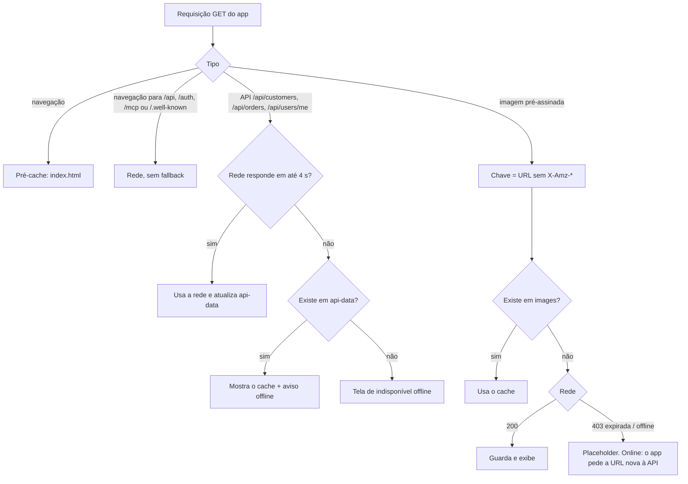

# 004 — Frontend como PWA

> Documento da história de usuário 004: transformar o frontend da HU 002 em Progressive Web App instalável, com leitura offline e atualização de versão controlada.

**Created:** 2026-10-25
**Last Updated:** 2026-10-25

| Campo | Valor |
|---|---|
| ID | 004 |
| Status | Planejada |
| Spec | — |
| Depende de | [002](002-frontend-web-perfil-cliente-pedidos.md) (frontend). Usa a [003](003-armazenamento-imagens-s3.md) para o cache de imagens |
| Código previsto | `frontend/` (`vite.config.ts`, `public/`, registro do service worker) |

---

## 1. História

**Como** vendedora, **quero** instalar o Ambrosia na tela inicial do celular e consultar clientes e pedidos já vistos mesmo sem sinal na loja, **para** não depender de conexão para lembrar o histórico de uma cliente na hora do atendimento.

## 2. Contexto e objetivo

- A [002](002-frontend-web-perfil-cliente-pedidos.md) entrega um SPA só de leitura. Esta HU acrescenta manifest, service worker, instalação, cache offline de leitura e um fluxo de atualização.
- O uso offline é **somente leitura**: o app não grava nada (não existem telas de escrita) e não faz fila de sincronização.
- As imagens vêm por URLs pré-assinadas que expiram ([003](003-armazenamento-imagens-s3.md)). A estratégia de cache precisa levar isso em conta.
- O PWA é servido em `https://ambrosiaai.site`, e a API e o authorization server ficam em subpastas da mesma origem: `https://ambrosiaai.site/api` e `https://ambrosiaai.site/auth`. O MCP também fica na mesma origem, em `https://ambrosiaai.site/mcp`, e os documentos de descoberta OAuth em `https://ambrosiaai.site/.well-known/*`. Não há CORS para a API, mas o service worker controla toda a origem, então precisa **excluir** `/api/*`, `/auth/*`, `/mcp*` e `/.well-known/*` do fallback de navegação e do cache (ver critério 12).
- A stack visual (Tailwind CSS 4.x e shadcn/ui) já está coberta pela constituição 3.0.0. Esta HU não pede emenda.

---

## 3. Escopo

### Dentro do escopo

- `vite-plugin-pwa` com Workbox (`generateSW`).
- Web App Manifest (nome, cores, `display: standalone`, `lang: pt-BR`, ícones).
- Ícones 192 e 512 px, ícone *maskable* 512 px, `apple-touch-icon` 180 px e favicon.
- Pré-cache do app shell (HTML, JS, CSS e fontes).
- Cache em tempo de execução dos `GET` da API e das imagens pré-assinadas.
- Indicação de offline e da data dos dados exibidos.
- Botão "Instalar app" (Android e desktop) e instruções para iOS.
- Aviso de nova versão com o botão "Atualizar".
- Limpeza dos caches no logout.

### Fora do escopo

- Escrita offline, *background sync* e fila de operações.
- Push notifications.
- Login offline. Sem rede não há como obter token novo.
- Publicação em loja (TWA na Play Store, por exemplo).

---

## 4. Critérios de aceite (a cumprir)

| # | Critério | Como verificar |
|---|---|---|
| 1 | O Chrome (Android e desktop) considera o app instalável e oferece a instalação | DevTools > Application > Manifest, sem erros de instalabilidade |
| 2 | No iOS, "Adicionar à Tela de Início" abre o app em tela cheia, com ícone e nome corretos | iPhone real |
| 3 | Com o app aberto uma vez e a rede desligada, a navegação entre telas já visitadas funciona | DevTools > Network > Offline |
| 4 | Offline, telas com dados em cache mostram um aviso "Você está offline. Dados de dd/mm hh:mm" | Idem |
| 5 | Offline, uma tela nunca visitada mostra uma mensagem amigável, não erro do navegador | Idem |
| 6 | Online, os dados da API vêm da rede. O cache só entra quando a rede falha ou demora mais que o limite (padrão 4 s) | Throttling no DevTools |
| 7 | Uma imagem já vista aparece offline, mesmo que a URL pré-assinada original já tenha expirado | Esperar a expiração e desligar a rede |
| 8 | Online, uma imagem com URL nova, mas do mesmo objeto, não é baixada de novo | Aba Network mostra resposta do service worker |
| 9 | Rotas `/api/auth/*` (login da 001), `/auth/*` (authorization server da 007) e qualquer método diferente de `GET` nunca são cacheados | Inspecionar o Cache Storage |
| 10 | O logout apaga os caches de dados e de imagens. Outro usuário no mesmo aparelho não vê nada do anterior | Logar com Ana, sair, logar com Bia, ficar offline |
| 11 | Com uma versão nova publicada, o app mostra "Nova versão disponível" e só recarrega quando a usuária clica em "Atualizar" | Dois deploys seguidos |
| 12 | O service worker não trata `/api/*`, `/auth/*`, `/mcp*` nem `/.well-known/*` como navegação: `navigateFallbackDenylist` inclui `/^\/api\//`, `/^\/auth\//`, `/^\/mcp/` e `/^\/\.well-known\//`, então o Swagger (`/api/swagger`), as telas do authorization server e os documentos de descoberta vêm do servidor, nunca como `index.html` | Com o app instalado, abrir `https://ambrosiaai.site/api/swagger`, `https://ambrosiaai.site/auth/connect/authorize` e `https://ambrosiaai.site/.well-known/oauth-protected-resource/mcp` |

---

## 5. Estratégia de cache

| Recurso | Estratégia Workbox | Nome do cache | Expiração | Observações |
|---|---|---|---|---|
| App shell (HTML, JS, CSS, fontes, ícones) | Pré-cache | `workbox-precache` | Por versão do build | `navigateFallback: '/index.html'` |
| `GET /api/users/me` | `NetworkFirst` (timeout 4 s) | `api-data` | 7 dias | Status 200 apenas |
| `GET /api/customers`, `/api/customers/{id}` | `NetworkFirst` (timeout 4 s) | `api-data` | 7 dias, máx. 200 entradas | A query string faz parte da chave (busca e página) |
| `GET /api/orders`, `/api/orders/{id}` | `NetworkFirst` (timeout 4 s) | `api-data` | 7 dias, máx. 300 entradas | Idem |
| Imagens pré-assinadas do storage | `CacheFirst` com plugin `cacheKeyWillBeUsed` | `images` | 30 dias, máx. 300 entradas | A chave do cache é a URL **sem** os parâmetros `X-Amz-*`, então a mesma imagem tem a mesma chave mesmo quando a assinatura muda |
| Imagens dos itens vindas do +Vendas | `StaleWhileRevalidate` | `external-images` | 7 dias, máx. 200 | Respostas opacas, se não houver CORS. Ver riscos |
| `/api/auth/*`, `/auth/*`, `/mcp*`, `/.well-known/*`, `POST`, `PUT` | `NetworkOnly` | — | — | Nunca cacheados. `/api/auth/*` é o login da 001; `/auth/*` é o authorization server da 007; `/mcp` é o servidor MCP da 006 |

---

## 6. Decisões técnicas propostas

| Tema | Proposta |
|---|---|
| Plugin | `vite-plugin-pwa` com `registerType: 'prompt'` e `workbox.runtimeCaching` conforme a tabela acima |
| Atualização | `useRegisterSW` de `virtual:pwa-register/react`. Toast `sonner` com o botão "Atualizar", que chama `updateServiceWorker(true)`. Checagem de versão nova a cada 60 min |
| Instalação | Capturar `beforeinstallprompt` para o botão "Instalar app". No iOS, mostrar um passo a passo (Compartilhar > Adicionar à Tela de Início) |
| Manifest | `name: "Ambrosia"`, `short_name: "Ambrosia"`, `lang: "pt-BR"`, `start_url: "/"`, `scope: "/"` (relativos a `https://ambrosiaai.site`), `display: "standalone"`, `theme_color` e `background_color` vindos dos tokens de design (Tailwind e shadcn/ui) |
| Rotas da API no Workbox | `urlPattern` por função que confere `url.origin === self.location.origin` e `url.pathname.startsWith('/api/')`. Como a API está na mesma origem, as respostas não são opacas e o status pode ser conferido |
| Fallback de navegação | `navigateFallback: '/index.html'` com `navigateFallbackDenylist: [/^\/api\//, /^\/auth\//, /^\/mcp/, /^\/\.well-known\//]`. Sem isso, o service worker devolveria o SPA no lugar do Swagger, das telas do authorization server e dos documentos de descoberta OAuth |
| Ícones | Gerados a partir do logotipo (agente `ux-designer`), com área segura para *maskable* |
| Logout | `caches.delete('api-data')`, `caches.delete('images')` e `caches.delete('external-images')`, além de limpar o localStorage |
| Troca de usuário | No login, se o `user.id` for diferente do último guardado, limpar os caches antes de carregar dados |
| Indicador de data | Usar o header `Date` da resposta em cache para mostrar "Dados de …" |
| Dev | `devOptions.enabled` só quando for preciso testar o service worker localmente |
| Auditoria | O Lighthouse removeu a categoria PWA na versão 12. A verificação passa a ser pelo painel Application do DevTools e por testes manuais em aparelho |

---

## 7. Dependências

| HU | Tipo | Motivo |
|---|---|---|
| [002](002-frontend-web-perfil-cliente-pedidos.md) | Obrigatória | O app a ser transformado em PWA |
| [003](003-armazenamento-imagens-s3.md) | Necessária para o critério 7 | Formato das URLs pré-assinadas e CORS do bucket |
| HTTPS em produção | Obrigatória | Service worker só registra em HTTPS (ou `localhost`). Certificado válido em `https://ambrosiaai.site` |
| API em `/api` atrás do proxy | Obrigatória | Mesmo ajuste de backend e de nginx da [002](002-frontend-web-perfil-cliente-pedidos.md#7-dependências) (`UsePathBase("/api")` e *forwarded headers*). Sem CORS, porque a origem é a mesma |

---

## 8. Riscos

| Risco | Impacto | Mitigação |
|---|---|---|
| Dados pessoais (nomes, CPF mascarado, compras, fotos) ficam no aparelho | Exposição em aparelho perdido ou compartilhado (LGPD) | Limpeza no logout e na troca de usuário, expiração de 7 e 30 dias e aviso na tela de login |
| Cache compartilhado entre usuários no mesmo navegador | Um usuário vê dados de outro offline | Critério 10 e limpeza na troca de usuário |
| Token expirado com dados em cache | Dúvida se ainda pode mostrar os dados | Ver perguntas em aberto |
| Respostas opacas (sem CORS) ocupam muita cota no Chrome e não permitem checar o status | Cache estoura e guarda erros | Exigir CORS no bucket ([003](003-armazenamento-imagens-s3.md)). Para imagens do +Vendas, limite baixo de entradas |
| O Safari pode apagar dados de sites não instalados depois de alguns dias sem uso | O offline "some" no iOS | Orientar a instalação na tela inicial |
| Service worker antigo preso | A usuária fica numa versão velha | `registerType: 'prompt'`, checagem periódica e versão visível no rodapé |

---

## 9. Perguntas em aberto

1. Com o token expirado e sem rede, o app ainda mostra os dados em cache ou bloqueia a tela até um novo login?
2. Os prazos de 7 dias (dados) e 30 dias (imagens) estão adequados à política de privacidade?
3. As imagens dos itens do +Vendas devem entrar no cache, dado o direito autoral e a dependência do domínio externo?
4. Haverá logotipo e paleta definidos antes desta HU, ou os ícones saem provisórios?
