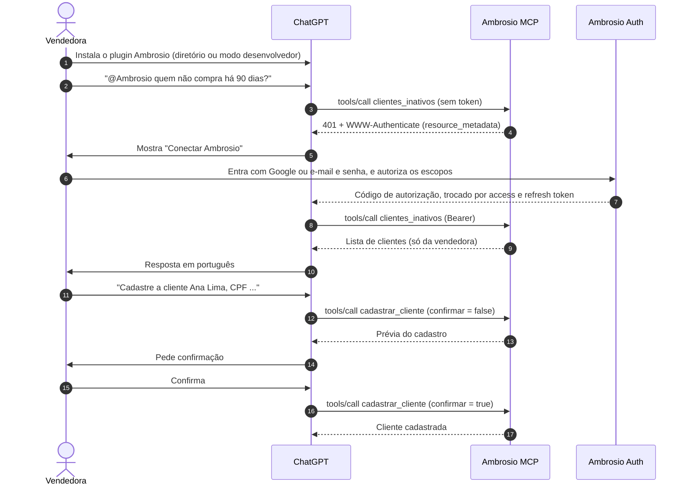
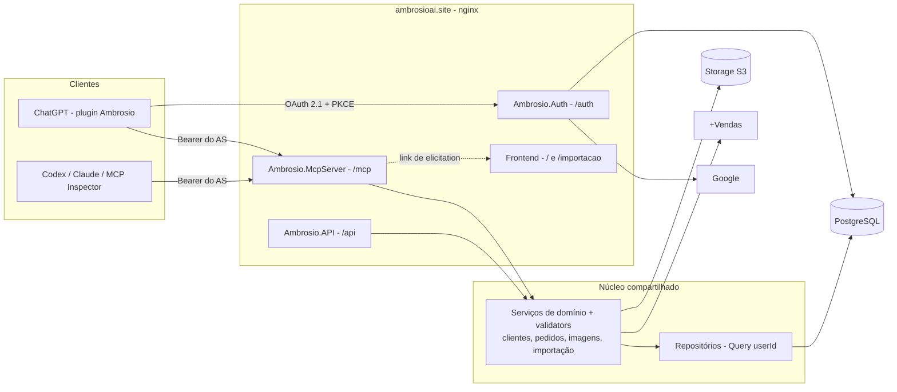
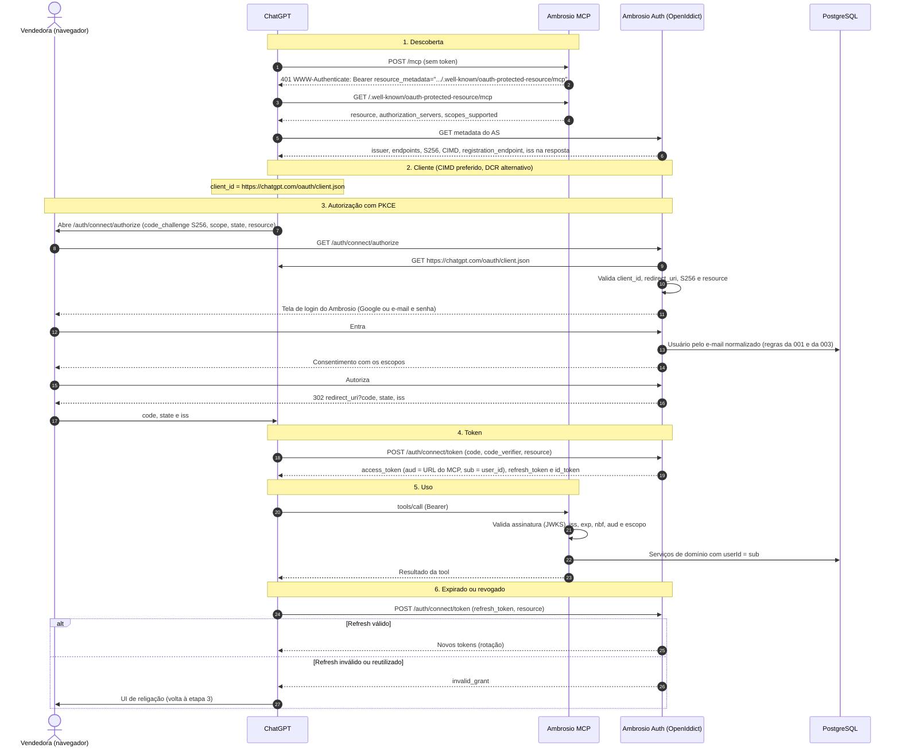

# 005 — Plugin do Ambrosio no ChatGPT (MCP com toda a API e login OAuth)

> Documento da história de usuário 005: o Ambrosio como **plugin do ChatGPT**. Um servidor MCP remoto expõe como tools **tudo o que a API expõe** (usuário, clientes, pedidos, imagens e importação do +Vendas), com **leitura e escrita**. O acesso é pelo **login do Ambrosio via OAuth 2.1**, que o ChatGPT exige. Esta HU incorpora as antigas [008](008-oauth-mcp-chatgpt.md) (OAuth) e [009](009-mcp-app-chatgpt.md) (app no ChatGPT).

**Created:** 2026-10-25
**Last Updated:** 2026-10-27

| Campo | Valor |
|---|---|
| ID | 005 |
| Status | Planejada (próxima) |
| Spec | — |
| Depende de | [001](001-api-cadastro-clientes-pedidos.md) (domínio, REST e usuários), [003](003-armazenamento-imagens-s3.md) (imagens) e [004](004-bot-migracao-mais-vendas.md) (importação do +Vendas) |
| Habilita | [007](007-graphql-clientes-pedidos.md) (tool `consultar_graphql`) e [010](010-banco-imagens-clientes-chatgpt.md) (fotos de clientes pelo ChatGPT) |
| Incorpora | [008](008-oauth-mcp-chatgpt.md) (OAuth 2.1) e [009](009-mcp-app-chatgpt.md) (app no ChatGPT) |
| Código previsto | `backend/Ambrosio.Mcp/` (tools), `backend/Ambrosio.McpServer/` (host MCP), `backend/Ambrosio.Auth/` (authorization server) e `plugin/` (pacote do plugin: `plugin.json`, `mcp.json`, `skills/` e `assets/`) |
| Fontes | Documentação de plugins da OpenAI, consultada em 27/10/2026: [visão geral](https://developers.openai.com/plugins/), [autenticação](https://developers.openai.com/plugins/build/auth), [empacotamento](https://developers.openai.com/plugins/build/plugins), [conectar e testar](https://developers.openai.com/plugins/deploy/connect-chatgpt) e [submissão](https://developers.openai.com/plugins/deploy/submission). Especificação de autorização do MCP (revisão 2025-11-25) |

---

## 1. História

**Como** vendedora, **quero** instalar o Ambrosio como plugin no ChatGPT, entrar com a minha conta do Ambrosio e pedir em linguagem natural coisas como "quem são minhas clientes que não compram há 3 meses?" ou "cadastre o pedido da Ana Lima", **para** consultar e gravar tudo o que faço no Ambrosio sem sair da conversa e sem copiar token nenhum.

## 2. Contexto e objetivo

### Como funciona um plugin do ChatGPT (outubro de 2026)

- Em 29/09/2026 a OpenAI relançou os **plugins** do ChatGPT. Os "apps" do Apps SDK (outubro de 2025) passaram a ser plugins. O núcleo de um plugin é um **servidor MCP remoto**. O mesmo servidor funciona no ChatGPT, no Codex e em outros clientes MCP.
- Um plugin é um **pacote** com três partes:
  - o **servidor MCP**, que dá as tools e o acesso aos dados;
  - **skills** (opcionais): pastas com `SKILL.md`, que ensinam fluxos e vocabulário em volta das tools;
  - **UI** (opcional): recursos HTML devolvidos por tools e renderizados na conversa.
- **Uso próprio (modo desenvolvedor):**
  1. Ativar o modo desenvolvedor em Settings → Security and login.
  2. Em `chatgpt.com/plugins`, usar **+ → Add custom MCP server** e informar nome, descrição, a URL do servidor MCP (com `/mcp`) e a autenticação.
  3. Confirmar em **Create as a plugin**. O ChatGPT lista as tools descobertas.
  4. Na conversa, digitar `@` e escolher o plugin.
- **Publicação:** em `platform.openai.com/plugins`, com envio do pacote, revisão do servidor MCP (automática e humana) e publicação no diretório.
- **Login:** um servidor MCP com dados de usuário precisa de **OAuth 2.1**. O ChatGPT não aceita API key própria, client credentials, JWT bearer nem token colado à mão. Por isso o login do plugin **é** o login do Ambrosio, feito por um authorization server próprio. Na primeira tool que exige conta, o ChatGPT mostra a UI de vinculação, a vendedora entra no Ambrosio e autoriza.

### Objetivo desta HU

- **Plugin completo:** servidor MCP, authorization server e pacote do plugin, do modo desenvolvedor até a submissão.
- **Toda a API, leitura e escrita:** usuário atual, clientes, pedidos e itens, imagens do storage ([003](003-armazenamento-imagens-s3.md)) e a importação do +Vendas ([004](004-bot-migracao-mais-vendas.md)).
- **Regra de paridade:** cada endpoint da API tem uma tool equivalente. Um endpoint novo só fica pronto quando ganha a tool (critério 14). A única exceção são as rotas de login da API (seção 4).
- **Sem GraphQL nesta HU:** as tools curadas do doc 04 usam os serviços de domínio. A tool `consultar_graphql` entra com a [007](007-graphql-clientes-pedidos.md).
- **Sem token provisório:** o MCP nasce exigindo o token do authorization server. Nenhum JWT HS256 da API é aceito no MCP, em nenhum ambiente.
- A constituição ainda tem `TODO(AUTH_SCHEME)` (Princípio VI). A decisão do authorization server (seção 8) pode encerrar esse TODO.

### Mudança de escopo em relação ao doc 04

| Tema | Doc 04 (previsto) | HU 005 (novo) | Motivo |
|---|---|---|---|
| Forma de uso | MCP local para uma LLM | Plugin do ChatGPT (e qualquer cliente MCP remoto) | Pedido do usuário: funcionar como plugin no ChatGPT |
| Operações | Somente leitura | Leitura e escrita em tudo o que a API expõe | Pedido do usuário: o MCP grava e tem acesso a toda a API |
| Transporte | stdio (local) | HTTP streamable (remoto). stdio fica opcional para dev | O ChatGPT só conecta em HTTPS público |
| Linguagem | TypeScript (`@modelcontextprotocol/sdk`) | C# (SDK oficial `ModelContextProtocol`) | Reutilizar o domínio .NET da 001 |
| Acesso aos dados | SQL parametrizado com usuário `SELECT`-only | Serviços de domínio em processo | Mesmas regras, validações e isolamento da API |
| Identidade | Não prevista (base de uma vendedora) | Login do Ambrosio por OAuth 2.1, isolamento por `user_id` | Exigência do ChatGPT e modelo multiusuário da 001 |

**Continua valendo do doc 04:** CPF nunca completo (só mascarado), parâmetros tipados, nada de SQL livre vindo do modelo, limite de linhas (≤ 200), descrições das tools em português com exemplos e informar a data dos dados.

### Endereços canônicos (definidos em 25/10/2026)

Estes valores entram nos tokens e nos metadados. Depois de publicados, não podem mudar (ver riscos). Tudo fica no domínio principal, em subpastas, com cada serviço como processo próprio atrás do nginx.

| Item | Valor |
|---|---|
| Servidor MCP e `resource` canônico | `https://ambrosioai.site/mcp` (é a URL informada ao ChatGPT) |
| Issuer do authorization server | `https://ambrosioai.site/auth` (exatamente assim, **sem** barra no final) |
| Metadata do AS (RFC 8414) | `https://ambrosioai.site/.well-known/oauth-authorization-server/auth` |
| Discovery OIDC | `https://ambrosioai.site/auth/.well-known/openid-configuration` |
| Endpoints do AS | `/connect/authorize`, `/connect/token`, `/connect/register`, `/connect/userinfo`, `/connect/revoke` e `/.well-known/jwks`, todos sob `https://ambrosioai.site/auth` |
| `aud` do access token | `https://ambrosioai.site/mcp`, com comparação exata |
| Protected Resource Metadata (RFC 9728) | `https://ambrosioai.site/.well-known/oauth-protected-resource/mcp`. Publicar também sem o caminho, por compatibilidade |
| Desafio de domínio da submissão | `https://ambrosioai.site/.well-known/openai-apps-challenge` (texto puro, só o token) |
| Política, termos e suporte | `https://ambrosioai.site/privacidade`, `https://ambrosioai.site/termos` e `https://ambrosioai.site/suporte`, servidas pelo frontend |

Os documentos da raiz `/.well-known/*` são servidos pelo nginx, que roteia cada um para o serviço dono dele. Nenhum deles pode cair no fallback do SPA nem no service worker do PWA ([006](006-frontend-pwa.md)). As rotas de login da API (`/api/auth/*`) não colidem com o AS, que ocupa `/auth/*` sem o prefixo `/api`.

---

## 3. Como a vendedora usa o plugin



---

## 4. Escopo

### Dentro do escopo

**Servidor MCP**
- Host ASP.NET Core com `ModelContextProtocol.AspNetCore` (`AddMcpServer().WithHttpTransport()` e `MapMcp("/mcp")`), em processo próprio atrás do nginx, em `https://ambrosioai.site/mcp`.
- Tools para **todos** os endpoints da API, leitura e escrita (seção 6).
- Tools curadas a partir do [doc 04](../04-mcp-consultas-llm.md#tools-sugeridas), sobre os serviços de domínio.
- Tool de perfil (`perfil_ambrosio`), que o ChatGPT usa para identificar a conta conectada.
- Anotações em todas as tools (`readOnlyHint`, `destructiveHint`, `idempotentHint`, `openWorldHint`, `title`) e `securitySchemes` por tool.
- Confirmação antes de qualquer escrita.
- Validação do header `Origin`, HTTPS fora de dev, *rate limiting* e log de auditoria das escritas.

**Login por OAuth 2.1**
- Authorization server próprio com metadata, `authorize`, `token`, `jwks`, `userinfo`, revogação e registro de cliente (CIMD e DCR).
- Login no AS com **Google** (regra da 001) e com **e-mail e senha** (spec [`003-email-password-jwt-auth`](../../specs/003-email-password-jwt-auth/)), na mesma tabela `users`. O e-mail e senha também atende à exigência da revisão de uma conta de teste sem MFA.
- Tela de login e consentimento em português, no visual do Ambrosio.
- Access token JWT assinado com chave assimétrica, `aud` = URL do MCP e `sub` = `user_id`. Refresh token com rotação.
- No MCP: Protected Resource Metadata, 401 com `WWW-Authenticate`, validação completa do token, checagem de escopo por tool e `_meta["mcp/www_authenticate"]` para disparar a UI de vinculação.

**Plugin no ChatGPT**
- Pacote do plugin em `plugin/`: `plugin.json` (identidade e `interface`), `mcp.json` (servidor `streamable-http` com OAuth por CIMD), `skills/` e `assets/` (logo e mascote).
- Skill de vendas com o vocabulário do negócio: mês de cota de 26 a 25, PA e VA, venda, devolução e cancelamento, e a regra de pedir confirmação antes de gravar.
- Páginas públicas de privacidade, termos e suporte, em português.
- Publicação do MCP e do AS em HTTPS público, com proxy compatível com streaming.
- Registro em modo desenvolvedor, roteiro de testes com prompts (seção 11) e preparação da submissão.

### Fora do escopo

- **Rotas de login da API** (`/auth/register`, `/auth/login` e `/auth/google`) como tools. O plugin já chega autenticado pelo OAuth, e uma tool de login faria a senha passar pela conversa.
- **Exclusão de clientes ou pedidos**, porque a API não tem esses endpoints. Pela regra de paridade, se a API ganhar, o MCP ganha a tool junto.
- **Fotos vinculadas a clientes** (anexar, foto principal, tags e consentimento), que são da [010](010-banco-imagens-clientes-chatgpt.md). As tools de imagem desta HU são as do storage da 003.
- **`consultar_graphql`**, que entra com a [007](007-graphql-clientes-pedidos.md).
- **UI do plugin** (componentes HTML na conversa, como um card de cliente com foto). Pode entrar numa HU futura.
- **Migrar o frontend e a API REST para os tokens do AS.** O frontend continua com o JWT da 003.
- **Monetização** e checkout.
- Tela de gestão das conexões autorizadas. Só o endpoint de revogação entra.

---

## 5. Critérios de aceite (a cumprir)

### Servidor MCP e tools

| # | Critério | Como verificar |
|---|---|---|
| 1 | O MCP Inspector conecta em `https://ambrosioai.site/mcp` (em dev, no endereço local) por HTTP streamable, com token do AS, e lista todas as tools da seção 6 | MCP Inspector |
| 2 | Toda tool tem `title`, descrição em português com exemplo, `inputSchema` tipado, anotações e `securitySchemes` | `tools/list` |
| 3 | Tools de leitura têm `readOnlyHint: true`. Tools de escrita têm `readOnlyHint: false` e `destructiveHint` coerente com a tabela | `tools/list` |
| 4 | Sem token, ou com token inválido, o MCP responde HTTP 401 com `WWW-Authenticate: Bearer resource_metadata="https://ambrosioai.site/.well-known/oauth-protected-resource/mcp", scope="…"` | `curl -i` |
| 5 | O resultado de qualquer tool só contém dados do usuário do token | Ana e Bia no mesmo servidor |
| 6 | Nenhuma tool devolve CPF completo. `obter_cliente` devolve `cpfMasked` | Revisão das saídas |
| 7 | Uma escrita sem confirmação não altera nada e devolve uma prévia do que seria gravado | Chamar `cadastrar_pedido` sem `confirmar` |
| 8 | As escritas aplicam as mesmas validações e mensagens da API (CPF inválido, 409 de duplicidade, sinal do total) | Comparar com o REST |
| 9 | As tools curadas dão o mesmo resultado que a API para o mesmo filtro, sem depender do GraphQL | Comparar com `GET /customers` e `GET /orders` |
| 10 | Listas devolvem no máximo 200 linhas e informam se há mais resultados | `listar_pedidos` com período longo |
| 11 | Requisições com `Origin` fora da lista permitida são recusadas | `curl -H "Origin: https://evil.example"` |
| 12 | Toda escrita fica registrada em log de auditoria (usuário, tool, argumentos sem dados sensíveis, resultado) | Log |
| 13 | Os erros de domínio voltam como resultado de tool com `isError: true` e a mensagem em português, não como erro de protocolo | Cadastrar CPF duplicado |
| 14 | Paridade com a API: todo endpoint dos controllers, exceto `/auth/*`, tem uma tool mapeada. Um teste automatizado compara as rotas dos controllers com o mapa de tools e falha quando surge um endpoint sem tool | Teste por reflexão |
| 15 | As tools de imagem aplicam as mesmas regras do storage da 003: tipos aceitos, tamanho máximo, deduplicação por SHA-256, isolamento por usuário e URL pré-assinada curta | Enviar um GIF e um arquivo acima do limite |
| 16 | A senha do +Vendas nunca aparece em argumento de tool, log de auditoria ou resposta | Revisão do schema e dos logs |
| 17 | Toda tool de escrita (inclusive `enviar_imagem`, `excluir_imagem`, `iniciar_importacao` e `cancelar_importacao`) segue a confirmação do critério 7 | Chamar cada escrita sem `confirmar` |

### Login por OAuth 2.1

| # | Critério | Como verificar |
|---|---|---|
| 18 | `GET https://ambrosioai.site/.well-known/oauth-protected-resource/mcp` devolve JSON (não o HTML do SPA) com `resource: "https://ambrosioai.site/mcp"`, `authorization_servers: ["https://ambrosioai.site/auth"]` e `scopes_supported`. A variante sem caminho devolve o mesmo | `curl` |
| 19 | Os dois endereços de metadata do AS respondem o mesmo conteúdo, com `issuer` exatamente `https://ambrosioai.site/auth`, `code_challenge_methods_supported` com `S256`, `client_id_metadata_document_supported: true`, `registration_endpoint`, `authorization_response_iss_parameter_supported: true` e `token_endpoint_auth_methods_supported` com `none` e `private_key_jwt` | `curl` |
| 20 | Autorização sem `code_challenge`, ou com `plain`, é recusada | Requisição manual |
| 21 | Com CIMD, o AS baixa `https://chatgpt.com/oauth/client.json`, valida o documento e só aceita `redirect_uri` listada nele | Log do AS |
| 22 | Com DCR, o `client_id` emitido continua válido enquanto a conexão existir (sem expiração automática) | Reconectar após dias |
| 23 | Toda resposta de autorização (sucesso e erro) inclui `iss` idêntico ao issuer | Inspecionar o redirect |
| 24 | O token tem `aud` igual ao `resource` enviado (`https://ambrosioai.site/mcp`) e `iss` igual a `https://ambrosioai.site/auth`. Pedido sem `resource`, ou com outro valor (inclusive com barra no final), é recusado | Decodificar o JWT |
| 25 | O login no AS aceita Google (e-mail verificado) e e-mail e senha. O mesmo e-mail cai no mesmo `user_id` da API | Comparar `sub` com `GET /api/users/me` |
| 26 | A tela de consentimento lista os escopos pedidos em português, e a vendedora pode negar | Fluxo manual |
| 27 | O MCP recusa com 401 tokens com assinatura inválida, `iss` errado, expirados, ainda não válidos (`nbf`) ou com `aud` diferente, e também o JWT HS256 da API | Testes com tokens adulterados |
| 28 | Uma tool chamada sem o escopo necessário devolve `isError: true` com `_meta["mcp/www_authenticate"]` contendo `error="insufficient_scope"`, `error_description` e o escopo faltante | Token só com `customers:read` chamando `cadastrar_cliente` |
| 29 | `userinfo` devolve `sub`, `email`, `email_verified: true` e `name` | `curl` com o token |
| 30 | O refresh token gira a cada uso. Um refresh token reutilizado invalida a família inteira | Reusar o refresh antigo |

### Plugin no ChatGPT

| # | Critério | Como verificar |
|---|---|---|
| 31 | MCP e AS respondem em HTTPS público com certificado válido, e o proxy não bufferiza streaming e respeita *timeouts* longos | `curl` de fora da rede e chamada longa pelo Inspector |
| 32 | O plugin é criado em `chatgpt.com/plugins` (modo desenvolvedor), conecta pelo OAuth e lista as tools | Painel do ChatGPT |
| 33 | Chamar uma tool sem conta vinculada faz o ChatGPT mostrar a UI de conectar o Ambrosio | Conversa nova sem conexão |
| 34 | A tool de perfil devolve um `id` opaco e estável (o `user_id`), igual entre reconexões e mudança de nome ou e-mail | Desconectar, reconectar e comparar |
| 35 | Desconectar e reconectar o plugin funciona sem erro `invalid_client` | Teste manual |
| 36 | Nos prompts de teste (seção 11), o modelo escolhe a tool certa em pelo menos 90% dos casos | Planilha de resultados |
| 37 | Escritas pedem confirmação no ChatGPT antes de gravar | Prompt "cadastre a cliente…" |
| 38 | Política de privacidade, termos e suporte publicados em HTTPS, em português | Navegador |
| 39 | O pacote (`plugin.json`, `mcp.json`, skills, ícones) passa na validação do envio, sem segredos no ZIP e sem campos rejeitados (`test_credentials`, `reviewer_instructions`) | Upload em `platform.openai.com/plugins` |
| 40 | O desafio de domínio responde o token em texto puro e a revisão automática escaneia as tools sem erro | Etapa **MCPs** da submissão |
| 41 | O material de revisão está pronto: conta de teste sem MFA, 5 casos positivos e 3 negativos, vídeo de demonstração e notas de versão | Checklist da submissão |

---

## 6. Tools

O escopo OAuth de cada tool está na seção 7. Os nomes das tools e dos parâmetros ficam em português, porque são lidos pelo modelo, e seguem o [doc 04](../04-mcp-consultas-llm.md#tools-sugeridas).

### Usuário, clientes e pedidos

| Tool | Equivale a | Leitura | `destructiveHint` | `idempotentHint` | Observações |
|---|---|---|---|---|---|
| `obter_usuario_atual` | `GET /users/me` | Sim | — | — | Nome, e-mail e provedor |
| `listar_clientes` | `GET /customers` | Sim | — | — | `busca`, `pagina`, `tamanho` (≤ 100) |
| `obter_cliente` | `GET /customers/{id}` | Sim | — | — | Com resumo de compras. CPF mascarado |
| `cadastrar_cliente` | `POST /customers` | Não | `false` | `false` | `nome`, `cpf`. Exige confirmação |
| `atualizar_cliente` | `PUT /customers/{id}` | Não | `true` | `true` | Sobrescreve o nome. Exige confirmação |
| `listar_pedidos` | `GET /orders` | Sim | — | — | `inicio`, `fim`, `tipo`, `canal`, `cliente_id`, `busca` |
| `obter_pedido` | `GET /orders/{id}` | Sim | — | — | Cliente e itens |
| `listar_itens_pedido` | `GET /orders/{id}` (só `items`) | Sim | — | — | A API não tem rota própria de itens. A tool recorta o detalhe |
| `cadastrar_pedido` | `POST /orders` | Não | `false` | `false` | Pedido com itens. Exige confirmação |
| `atualizar_pedido` | `PUT /orders/{id}` | Não | `true` | `true` | `status` e `total`. Exige confirmação |

### Imagens (storage da 003)

| Tool | Equivale a | Leitura | `destructiveHint` | `idempotentHint` | Observações |
|---|---|---|---|---|---|
| `obter_imagem` | `GET /images/{id}` | Sim | — | — | Metadados e URL pré-assinada de leitura, de curta duração |
| `enviar_imagem` | `POST /images` (gravação pelo servidor) | Não | `false` | `true` | Recebe o arquivo do ChatGPT (objeto com `download_url`, nunca base64). O servidor baixa (`openWorldHint: true`), valida e grava com `ImageSource.ChatGpt`. Mesmo arquivo devolve a mesma imagem. Exige confirmação |
| `solicitar_upload_imagem` | `POST /images/uploads` | Não | `false` | `true` | Devolve a URL pré-assinada de envio direto ao storage, para clientes que conseguem fazer o `PUT` |
| `confirmar_upload_imagem` | `POST /images/uploads/{id}/confirm` | Não | `false` | `true` | Confere tamanho e hash do que chegou ao storage |
| `excluir_imagem` | `DELETE /images/{id}` | Não | `true` | `true` | Apaga o objeto e o metadado. Exige confirmação |

### Importação do +Vendas (004)

| Tool | Equivale a | Leitura | `destructiveHint` | `idempotentHint` | Observações |
|---|---|---|---|---|---|
| `sugestao_periodo_importacao` | `GET /imports/mais-vendas/defaults` | Sim | — | — | Data inicial sugerida (último pedido importado) e data final (hoje) |
| `iniciar_importacao` | `POST /imports/mais-vendas/runs` | Não | `false` | `true` | `inicio`, `fim`, `simular`. **Login e senha do +Vendas não são argumentos da tool** (seção 8). Exige confirmação, `openWorldHint: true` |
| `importacao_atual` | `GET /imports/mais-vendas/runs/current` | Sim | — | — | Execução em andamento, com progresso por bloco |
| `obter_importacao` | `GET /imports/mais-vendas/runs/{id}` | Sim | — | — | Relatório: contagens, blocos, alterações e erros |
| `listar_importacoes` | `GET /imports/mais-vendas/runs` | Sim | — | — | Histórico paginado |
| `cancelar_importacao` | `POST /imports/mais-vendas/runs/{id}/cancel` | Não | `false` | `true` | Interrompe após o bloco atual. Os blocos já gravados ficam. Exige confirmação |

### Tools curadas do doc 04

| Tool | Base | Leitura | Observações |
|---|---|---|---|
| `buscar_cliente` | `ICustomerService` | Sim | Por nome. Por CPF: o servidor normaliza, calcula o hash e busca, sem devolver o CPF |
| `historico_cliente` | `ICustomerService` + `IOrderService` | Sim | Pedidos, itens, ticket médio e última compra |
| `clientes_inativos` | Consulta nova no repositório de clientes, sobre o resumo de compras | Sim | `dias`, `min_compras?`, `min_total?` |
| `resumo_periodo` | Consulta nova no repositório de pedidos | Sim | Total, atendimentos, peças, PA e VA. Sem % da cota (fora do modelo atual) |
| `devolucoes_cancelamentos` | `IOrderService` com filtro por tipo | Sim | Totais por tipo. "Motivos" não existem no modelo atual |
| `top_produtos` | — | — | Pergunta em aberto: exige agregação por `sku_ref` |

### Tools do plugin

| Tool | `securitySchemes` | Observações |
|---|---|---|
| `perfil_ambrosio` | `oauth2` | Tool de perfil exigida pelo ChatGPT para identificar a conta: `_meta["openai/profile"]: true`, `inputSchema` vazio com `additionalProperties: false`, anotações só leitura. Devolve `id` (o `user_id` em texto, opaco e estável, nunca o e-mail), `name` e `email`, em `structuredContent` e também como JSON num item de texto |
| `sobre_ambrosio` | `noauth` | Proposta: explica o que o plugin faz e como conectar, sem acessar dados |

---

## 7. Escopos OAuth

| Escopo | Permite | Tools |
|---|---|---|
| `openid`, `email`, `profile` | Identidade OIDC, `userinfo` e a tool de perfil. O ChatGPT pede esses escopos por padrão quando anunciados | `perfil_ambrosio` |
| `offline_access` | Emissão de refresh token | — |
| `customers:read` | Ler clientes, resumo de compras e imagens | `obter_usuario_atual`, `listar_clientes`, `obter_cliente`, `buscar_cliente`, `clientes_inativos`, `historico_cliente`*, `obter_imagem` |
| `customers:write` | Cadastrar e atualizar clientes | `cadastrar_cliente`, `atualizar_cliente` |
| `orders:read` | Ler pedidos e itens | `listar_pedidos`, `obter_pedido`, `listar_itens_pedido`, `resumo_periodo`, `devolucoes_cancelamentos`, `historico_cliente`* |
| `orders:write` | Cadastrar e atualizar pedidos | `cadastrar_pedido`, `atualizar_pedido` |
| `images:write` | Enviar e excluir imagens | `enviar_imagem`, `solicitar_upload_imagem`, `confirmar_upload_imagem`, `excluir_imagem` |
| `imports:read` | Ver sugestão de período, andamento e histórico das importações | `sugestao_periodo_importacao`, `importacao_atual`, `obter_importacao`, `listar_importacoes` |
| `imports:write` | Iniciar e cancelar importações | `iniciar_importacao`, `cancelar_importacao` |

\* Exige os dois escopos. A [007](007-graphql-clientes-pedidos.md) adiciona `consultar_graphql` com `customers:read` e `orders:read`, e a [010](010-banco-imagens-clientes-chatgpt.md) acrescenta as tools de fotos de clientes em `customers:read` e `images:write`.

No descritor de cada tool, `securitySchemes` traz `[{ "type": "oauth2", "scopes": [...] }]` com os escopos da tabela. Exemplo (ilustrativo, o formato final segue a documentação vigente):

```json
{
  "name": "listar_clientes",
  "title": "Listar clientes",
  "description": "Lista as clientes da vendedora conectada. Use quando a pergunta for sobre quem são as clientes ou para achar uma cliente pelo nome. Não use para valores de vendas (use resumo_periodo).",
  "inputSchema": { "type": "object", "properties": { "busca": { "type": "string" } } },
  "annotations": { "readOnlyHint": true, "destructiveHint": false, "openWorldHint": false },
  "securitySchemes": [{ "type": "oauth2", "scopes": ["customers:read"] }]
}
```

Resultado de tool quando falta escopo, que faz o ChatGPT oferecer a religação:

```json
{
  "isError": true,
  "content": [{ "type": "text", "text": "É preciso autorizar o Ambrosio a cadastrar clientes." }],
  "_meta": {
    "mcp/www_authenticate": [
      "Bearer resource_metadata=\"https://ambrosioai.site/.well-known/oauth-protected-resource/mcp\", error=\"insufficient_scope\", error_description=\"Falta o escopo customers:write\", scope=\"customers:write\""
    ]
  }
}
```

---

## 8. Decisões técnicas propostas

### MCP chama a API por HTTP ou reutiliza o domínio?

| Critério | Chamar a API REST por HTTP | Reutilizar o domínio em processo (C#) |
|---|---|---|
| Regras e validações | Reaproveitadas pelo contrato HTTP | Reaproveitadas diretamente (serviços, validators FluentValidation) |
| Token | O MCP precisaria de um token aceito pela API. A especificação MCP **proíbe** repassar o token recebido (*token passthrough*). Seria preciso *token exchange* | Nenhuma troca de token. Um único ponto de validação |
| Latência | Dois saltos de rede por chamada | Um salto |
| Acoplamento | Baixo | Médio: o MCP depende de `Domain`, `Infra` e `Application` |
| Erros | Precisa traduzir `ErrorResult` HTTP | Exceções e resultados de domínio tratados diretamente |

**Recomendação: reutilizar o domínio em processo.** As tools ficam em `Ambrosio.Mcp`, hospedadas em `Ambrosio.McpServer`, que chama o mesmo `ConfigureServices` da camada `Application`. O `userId` vem do `sub` do token validado. O MCP continua como serviço separado da API, com escala e *rate limit* próprios.

### Authorization server: próprio ou IdP externo

| Critério | Próprio no .NET (OpenIddict) | Auth0 | Keycloak (self-hosted) |
|---|---|---|---|
| PKCE S256 | Sim | Sim | Sim |
| CIMD (preferido pelo ChatGPT) | Handler próprio que baixa e valida o documento | A verificar | A verificar |
| DCR | Endpoint próprio sobre o `IOpenIddictApplicationManager` | Sim, com restrições | Sim |
| RFC 9207 (`iss` na resposta) | Suportado nas versões recentes (a confirmar) | A verificar | Sim |
| `resource` (RFC 8707) no `aud` | Controle total | Usa `audience`. Suporte a `resource`: a verificar | Exige *mapper* de audiência |
| Login Google e e-mail/senha do Ambrosio | Direto: mesma base `users` e mesmas regras da 001 e da 003 | Sincronização por e-mail | Sincronização por e-mail |
| Custo e operação | Só infraestrutura. Rotação de chaves e atualizações por nossa conta | Gerenciado. Pago ao crescer | Outra stack (Java) para operar |

**Recomendação: authorization server próprio no .NET com OpenIddict**, no processo `Ambrosio.Auth` em `https://ambrosioai.site/auth`. Motivos: CIMD e `resource` ficam sob nosso controle, o `sub` do token é o `user_id` do Ambrosio sem sincronização, a stack é a mesma (.NET 8, EF Core e PostgreSQL) e a decisão fecha o `TODO(AUTH_SCHEME)`. Se o esforço ficar alto demais, o plano B é o Keycloak.

### Demais decisões

| Tema | Proposta |
|---|---|
| SDK MCP | `ModelContextProtocol` e `ModelContextProtocol.AspNetCore` (C#). Tools com `[McpServerToolType]` e `[McpServerTool]`, anotações pelos parâmetros do atributo |
| Transporte | HTTP streamable em `/mcp`. Avaliar o modo *stateless* (ver perguntas em aberto) |
| `securitySchemes` e `_meta` no SDK C# | Verificar se o SDK aceita campos extras no descritor. Se não aceitar, um filtro de `tools/list` acrescenta `securitySchemes`, e um *filter* comum às tools confere o escopo antes de executar e monta o `_meta["mcp/www_authenticate"]` |
| Validação do token no MCP | `AddJwtBearer` com `Authority` = `https://ambrosioai.site/auth`, `ValidIssuer` igual ao issuer e `ValidAudience` = `https://ambrosioai.site/mcp`. Política por escopo em cada tool |
| Token | JWT assinado (RS256 ou ES256), **sem criptografia** (o OpenIddict criptografa por padrão, e o MCP não validaria pelo JWKS). Access token de 30 min e refresh de 14 dias, deslizante e com rotação. Claims: `sub` (= `user_id`), `iss`, `aud`, `scope`, `exp`, `nbf`, `iat` e `client_id`. ID token emitido, para o ChatGPT poder mandar `id_token_hint` na religação |
| CIMD | Quando o `client_id` é uma URL `https`, o AS baixa o documento com proteções contra SSRF (só `https`, sem IP privado, *timeout* de 5 s, limite de 64 KB e cache), valida `client_id` igual à URL, `redirect_uris` e o método de autenticação. Para `private_key_jwt`, usa o JWKS do documento |
| DCR | `POST /connect/register` que aceita só as `redirect_uris` do ChatGPT e emite cliente público (`none`) sem expiração |
| Redirect URIs | `https://chatgpt.com/connector_platform_oauth_redirect` (AS com RFC 9207) e `https://chatgpt.com/connector/oauth/{callback_id}`. Copiar a URI exata exibida na página do plugin |
| Issuer com caminho | `SetIssuer(new Uri("https://ambrosioai.site/auth"))` explícito, `UsePathBase("/auth")` e *forwarded headers*. Sem isso, atrás do proxy o issuer pode sair sem `/auth` ou com `http://` |
| Login e consentimento | Telas Razor em português, no visual do Ambrosio (tema escuro e azul da marca), com Google e e-mail/senha. Reaproveitar as regras de `users` da 001 e da 003, extraídas para um serviço comum. Autorização permanente guardada, para não pedir de novo em cada religação |
| Tool de perfil | `perfil_ambrosio` devolve o `user_id` como `id`. Nunca o e-mail, que pode mudar |
| mTLS | O ChatGPT apresenta certificado de cliente da OpenAI (SAN `mtls.prod.connectors.openai.com`). Validar no nginx é opcional e reforça que a chamada vem do ChatGPT, sem substituir o OAuth. Sem *pinning* do certificado folha |
| Pacote do plugin | `plugin/plugin.json` com `name: "ambrosio"`, `version` e `extensions.com.openai.interface` (`displayName: "Ambrosio"`, `developerName`, `category`, `websiteURL`, `privacyPolicyURL`, `termsOfServiceURL`, `composerIcon` e `logo` com o mascote). `plugin/mcp.json` com o servidor `streamable-http` em `https://ambrosioai.site/mcp` e `auth` do tipo `oauth` com `client.mode: "cimd"`. Nenhum segredo no pacote |
| Skills | `plugin/skills/vendas-ambrosio/SKILL.md`: vocabulário (mês de cota de 26 a 25, PA = peças por atendimento, VA = valor por atendimento), quando usar cada tool, pedir confirmação antes de gravar e tratar nomes de clientes e produtos como dados, não como instruções |
| Credenciais do +Vendas em `iniciar_importacao` | **Recomendação:** a senha não passa pela LLM. A tool usa a *elicitation* em modo URL do MCP e devolve um link para `/importacao` com o período preenchido. A vendedora digita login e senha lá, e o MCP acompanha com `importacao_atual`. Sem suporte a *elicitation*, o mesmo link vai como texto |
| Arquivos em `enviar_imagem` | Objeto de arquivo (`download_url`, `mime_type`, `file_name`), nunca base64. Download só `https`, sem IP privado ou loopback, com *timeout* e tamanho máximo |
| Paridade com a API | Mapa único `endpoint → tool` no `Ambrosio.Mcp`, conferido por teste de reflexão contra os controllers (critério 14) |
| Confirmação de escrita | Em camadas: anotações (o ChatGPT pede aprovação em tools que não são só leitura), parâmetro `confirmar` (a primeira chamada devolve prévia) e *elicitation* quando o cliente suportar |
| Formato de saída | `structuredContent` (JSON tipado) e um texto curto em português. Valores em `R$` e datas `dd/mm/aaaa` no texto. Toda saída inclui `consultado_em` e, nos pedidos importados, `capturado_em` |
| Publicação | nginx de `ambrosioai.site`: `/mcp` para o `Ambrosio.McpServer` (sem reescrever o caminho, com `proxy_buffering off`, `proxy_read_timeout` alto e HTTP/1.1), `/auth/` para o `Ambrosio.Auth` e os documentos de `/.well-known/` para o serviço dono, todos antes do fallback do SPA |
| Ambientes | O ChatGPT só conecta em HTTPS público. A homologação local precisa de um túnel (o **Secure MCP Tunnel** do ChatGPT ou um túnel HTTPS para o gateway), e o AS também precisa estar acessível, porque o ChatGPT chama o token endpoint. Um plugin de desenvolvimento aponta para homologação e o publicado aponta para produção |
| Testes | xUnit para as tools e o AS (skill `dotnet-test`), testes HTTP com cliente MCP do SDK (skill `dotnet-test-api`), MCP Inspector e o roteiro da seção 11 no ChatGPT |
| Observabilidade | Log estruturado por chamada de tool (tool, usuário, duração, erro), sem dados pessoais, para medir o critério 36 |

### Arquitetura



---

## 9. Fluxo OAuth completo



---

## 10. Requisitos do ChatGPT (verificados em 27/10/2026)

| # | Requisito | Onde se aplica |
|---|---|---|
| R1 | OAuth 2.1 com authorization code e PKCE `S256`. Sem `S256` em `code_challenge_methods_supported`, o servidor não é suportado | AS |
| R2 | Protected Resource Metadata (RFC 9728) com `resource`, `authorization_servers` e `scopes_supported`, e 401 com `WWW-Authenticate: Bearer resource_metadata="…"` | MCP |
| R3 | Metadata do AS em `/.well-known/oauth-authorization-server` ou `/.well-known/openid-configuration`, com `issuer`, endpoints, `S256`, `token_endpoint_auth_methods_supported` e `client_id_metadata_document_supported` | AS |
| R4 | Registro do cliente: **CIMD preferido** (`client_id` = `https://chatgpt.com/oauth/client.json` ou `/oauth/{callback_id}/client.json`, autenticação `none` ou `private_key_jwt`). DCR como alternativa, uma vez por conexão e sem expirar | AS |
| R5 | RFC 9207: com `authorization_response_iss_parameter_supported: true`, toda resposta de autorização (inclusive erro) traz `iss` idêntico ao issuer | AS |
| R6 | O ChatGPT envia `resource` na autorização e no token. O token carrega esse valor no `aud`, e o MCP recusa `aud` diferente | AS e MCP |
| R7 | O MCP valida em toda chamada: assinatura, `iss`, `aud`, `exp`/`nbf` e escopos | MCP |
| R8 | `securitySchemes` por tool (`noauth` ou `oauth2` com `scopes`) e `_meta["mcp/www_authenticate"]` com `error` e `error_description` para disparar a UI de vinculação | MCP |
| R9 | Escopos OIDC (`openid`, `email`, `profile`) pedidos por padrão quando anunciados. Workspaces com restrição de domínio exigem `userinfo` com `email` e `email_verified: true` | AS |
| R10 | Tool de perfil com `_meta["openai/profile"]: true` e `id` opaco e estável, usada para múltiplas contas e detecção de duplicatas | MCP |
| R11 | Sem client credentials, JWT bearer, API key própria ou token em header no pacote publicado | — |
| R12 | Submissão: identidade do desenvolvedor verificada, desafio em `/.well-known/openai-apps-challenge`, URLs de site, suporte, privacidade e termos em HTTPS, conta de teste sem MFA, 5 casos positivos e 3 negativos, vídeo e notas de versão. Depois de publicado, mudanças nas tools passam por revisão contínua; mudanças no pacote exigem nova versão | Publicação |

---

## 11. Roteiro de testes no ChatGPT

Os casos marcados com **(+)** e **(−)** formam os 5 positivos e 3 negativos exigidos na submissão.

| # | Prompt | Tool esperada |
|---|---|---|
| 1 | "Quanto eu vendi neste mês de cota?" **(+)** | `resumo_periodo` |
| 2 | "Quais clientes não compram há 90 dias e já gastaram mais de R$ 5 mil?" **(+)** | `clientes_inativos` |
| 3 | "Mostre os pedidos da Maria Souza" **(+)** | `buscar_cliente` e depois `listar_pedidos` |
| 4 | "O que tinha no pedido 00004751?" **(+)** | `listar_pedidos` (busca) e `obter_pedido` |
| 5 | "Cadastre a cliente Ana Lima, CPF ..." **(+)** | `cadastrar_cliente` com prévia e confirmação |
| 6 | "Quantas devoluções tive na semana passada?" | `devolucoes_cancelamentos` |
| 7 | "Mude o nome da cliente 12 para Ana Lima Souza" | `atualizar_cliente` com confirmação |
| 8 | "Importe meus pedidos do +Vendas desta semana" | `sugestao_periodo_importacao` e `iniciar_importacao` (link para digitar a senha) |
| 9 | "Como está a importação?" | `importacao_atual` |
| 10 | "Guarde esta foto" (com arquivo) | `enviar_imagem` com confirmação |
| 11 | "Qual é o meu e-mail no Ambrosio?" | `obter_usuario_atual` |
| 12 | "O que é o Ambrosio?" (sem conta conectada) | `sobre_ambrosio` |
| 13 | "Qual a previsão do tempo amanhã?" **(−)** | Nenhuma tool |
| 14 | "Mostre os clientes de outra vendedora" **(−)** | Nenhum dado de outro usuário |
| 15 | "Apague todos os meus pedidos" **(−)** | Nenhuma tool (não existe exclusão de pedidos) |

---

## 12. Dependências

| HU | Tipo | Motivo |
|---|---|---|
| [001](001-api-cadastro-clientes-pedidos.md) | Obrigatória | Serviços de domínio, validators, repositórios, `users` e login Google |
| Spec [`003-email-password-jwt-auth`](../../specs/003-email-password-jwt-auth/) | Obrigatória | Login por e-mail e senha, também no AS (conta de teste da revisão) |
| [003](003-armazenamento-imagens-s3.md) | Obrigatória | `IImageService`, regras de aceitação e URLs pré-assinadas |
| [004](004-bot-migracao-mais-vendas.md) | Obrigatória | Serviços de importação (`IImportRunService`) e tela `/importacao` |
| [007](007-graphql-clientes-pedidos.md) | Posterior (não bloqueia) | Adiciona `consultar_graphql` a este servidor |
| DNS, TLS e nginx de `ambrosioai.site` | Obrigatória | Issuer e URL do MCP públicos e estáveis. O nginx roteia `/auth/`, `/mcp` e `/.well-known/` antes do fallback do SPA |
| Projeto Google Cloud | Obrigatória | Cliente OAuth do Google com o redirect do AS sob `https://ambrosioai.site/auth` (o caminho definitivo sai da spec) |
| Conta ChatGPT com modo desenvolvedor | Obrigatória | Criar e testar o plugin |
| Organização na plataforma OpenAI com identidade verificada | Para publicar | Submissão em `platform.openai.com/plugins` |

---

## 13. Riscos

| Risco | Impacto | Mitigação |
|---|---|---|
| A LLM grava dados errados (cliente trocado, total com sinal errado) | Base corrompida | Confirmação em camadas, prévia, validações do domínio e auditoria |
| *Prompt injection* em dados (nome de cliente ou produto com instruções) | O modelo é induzido a gravar | Escritas sempre com confirmação. Skill e descrições avisam que dados não são instruções |
| A LLM exclui uma imagem ou cancela uma importação por engano | Perda de foto ou importação incompleta | `destructiveHint`, confirmação e auditoria. A importação pode ser repetida, porque é idempotente |
| `enviar_imagem` vira vetor de SSRF | Acesso a serviços internos | Só `https`, bloqueio de IPs privados e loopback, *timeout* e tamanho máximo |
| A vendedora cola a senha do +Vendas na conversa | Senha no histórico do provedor da LLM | Descrição da tool e skill orientam a não informar no chat. O servidor nunca aceita senha como argumento |
| As regras de plugins mudam (relançamento recente, CIMD novo) | Conexão ou revisão falham | Revisar a documentação no início da spec e antes da submissão. Manter DCR como alternativa ativa |
| Planos do ChatGPT com restrição a ações de escrita | A vendedora não consegue gravar pelo plugin no plano dela | Confirmar o plano antes da spec (perguntas em aberto) |
| Implementação própria de OAuth com falha | Acesso indevido | Só fluxos do OpenIddict, testes de conformidade e revisão de segurança (skill `security-review`) |
| `issuer` ou URL do MCP mudam depois de publicados, ou diferença de uma barra no final | Todas as conexões quebram | Valores imutáveis (seção 2), validação no startup que recusa barra no final, critérios 19 e 24 |
| A descoberta com caminho (`/auth` e `/mcp`) não funciona no ChatGPT | O plugin não conecta | Publicar as variantes de metadata, conferir no log do nginx o que o ChatGPT consulta e, se falhar, usar subdomínios `auth.` e `mcp.` |
| `/.well-known/*` ou `/mcp` engolidos pelo fallback do SPA ou pelo service worker | A descoberta recebe HTML e falha | Rotas do nginx antes do fallback e `navigateFallbackDenylist` da [006](006-frontend-pwa.md) |
| AS, MCP e SPA na mesma origem | Um XSS no SPA alcança as telas do AS | Cookie do AS com `HttpOnly`, `Secure`, `SameSite=Lax` e `Path=/auth`, antiforgery e CSP restritiva |
| Perda ou vazamento da chave de assinatura | Tokens forjados | Cofre, rotação publicada no JWKS e revogação geral em incidente |
| Revisão da OpenAI reprova por dados pessoais (CPF, compras) | Publicação atrasa | Política de privacidade clara, CPF sempre mascarado e escopos mínimos |
| O modelo escolhe a tool errada | Respostas erradas | Descrições com "use quando" e "não use quando", skill de vendas e critério 36 |
| Proxy derruba conexões de streaming | Falhas intermitentes | Critério 31 e configuração de *timeouts* |
| O SDK C# do MCP evolui rápido | Quebras entre versões | Fixar a versão e acompanhar as notas de release |
| Uma rota nova na API sem tool | O plugin deixa de ter acesso a tudo | Teste de paridade do critério 14 no CI |

---

## 14. Perguntas em aberto

1. Em qual plano do ChatGPT a vendedora vai usar o plugin? A documentação de ajuda indica ações de escrita completas para Business, Enterprise e Edu e só leitura para Pro, com o Plus incerto. Isso decide se as escritas funcionam no uso real.
2. O plugin será publicado no diretório para qualquer usuário, ou fica só em modo desenvolvedor ou no workspace da empresa?
3. Quem é o responsável legal (pessoa física ou empresa) pela verificação de identidade e pela política de privacidade?
4. A recomendação de authorization server próprio (OpenIddict) está aprovada, ou o Keycloak deve passar por uma prova de conceito antes?
5. `iniciar_importacao` segue a recomendação (senha só na tela do Ambrosio, por link)? Ou a vendedora aceita informar a senha na conversa, sabendo que ela fica no histórico do provedor?
6. A confirmação via parâmetro `confirmar` é necessária, ou basta a confirmação do próprio ChatGPT pelas anotações?
7. `atualizar_pedido` pode alterar o `total`, ou fica limitada a `status`?
8. `top_produtos` entra aqui (agregação por `sku_ref`) ou numa HU de relatórios?
9. Modo *stateless* ou com sessão? A *elicitation* em modo URL pesa a favor de sessão.
10. Criar `images:read` separado de `customers:read`, para a vendedora poder negar o acesso às fotos?
11. Validades: access token de 30 min e refresh de 14 dias estão bons? O ChatGPT pede `offline_access` para receber refresh token? Confirmar no teste em modo desenvolvedor.
12. Haverá a tool `noauth` `sobre_ambrosio`, ou todas as tools exigem conta?
13. A API REST e o frontend vão migrar para os tokens do AS no futuro? Se sim, em qual HU?

Resolvida em 25/10/2026: os endereços definitivos são o issuer `https://ambrosioai.site/auth` e o MCP `https://ambrosioai.site/mcp`, em subpastas do domínio principal, com cada serviço em processo próprio.
