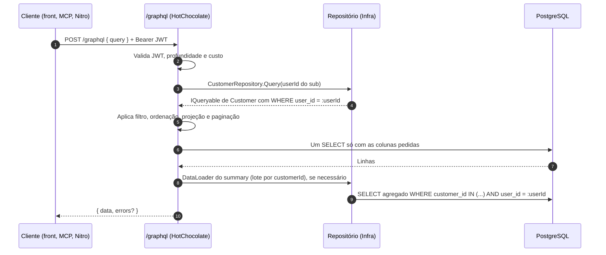

# 006 — GraphQL para consultas de clientes e pedidos

> Documento da história de usuário 006: endpoint GraphQL (HotChocolate), somente consultas, com filtros, ordenação, paginação por cursor, projeções e campos calculados, sempre isolado por usuário.

**Created:** 2026-10-25
**Last Updated:** 2026-10-25

| Campo | Valor |
|---|---|
| ID | 006 |
| Status | Planejada |
| Spec | — |
| Depende de | [001](001-api-cadastro-clientes-pedidos.md) (modelo, repositórios, JWT) |
| Habilita | [007](007-mcp-servidor-completo.md) (consulta flexível no MCP) |
| Código previsto | `backend/Ambrosio.GraphQL/` (novo), registrado no `Ambrosio.API` |

---

## 1. História

**Como** vendedora (e, depois, como LLM conectada pelo MCP), **quero** fazer consultas mais apuradas sobre clientes e pedidos, combinando filtros, ordenação e campos, **para** responder perguntas como "quais clientes não compram há 90 dias e já gastaram mais de R$ 5 mil?" sem precisar de um endpoint REST para cada pergunta.

## 2. Contexto e objetivo

- O REST da 001 tem filtros fixos (`search`, período, tipo, canal e cliente) e paginação por página.
- O [doc 04](../04-mcp-consultas-llm.md#tools-sugeridas) lista perguntas que pedem combinações livres (`clientes_inativos`, `historico_cliente`, `resumo_periodo`). O GraphQL cobre isso com uma única superfície tipada, sem SQL livre ([doc 04, boas práticas](../04-mcp-consultas-llm.md#boas-práticas)).
- Stack: HotChocolate 14.x, seguindo a skill `dotnet-graphql` (queries que devolvem `IQueryable`, *type extensions* para campos calculados e ocultação de campos). A constituição 3.0.0 (25/10/2026) já inclui o HotChocolate na stack fixa e torna a skill obrigatória, então esta HU não pede emenda.
- **Somente consultas.** Mutations ficam fora desta HU.

---

## 3. Escopo

### Dentro do escopo

- Endpoint `POST /graphql` (e `GET` para consultas persistidas, se adotadas), protegido pelo mesmo JWT da API. Em produção: `https://ambrosiaai.site/api/graphql`, sob o mesmo `PathBase` (`/api`) do REST e na mesma origem do frontend, então não há CORS (ver o roteamento na [002](002-frontend-web-perfil-cliente-pedidos.md#7-dependências)).
- Queries `me`, `customers`, `customer(id)`, `orders`, `order(id)` e `salesSummary(from, to, channel)`.
- `[UsePaging]` (cursor, conexões Relay), `[UseProjection]`, `[UseFiltering]` e `[UseSorting]` sobre `IQueryable` do EF Core.
- Campos calculados: `Customer.summary` (`purchases`, `netTotal`, `lastPurchase`, `daysSinceLastPurchase`, `averageTicket`) e `Order.itemsCount`.
- Isolamento obrigatório por `user_id` em toda raiz de consulta.
- Ocultação de campos sensíveis e internos.
- Limites de profundidade, custo e tamanho de página.
- Mensagens de erro em português e log de erros.

### Fora do escopo

- Mutations e subscriptions.
- Substituir o REST. Os dois convivem.
- Consumo pelo frontend [002](002-frontend-web-perfil-cliente-pedidos.md) (pode migrar depois).
- Cota, supercota e KPIs por período. O modelo da 001 não tem `sales_period` nem `period_kpi`.
- Federação ou *schema stitching*.

---

## 4. Critérios de aceite (a cumprir)

| # | Critério | Como verificar |
|---|---|---|
| 1 | Consulta sem token, ou com token inválido, recebe erro de autorização (`AUTH_NOT_AUTHORIZED`) e nenhum dado | Teste HTTP |
| 2 | `customers` e `orders` só devolvem registros do usuário do claim `sub`, em qualquer combinação de filtros | Usuários Ana e Bia |
| 3 | `customer(id)` e `order(id)` de outro usuário devolvem `null`, exatamente como um id inexistente | Idem |
| 4 | Navegar por `order.customer` ou `customer.orders` nunca alcança dados de outro usuário | Consulta aninhada |
| 5 | Os campos `cpfHash`, `cpfEncrypted`, `passwordHash` e `userId` não existem no schema | Introspecção |
| 6 | O CPF só aparece como `cpfMasked` | Introspecção |
| 7 | A paginação é por cursor (`first`, `after`, `last`, `before`), com `pageInfo` e `totalCount`. `first` tem máximo de 100 | Pedir `first: 500` |
| 8 | Filtros funcionam por nome do cliente (`contains`), período, tipo, canal, origem, status e faixa de total | Teste de cada operador |
| 9 | É possível filtrar e ordenar clientes pelos campos do resumo (`lastPurchase`, `netTotal`, `purchases`, `daysSinceLastPurchase`) | "Inativos há 90 dias com `netTotal` > 5000" |
| 10 | A projeção gera SQL só com as colunas pedidas | Log do EF Core em Development |
| 11 | Pedir `summary` numa lista de 100 clientes não gera N+1 consultas | Contar comandos SQL no log |
| 12 | `salesSummary` confere com as regras do [doc 02](../02-modelo-de-dados.md#regras-de-negócio-a-respeitar): líquido = soma dos totais, PA = peças / atendimentos, VA = valor / atendimentos | Conferir contra uma base de teste |
| 13 | Consulta com profundidade acima do limite, ou custo acima do limite, é recusada antes de executar | Consulta abusiva |
| 14 | Mutations não existem no schema | Introspecção |
| 15 | O IDE do GraphQL (Nitro) só fica disponível em Development | Abrir `https://ambrosiaai.site/api/graphql` no navegador em Production |
| 16 | Uma consulta típica (lista de 20 clientes com resumo) responde em menos de 1 s com 10.000 pedidos | Mesma base de carga prevista na 001 (T095) |

---

## 5. Esquema proposto (resumo)

```graphql
type Query {
  me: User!
  customers(where: CustomerFilterInput, order: [CustomerSortInput!],
            first: Int, after: String, last: Int, before: String): CustomersConnection!
  customer(id: Long!): Customer
  orders(where: OrderFilterInput, order: [OrderSortInput!],
         first: Int, after: String, last: Int, before: String): OrdersConnection!
  order(id: Long!): Order
  salesSummary(from: LocalDate!, to: LocalDate!, channel: String): SalesSummary!
}

type Customer {
  id: Long!
  name: String!
  cpfMasked: String!
  createdAt: DateTime!
  summary: CustomerSummary!
  orders(where: OrderFilterInput, order: [OrderSortInput!], first: Int, after: String): OrdersConnection!
}

type CustomerSummary {
  purchases: Int!
  netTotal: Decimal!
  lastPurchase: LocalDate
  daysSinceLastPurchase: Int
  averageTicket: Decimal
}

type Order {
  id: Long!
  orderNumber: String!
  orderDate: LocalDate!
  kind: OrderKind!          # SALE | RETURN | CANCELLATION
  channel: String
  origin: OrderOrigin       # COTA | OMNI
  status: String
  total: Decimal!
  originalSaleOn: LocalDate
  cancelledOn: LocalDate
  itemsCount: Int!
  customer: Customer
  items: [OrderItem!]!
}

type SalesSummary {
  netTotal: Decimal!
  salesCount: Int!          # atendimentos
  itemsCount: Int!          # peças
  pa: Decimal               # peças por atendimento
  va: Decimal               # valor por atendimento
  returnsTotal: Decimal!
  cancellationsTotal: Decimal!
}
```

Os nomes finais dos tipos de filtro e de ordenação são os gerados pelo HotChocolate. O esquema acima é ilustrativo.

---

## 6. Decisões técnicas propostas

| Tema | Proposta |
|---|---|
| Projeto | `Ambrosio.GraphQL` (skill `dotnet-graphql`), referenciado pela API e mapeado em `/graphql`. HotChocolate 14.x, versão fixada pela constituição 3.0.0 (Princípio II) |
| Autenticação | `HotChocolate.AspNetCore.Authorization` com `[Authorize]` na raiz `Query`. O mesmo JWT HS256 da API (claim `sub`) |
| Isolamento | Cada resolver de raiz recebe o `userId` do `ClaimsPrincipal` e chama um método de repositório `Query(userId)` que já devolve `IQueryable` filtrado. Navegações (`customer.orders`) partem de entidades já filtradas e, por segurança, também aplicam `UserId == userId` |
| Proteção extra | Avaliar um *global query filter* do EF Core por `user_id` com um `ICurrentUser` *scoped*. Fica como pergunta, porque afeta o REST da 001 |
| Ordem dos middlewares | `[UsePaging]` > `[UseProjection]` > `[UseFiltering]` > `[UseSorting]`, conforme a documentação do HotChocolate |
| Resumo do cliente | Para filtrar e ordenar pelos campos do resumo (critério 9), mapear uma *view* `v_customer_summary` como entidade sem chave no EF Core, como previa o [doc 02](../02-modelo-de-dados.md#views-úteis-para-o-mcp). A 001 calcula em LINQ ([doc 001, seção 10](001-api-cadastro-clientes-pedidos.md#divergências-entre-specartefatos-e-código)); a spec decide entre manter o LINQ com DataLoader (sem filtro pelo resumo) ou criar a view |
| N+1 | DataLoader (GreenDonut) em lote por `customerId` para `summary` e `items`, quando não vierem pela projeção |
| Campos ocultos | `cpf_hash`, `cpf_encrypted`, `password_hash`, `user_id` e `provider_subject` ignorados nos tipos (`IgnoreField`), como manda a skill |
| Limites | `MaxPageSize = 100`, `DefaultPageSize = 20`, `IncludeTotalCount = true`, profundidade máxima 6 e análise de custo do HotChocolate ativa |
| Introspecção | Liberada para usuários autenticados (o MCP e as ferramentas precisam dela). Nitro só em Development |
| Erros | `IErrorFilter` que traduz para português, registra a exceção no log e não expõe stack trace fora de Development |
| Datas | `LocalDate` para `orderDate`, `originalSaleOn` e `cancelledOn`, evitando deslocamento de fuso |

### Fluxo de uma consulta



---

## 7. Dependências

| HU | Tipo | Motivo |
|---|---|---|
| [001](001-api-cadastro-clientes-pedidos.md) | Obrigatória | Entidades, `DbContext`, repositórios e JWT |
| Pendências da 001 (T087, T088) | Recomendada | Testes de isolamento e o teste de contrato por reflexão também devem cobrir o GraphQL |

---

## 8. Riscos

| Risco | Impacto | Mitigação |
|---|---|---|
| Uma navegação ou um resolver novo esquece o filtro por `user_id` | Vazamento entre usuários | Repositório que só expõe `Query(userId)`, testes de isolamento específicos do GraphQL e avaliação do *global query filter* |
| Consultas caras (aninhamento, `first` alto, filtros sem índice) | Lentidão ou DoS | Limites de profundidade, custo e página, além de índices em `order_date`, `customer_id` e `channel` |
| Filtro por campo calculado não traduz para SQL | Erro em tempo de execução ou avaliação em memória | View `v_customer_summary` mapeada, ou expor só filtros traduzíveis |
| Divergência entre REST e GraphQL nas regras (resumo, sinal do total) | Números diferentes na tela e no ChatGPT | Mesma fonte (repositório e view) para os dois e teste comparando os resultados |

---

## 9. Perguntas em aberto

1. Criar a view `v_customer_summary` (filtro e ordenação pelo resumo) ou manter o cálculo em LINQ da 001?
2. Adotar o *global query filter* por `user_id` também no REST?
3. Introspecção liberada em produção para qualquer usuário autenticado?
4. Usar consultas persistidas (*persisted operations*) para o frontend, deixando consultas livres só para o MCP?
5. `salesSummary` deve considerar o mês de cota (26 a 25) como período padrão?
