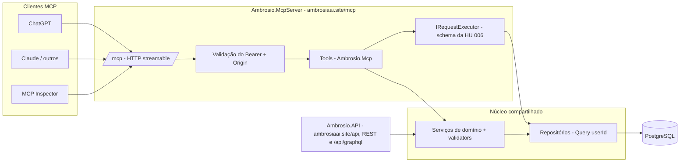

# 007 — Servidor MCP completo (REST e GraphQL como tools)

> Documento da história de usuário 007: servidor MCP remoto (HTTP streamable) que expõe como tools todos os recursos da API REST e a consulta flexível do GraphQL, com leitura e escrita.

**Created:** 2026-10-25
**Last Updated:** 2026-10-25

| Campo | Valor |
|---|---|
| ID | 007 |
| Status | Planejada |
| Spec | — |
| Depende de | [001](001-api-cadastro-clientes-pedidos.md) (domínio e REST) e [006](006-graphql-clientes-pedidos.md) (GraphQL) |
| Habilita | [008](008-oauth-mcp-chatgpt.md), [009](009-mcp-app-chatgpt.md) e [010](010-banco-imagens-clientes-chatgpt.md) |
| Código previsto | `backend/Ambrosio.Mcp/` (tools) e `backend/Ambrosio.McpServer/` (host ASP.NET Core) |

---

## 1. História

**Como** vendedora, **quero** conversar com uma LLM (ChatGPT, Claude ou outra compatível com MCP) que consulte e, com a minha confirmação, cadastre clientes e pedidos no Ambrosio, **para** fazer em linguagem natural o que hoje exige telas ou Swagger.

## 2. Contexto e objetivo

- O [doc 04](../04-mcp-consultas-llm.md) previa um MCP **somente leitura**, em TypeScript, via **stdio**, lendo a base direto com um usuário de banco `SELECT`-only.
- Esta HU amplia esse escopo: **todos** os recursos da API (clientes, pedidos, itens e usuário atual) e a consulta flexível do GraphQL viram tools, com transporte **HTTP streamable** para uso remoto.
- A autenticação OAuth 2.1 exigida pelo ChatGPT fica na [008](008-oauth-mcp-chatgpt.md). Nesta HU o MCP aceita o JWT atual do Ambrosio, para desenvolvimento e testes.

### Mudança de escopo em relação ao doc 04

| Tema | Doc 04 (previsto) | HU 007 (novo) | Motivo |
|---|---|---|---|
| Operações | Somente leitura | Leitura e escrita (cadastro e atualização) | Pedido do usuário: todos os recursos da API |
| Transporte | stdio (local) | HTTP streamable (remoto). stdio fica opcional para dev | Uso no ChatGPT e em clientes remotos |
| Linguagem | TypeScript (`@modelcontextprotocol/sdk`) | C# (SDK oficial `ModelContextProtocol`) | Reutilizar o domínio .NET da 001 |
| Acesso aos dados | SQL parametrizado com usuário `SELECT`-only | Serviços de domínio e GraphQL em processo | Mesmas regras, validações e isolamento da API |
| Identidade | Não prevista (base de uma vendedora) | Usuário autenticado, isolamento por `user_id` | Modelo multiusuário da 001 |

**Continua valendo do doc 04:** CPF nunca completo (só mascarado), parâmetros tipados, nada de SQL livre vindo do modelo, limite de linhas (≤ 200), descrições das tools em português com exemplos e informar a data dos dados.

---

## 3. Escopo

### Dentro do escopo

- Host ASP.NET Core com `ModelContextProtocol.AspNetCore` (`AddMcpServer().WithHttpTransport()` e `MapMcp("/mcp")`), publicado como processo próprio atrás do nginx do domínio principal: `https://ambrosiaai.site/mcp`.
- Tools para todos os endpoints REST da 001 (tabela da seção 5).
- Tool de consulta GraphQL (somente `query`) e tools curadas a partir do [doc 04](../04-mcp-consultas-llm.md#tools-sugeridas).
- Anotações em todas as tools (`readOnlyHint`, `destructiveHint`, `idempotentHint`, `openWorldHint`, `title`).
- Confirmação antes de qualquer escrita.
- Autenticação Bearer com o JWT atual (temporária, até a 008).
- Validação do header `Origin`, HTTPS fora de dev, *rate limiting* e log de auditoria das escritas.

### Fora do escopo

- OAuth 2.1, metadata de recurso protegido e descoberta ([008](008-oauth-mcp-chatgpt.md)).
- Registro e publicação no ChatGPT, `securitySchemes` e `_meta` específicos da OpenAI ([009](009-mcp-app-chatgpt.md)).
- Tools de imagem ([010](010-banco-imagens-clientes-chatgpt.md)).
- Exclusão de clientes ou pedidos. A API da 001 não tem esses endpoints.
- Widgets de UI e *resources* MCP com HTML.
- Tool `status_coleta` do doc 04, que depende do bot ([004](004-bot-migracao-mais-vendas.md)).

---

## 4. Critérios de aceite (a cumprir)

| # | Critério | Como verificar |
|---|---|---|
| 1 | O MCP Inspector conecta em `https://ambrosiaai.site/mcp` (em dev, no endereço local do host) por HTTP streamable e lista todas as tools da seção 5 | MCP Inspector |
| 2 | Toda tool tem `title`, descrição em português com exemplo, `inputSchema` tipado e anotações | `tools/list` |
| 3 | Tools de leitura têm `readOnlyHint: true`. Tools de escrita têm `readOnlyHint: false` e `destructiveHint` coerente com a tabela | `tools/list` |
| 4 | Sem token, ou com token inválido, o MCP responde HTTP 401 com `WWW-Authenticate: Bearer` | `curl` |
| 5 | O resultado de qualquer tool só contém dados do usuário do token | Ana e Bia no mesmo servidor |
| 6 | Nenhuma tool devolve CPF completo. `obter_cliente` devolve `cpfMasked` | Revisão das saídas |
| 7 | Uma escrita sem confirmação não altera nada e devolve uma prévia do que seria gravado | Chamar `cadastrar_pedido` sem `confirmar` |
| 8 | As escritas aplicam as mesmas validações e mensagens da API (CPF inválido, 409 de duplicidade, sinal do total) | Comparar com o REST |
| 9 | `consultar_graphql` recusa `mutation` e `subscription`, e respeita os limites de profundidade e custo da [006](006-graphql-clientes-pedidos.md) | Enviar uma mutation |
| 10 | Listas devolvem no máximo 200 linhas e informam se há mais resultados | `listar_pedidos` com período longo |
| 11 | Requisições com `Origin` fora da lista permitida são recusadas | `curl -H "Origin: https://evil.example"` |
| 12 | Toda escrita fica registrada em log de auditoria (usuário, tool, argumentos sem dados sensíveis, resultado) | Log |
| 13 | Os erros de domínio voltam como resultado de tool com `isError: true` e a mensagem em português, não como erro de protocolo | Cadastrar CPF duplicado |

---

## 5. Tools

### Recursos da API REST

| Tool | Equivale a | Leitura | `destructiveHint` | `idempotentHint` | Observações |
|---|---|---|---|---|---|
| `obter_usuario_atual` | `GET /users/me` | Sim | — | — | Nome, e-mail e provedor |
| `listar_clientes` | `GET /customers` | Sim | — | — | `busca`, `pagina`, `tamanho` (≤ 100) |
| `obter_cliente` | `GET /customers/{id}` | Sim | — | — | Com resumo de compras. CPF mascarado |
| `cadastrar_cliente` | `POST /customers` | Não | `false` | `false` | `nome`, `cpf`. Exige confirmação |
| `atualizar_cliente` | `PUT /customers/{id}` | Não | `true` | `true` | Sobrescreve o nome. Exige confirmação |
| `listar_pedidos` | `GET /orders` | Sim | — | — | `inicio`, `fim`, `tipo`, `canal`, `cliente_id`, `busca` |
| `obter_pedido` | `GET /orders/{id}` | Sim | — | — | Cliente e itens |
| `listar_itens_pedido` | `GET /orders/{id}` (só `items`) | Sim | — | — | A 001 não tem rota própria de itens. A tool recorta o detalhe |
| `cadastrar_pedido` | `POST /orders` | Não | `false` | `false` | Pedido com itens. Exige confirmação |
| `atualizar_pedido` | `PUT /orders/{id}` | Não | `true` | `true` | `status` e `total`. Exige confirmação |

### GraphQL e tools curadas do doc 04

| Tool | Base | Leitura | Observações |
|---|---|---|---|
| `consultar_graphql` | `/graphql` da [006](006-graphql-clientes-pedidos.md) | Sim | Recebe `query` e `variables`. Só `query`. A descrição traz o resumo do schema e exemplos |
| `buscar_cliente` | GraphQL `customers` | Sim | Por nome. Por CPF: o servidor normaliza, calcula o hash e busca, sem devolver o CPF |
| `historico_cliente` | GraphQL `customer { orders { items } }` | Sim | Pedidos, itens, ticket médio e última compra |
| `clientes_inativos` | GraphQL `customers(where: summary…)` | Sim | `dias`, `min_compras?`, `min_total?` |
| `resumo_periodo` | GraphQL `salesSummary` | Sim | Total, atendimentos, peças, PA e VA. Sem % da cota (fora do modelo atual) |
| `devolucoes_cancelamentos` | GraphQL `orders(where: kind in [RETURN, CANCELLATION])` | Sim | Totais por tipo. "Motivos" não existem no modelo atual |
| `top_produtos` | — | — | Fica como pergunta em aberto: exige agregação por `sku_ref` que a 006 não prevê |

Os nomes em português seguem o [doc 04](../04-mcp-consultas-llm.md#tools-sugeridas). Os nomes dos parâmetros também ficam em português, porque são lidos pelo modelo.

---

## 6. Decisões técnicas propostas

### MCP chama a API por HTTP ou reutiliza o domínio?

| Critério | Chamar a API REST e o GraphQL por HTTP | Reutilizar o domínio em processo (C#) |
|---|---|---|
| Regras e validações | Reaproveitadas pelo contrato HTTP | Reaproveitadas diretamente (serviços, validators FluentValidation) |
| Isolamento por usuário | Depende de repassar a identidade à API | O `userId` vem do token validado pelo MCP e vai para os mesmos serviços |
| Token | O MCP precisaria de um token aceito pela API em nome do usuário. A especificação MCP **proíbe** repassar o token recebido pelo cliente (*token passthrough*). Seria preciso *token exchange* ou um segundo emissor | Nenhuma troca de token. Um único ponto de validação |
| Latência | Dois saltos de rede por chamada | Um salto |
| Acoplamento | Baixo: o MCP poderia estar em outra linguagem | Médio: o MCP depende dos projetos `Domain`, `Infra` e `Application` |
| Deploy | Independente | Processo separado, mas compartilha o build da solução |
| Erros | Precisa traduzir `ErrorResult` HTTP para resultado de tool | Exceções e resultados de domínio tratados diretamente |

**Recomendação: reutilizar o domínio em processo.** O MCP fica num projeto `Ambrosio.Mcp` (as tools) hospedado em `Ambrosio.McpServer` (ASP.NET Core), que chama o mesmo `ConfigureServices` da camada `Application`. Para o GraphQL, o host registra o mesmo schema do `Ambrosio.GraphQL` e executa as consultas em processo com o `IRequestExecutor` do HotChocolate, passando o `ClaimsPrincipal` do usuário. Os motivos principais:

1. Evita o *token passthrough*, que a especificação MCP proíbe, e evita criar *token exchange* só para isso.
2. Um único conjunto de regras e validações para REST, GraphQL e MCP.
3. Mantém o MCP como serviço separado da API, com escala e *rate limit* próprios, mesmo no mesmo domínio: o nginx roteia `https://ambrosiaai.site/mcp` (o `resource` da [008](008-oauth-mcp-chatgpt.md)) para o `Ambrosio.McpServer` e `https://ambrosiaai.site/api` para a `Ambrosio.API`.

### Demais decisões

| Tema | Proposta |
|---|---|
| SDK | `ModelContextProtocol` e `ModelContextProtocol.AspNetCore` (C#). Tools com `[McpServerToolType]` e `[McpServerTool]`, anotações pelos parâmetros do atributo (`ReadOnly`, `Destructive`, `Idempotent`, `OpenWorld`, `Title`) |
| Transporte | HTTP streamable em `/mcp`. Avaliar o modo *stateless* do SDK (sem sessão no servidor), que simplifica a escala horizontal |
| Autenticação (provisória) | `AddJwtBearer` com os mesmos parâmetros da API (HS256, `iss` e `aud` = `ambrosio`). A [008](008-oauth-mcp-chatgpt.md) troca por tokens do authorization server `https://ambrosiaai.site/auth` com `aud` = `https://ambrosiaai.site/mcp` |
| Publicação | Mesmo domínio, serviço separado: o `Ambrosio.McpServer` roda como processo próprio e o nginx de `ambrosiaai.site` repassa `/mcp` sem reescrever o caminho (por isso o `MapMcp("/mcp")` dispensa `PathBase`). O nginx também repassa ao MCP o Protected Resource Metadata da 008 (`/.well-known/oauth-protected-resource/mcp`), que fica na raiz do domínio, fora de `/mcp` |
| Confirmação de escrita | Em camadas: (1) anotações, para o cliente pedir aprovação (ChatGPT e Claude pedem confirmação em tools que não são somente leitura); (2) parâmetro `confirmar` (padrão `false`), em que a primeira chamada devolve uma prévia e só a chamada com `confirmar: true` grava; (3) *elicitation* do MCP, quando o cliente suportar |
| Formato de saída | `structuredContent` (JSON tipado) e um `content` de texto curto em português para o modelo. Valores em `R$` e datas `dd/mm/aaaa` no texto |
| Data dos dados | Toda saída inclui `consultado_em`. Quando o bot existir ([004](004-bot-migracao-mais-vendas.md)), também `capturado_em` |
| Segurança de transporte | Validar `Origin` (proteção contra *DNS rebinding*, exigida pela especificação do transporte), HTTPS fora de dev e *rate limiting* do ASP.NET Core por usuário |
| stdio | Opcional para dev local, com as mesmas tools e um usuário de dev |
| Testes | xUnit para as tools (skill `dotnet-test`) e testes HTTP com o MCP Inspector ou um cliente do SDK (skill `dotnet-test-api`) |

### Arquitetura

---

## 7. Dependências

| HU | Tipo | Motivo |
|---|---|---|
| [001](001-api-cadastro-clientes-pedidos.md) | Obrigatória | Serviços de domínio, validators e repositórios |
| [006](006-graphql-clientes-pedidos.md) | Obrigatória | Schema e executor GraphQL para `consultar_graphql` e as tools curadas |
| [008](008-oauth-mcp-chatgpt.md) | Para uso no ChatGPT | Sem OAuth 2.1 o ChatGPT não conecta com autenticação |

---

## 8. Riscos

| Risco | Impacto | Mitigação |
|---|---|---|
| A LLM grava dados errados (cliente trocado, total com sinal errado) | Base corrompida | Confirmação em camadas, prévia antes de gravar, validações do domínio e auditoria |
| *Prompt injection* em dados (nome de cliente ou de produto com instruções) | O modelo é induzido a chamar escritas | Escritas sempre com confirmação. Descrições das tools avisam que o conteúdo dos dados não é instrução |
| `consultar_graphql` permite consultas caras | Lentidão | Limites da 006 e *timeout* por chamada |
| Muitas tools confundem o modelo | Escolha errada de tool | Descrições com "use quando" e "não use quando", e revisão na [009](009-mcp-app-chatgpt.md) com prompts de teste |
| O SDK C# do MCP ainda evolui rápido | Quebras entre versões | Fixar a versão e acompanhar as notas de release |
| O JWT HS256 atual é aceito no MCP só nesta fase | Se for esquecido, segue em produção | Desligar por configuração quando a 008 entrar, com critério de aceite lá |

---

## 9. Perguntas em aberto

1. A confirmação via parâmetro `confirmar` é aceitável, ou basta a confirmação do próprio cliente (ChatGPT e Claude) pelas anotações?
2. `atualizar_pedido` permite alterar o `total`? Pela LLM isso é sensível. Uma opção é limitar a tool a `status`.
3. `top_produtos` entra aqui (exige agregação por `sku_ref` na 006) ou numa HU de relatórios?
4. Modo *stateless* ou com sessão? Depende de usar notificações e *elicitation*.

Resolvida em 25/10/2026 (host separado ou mesmo host): mesmo domínio, serviço separado. O MCP fica em `https://ambrosiaai.site/mcp`, atrás do mesmo nginx da API, mas o `Ambrosio.McpServer` continua como processo próprio, com escala e *rate limit* independentes.
