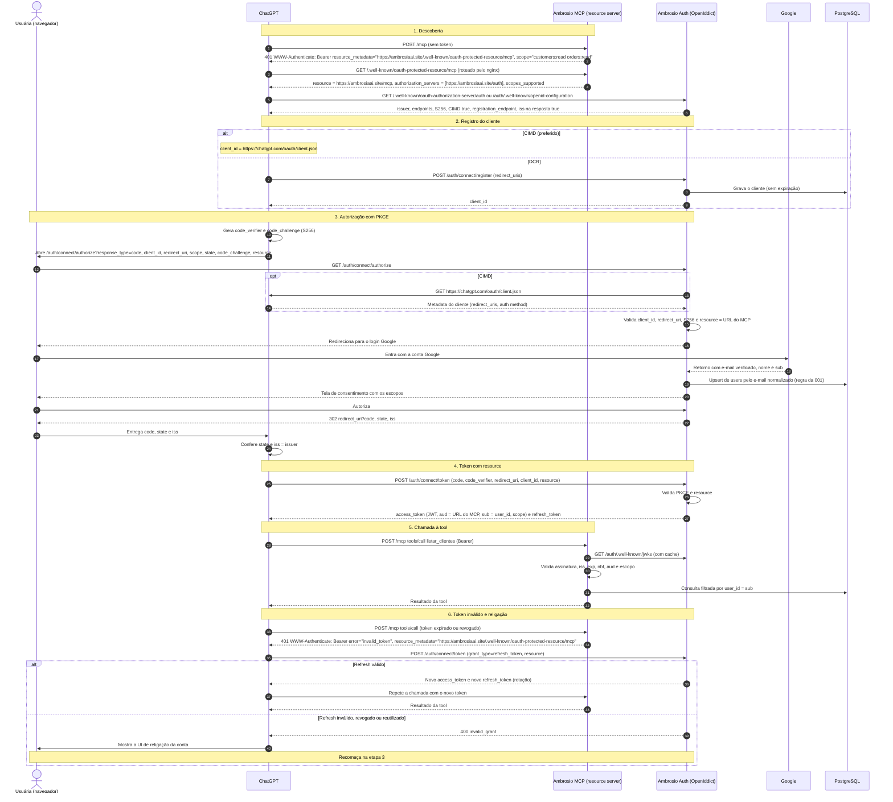

# 008 — OAuth 2.1 para usar o MCP no ChatGPT

> Documento da história de usuário 008: authorization server OAuth 2.1 e validação de tokens no MCP, conforme a especificação de autorização do MCP e os requisitos do ChatGPT.

**Created:** 2026-10-25
**Last Updated:** 2026-10-25

| Campo | Valor |
|---|---|
| ID | 008 |
| Status | Planejada |
| Spec | — |
| Depende de | [007](007-mcp-servidor-completo.md) (MCP, que vira o resource server) e [001](001-api-cadastro-clientes-pedidos.md) (usuários e login Google) |
| Habilita | [009](009-mcp-app-chatgpt.md) e [010](010-banco-imagens-clientes-chatgpt.md) |
| Código previsto | `backend/Ambrosio.Auth/` (authorization server, novo) e ajustes em `backend/Ambrosio.McpServer/` |
| Fonte dos requisitos | Documentação da OpenAI, [Apps SDK: Authentication](https://developers.openai.com/apps-sdk/build/auth), consultada em 25/10/2026, e especificação de autorização do MCP (revisão 2025-11-25) |

---

## 1. História

**Como** vendedora, **quero** conectar o Ambrosio ao ChatGPT entrando com a minha conta Google e autorizando o que ele pode fazer, **para** que o ChatGPT acesse só os meus dados, com permissões que eu escolhi, sem eu copiar token nenhum.

## 2. Contexto e objetivo

- A [007](007-mcp-servidor-completo.md) aceita, provisoriamente, o JWT HS256 da API. O ChatGPT não funciona assim: ele exige OAuth 2.1 com authorization code e PKCE.
- O ChatGPT **não** suporta client credentials, JWT bearer assertion nem API key customizada.
- Papéis: o **servidor MCP** é o resource server, o **authorization server** (AS) emite os tokens e o **ChatGPT** é o client.
- Esta HU é separada da [009](009-mcp-app-chatgpt.md) a pedido do usuário: aqui fica só a autorização; o registro do app e as descrições das tools ficam lá.
- A constituição ainda tem `TODO(AUTH_SCHEME)` (Princípio VI). Esta HU propõe uma decisão que pode encerrar esse TODO.

### Endereços canônicos (definidos em 25/10/2026)

Estes valores entram nos tokens e nos metadados. Depois de publicados, não podem mudar (ver riscos).

| Item | Valor |
|---|---|
Tudo fica no domínio principal, em subpastas, com cada serviço como processo próprio atrás do nginx (roteamento na [002](002-frontend-web-perfil-cliente-pedidos.md#roteamento-em-produção)).

| Item | Valor |
|---|---|
| Issuer do AS | `https://ambrosiaai.site/auth` (exatamente assim, **sem** barra no final) |
| Metadata do AS (RFC 8414) | `https://ambrosiaai.site/.well-known/oauth-authorization-server/auth`. Com issuer que tem caminho, o `/.well-known/…` entra **antes** do caminho |
| Discovery OIDC | `https://ambrosiaai.site/auth/.well-known/openid-configuration` (o caminho do issuer seguido de `/.well-known/openid-configuration`) |
| Endpoints do AS (propostos) | `/connect/authorize`, `/connect/token`, `/connect/register`, `/connect/userinfo`, `/connect/revoke` e `/.well-known/jwks`, todos sob `https://ambrosiaai.site/auth` (por exemplo, `https://ambrosiaai.site/auth/connect/token`) |
| Servidor MCP e `resource` canônico | `https://ambrosiaai.site/mcp` |
| `aud` do access token | `https://ambrosiaai.site/mcp`, com comparação exata |
| Protected Resource Metadata (RFC 9728) | `https://ambrosiaai.site/.well-known/oauth-protected-resource/mcp` (o caminho do `resource` vai depois do `/.well-known/…`). Publicar também em `https://ambrosiaai.site/.well-known/oauth-protected-resource`, sem o caminho, por compatibilidade |
| `authorization_servers` no PRM | `["https://ambrosiaai.site/auth"]` |

Os documentos da raiz `/.well-known/*` são servidos pelo nginx, que roteia cada um para o serviço dono dele: `oauth-authorization-server/auth` vai para o AS e `oauth-protected-resource` (com e sem `/mcp`) vai para o MCP. Nenhum deles pode cair no fallback do SPA nem no service worker do PWA ([005](005-frontend-pwa.md)).

As rotas de login da API — `/auth/google`, da 001, e `/auth/register` e `/auth/login`, da spec [`003-email-password-jwt-auth`](../../specs/003-email-password-jwt-auth/) — passam a ficar sob a API, em `https://ambrosiaai.site/api/auth/*`. Elas não colidem com o AS, que ocupa `https://ambrosiaai.site/auth/*` sem o prefixo `/api`.

A entrada de desenvolvimento `/auth/dev-login` não existe mais: a 003 a removeu de **todos** os ambientes (responde 404) e a substituiu por cadastro e login com e-mail e senha. Para o AS isso não muda nada — quem entra com Google continua usando `/auth/google`, e a conta passa a poder ter também senha (`users.password_hash`), removida quando o login Google a reutiliza (FR-009).

---

## 3. Requisitos do ChatGPT (verificados em 25/10/2026)

| # | Requisito | Onde se aplica |
|---|---|---|
| R1 | OAuth 2.1 conforme a especificação de autorização do MCP (2025-11-25): authorization code + PKCE com **S256** obrigatório | AS |
| R2 | Protected Resource Metadata (RFC 9728) em `GET /.well-known/oauth-protected-resource` (com o caminho do `resource` no final, quando houver: `/.well-known/oauth-protected-resource/mcp`), com `resource` (URL canônica do MCP), `authorization_servers` e `scopes_supported` | MCP |
| R3 | Respostas 401 com `WWW-Authenticate: Bearer resource_metadata="https://ambrosiaai.site/.well-known/oauth-protected-resource/mcp", scope="…"`. O ChatGPT segue essa URL, então a descoberta do PRM não depende de adivinhar o caminho | MCP |
| R4 | Authorization Server Metadata em `/.well-known/oauth-authorization-server` ou `/.well-known/openid-configuration` (para issuer com caminho, nas variantes da seção 2), com `issuer` idêntico ao de `authorization_servers`, `authorization_endpoint`, `token_endpoint`, `code_challenge_methods_supported` com `S256` (sem isso não funciona) e `token_endpoint_auth_methods_supported` | AS |
| R5 | Registro do cliente, preferencialmente por **CIMD**: `client_id_metadata_document_supported: true`. O `client_id` é a URL `https://chatgpt.com/oauth/client.json` (ou `/oauth/{callback_id}/client.json`), com autenticação `none` ou `private_key_jwt` | AS |
| R6 | Alternativa: **DCR** (`registration_endpoint`). O ChatGPT registra uma vez por conexão, e as credenciais precisam continuar válidas enquanto a conexão existir, senão dá `invalid_client` | AS |
| R7 | Redirect URI `https://chatgpt.com/connector_platform_oauth_redirect` quando o AS suporta RFC 9207 (`authorization_response_iss_parameter_supported: true`, e toda resposta de autorização inclui `iss` idêntico ao issuer). Caso contrário, `https://chatgpt.com/connector/oauth/{callback_id}`. Copiar a URI exata exibida no painel | AS |
| R8 | O ChatGPT envia `resource=https://ambrosiaai.site/mcp` na autorização e no token. O AS coloca esse valor no `aud` do token | AS |
| R9 | O MCP valida em toda chamada: assinatura (JWKS), `iss`, `exp`/`nbf`, `aud`/`resource` e escopos. Em falha, responde 401 com `WWW-Authenticate` | MCP |
| R10 | Escopos OIDC (`openid`, `email`, `profile`) são pedidos por padrão quando anunciados. Workspaces Enterprise com restrição de domínio exigem `userinfo` com `email` e `email_verified: true` | AS |
| R11 | Sem client credentials, JWT bearer assertion ou API key customizada | — |

---

## 4. Escopo

### Dentro do escopo

- Authorization server com metadata, `authorize`, `token`, `jwks`, `userinfo`, revogação e registro de cliente (CIMD e DCR).
- Login no AS federado com o Google, reaproveitando a regra da 001 (e-mail verificado e upsert de `users` pelo e-mail normalizado).
- Tela de consentimento com os escopos pedidos, em português.
- Access token JWT assinado com chave assimétrica, `aud` = URL canônica do MCP e `sub` = `user_id`.
- Refresh token com rotação.
- No MCP: Protected Resource Metadata, 401 com `WWW-Authenticate`, validação completa do token e checagem de escopo por tool.
- Desligar o JWT HS256 da API como credencial aceita no MCP em produção.

### Fora do escopo

- Registro do app no ChatGPT, `securitySchemes` por tool e `_meta["mcp/www_authenticate"]` ([009](009-mcp-app-chatgpt.md)).
- Migrar o frontend ([002](002-frontend-web-perfil-cliente-pedidos.md)) e a API REST para os tokens do AS. Pode virar uma HU futura.
- Login por senha.
- Tela de gestão das conexões autorizadas (só o endpoint de revogação entra).

---

## 5. Critérios de aceite (a cumprir)

| # | Critério | Como verificar |
|---|---|---|
| 1 | `GET https://ambrosiaai.site/.well-known/oauth-protected-resource/mcp` devolve JSON (não o HTML do SPA) com `resource: "https://ambrosiaai.site/mcp"`, `authorization_servers: ["https://ambrosiaai.site/auth"]` e `scopes_supported`. A variante sem caminho (`https://ambrosiaai.site/.well-known/oauth-protected-resource`) devolve o mesmo | `curl` |
| 2 | `POST https://ambrosiaai.site/mcp` sem token devolve 401 com `WWW-Authenticate: Bearer resource_metadata="https://ambrosiaai.site/.well-known/oauth-protected-resource/mcp", scope="…"` | `curl -i` |
| 3 | `https://ambrosiaai.site/.well-known/oauth-authorization-server/auth` e `https://ambrosiaai.site/auth/.well-known/openid-configuration` respondem com o mesmo conteúdo. O metadata tem `issuer` exatamente igual a `https://ambrosiaai.site/auth` (sem barra no final) e idêntico ao valor de `authorization_servers`, `code_challenge_methods_supported` com `S256`, `client_id_metadata_document_supported: true`, `registration_endpoint`, `authorization_response_iss_parameter_supported: true` e `token_endpoint_auth_methods_supported` com `none` e `private_key_jwt` | `curl` |
| 4 | Autorização sem `code_challenge`, ou com `plain`, é recusada | Requisição manual |
| 5 | Com CIMD, o AS baixa `https://chatgpt.com/oauth/client.json`, valida o documento e só aceita `redirect_uri` listada nele | Log do AS |
| 6 | Com DCR, o `client_id` emitido continua válido indefinidamente enquanto a conexão existir (sem expiração automática) | Reconectar após dias |
| 7 | Toda resposta de autorização (sucesso e erro) inclui `iss` idêntico ao issuer | Inspecionar o redirect |
| 8 | O token emitido tem `aud` igual ao `resource` enviado (`https://ambrosiaai.site/mcp`) e `iss` igual a `https://ambrosiaai.site/auth`. Pedido sem `resource`, ou com `resource` diferente de `https://ambrosiaai.site/mcp` (inclusive com barra no final), é recusado | Decodificar o JWT |
| 9 | O login no AS é com Google. Um e-mail não verificado é recusado. O mesmo e-mail cai no mesmo `user_id` da API | Comparar `sub` com `GET /api/users/me` |
| 10 | A tela de consentimento lista os escopos pedidos em português, e a usuária pode negar | Fluxo manual |
| 11 | O MCP recusa com 401 tokens com assinatura inválida, `iss` errado, expirados, ainda não válidos (`nbf`) ou com `aud` diferente | Testes com tokens adulterados |
| 12 | Uma tool chamada sem o escopo necessário recebe 403 `insufficient_scope` com o escopo faltante no `WWW-Authenticate` | Token só com `customers:read` chamando `cadastrar_cliente` |
| 13 | `userinfo` devolve `sub`, `email`, `email_verified: true` e `name` | `curl` com o token |
| 14 | O refresh token gira a cada uso. Um refresh token reutilizado invalida a família inteira | Reusar o refresh antigo |
| 15 | Em produção o MCP não aceita mais o JWT HS256 da API | Chamar com token da API |
| 16 | O fluxo completo funciona no ChatGPT em modo desenvolvedor (conectar, usar tool, desconectar, religar) | Teste manual na [009](009-mcp-app-chatgpt.md) |

---

## 6. Escopos

| Escopo | Permite | Tools ([007](007-mcp-servidor-completo.md) e [010](010-banco-imagens-clientes-chatgpt.md)) |
|---|---|---|
| `openid`, `email`, `profile` | Identidade OIDC e `userinfo` | — |
| `offline_access` | Emissão de refresh token | — |
| `customers:read` | Ler clientes e o resumo de compras | `obter_usuario_atual`, `listar_clientes`, `obter_cliente`, `buscar_cliente`, `clientes_inativos`, `historico_cliente`*, `listar_fotos_cliente` |
| `customers:write` | Cadastrar e atualizar clientes | `cadastrar_cliente`, `atualizar_cliente` |
| `orders:read` | Ler pedidos e itens | `listar_pedidos`, `obter_pedido`, `listar_itens_pedido`, `resumo_periodo`, `devolucoes_cancelamentos`, `historico_cliente`* |
| `orders:write` | Cadastrar e atualizar pedidos | `cadastrar_pedido`, `atualizar_pedido` |
| `images:write` | Enviar, alterar e excluir fotos de clientes | `anexar_fotos_cliente`, `definir_foto_principal`, `atualizar_foto`, `excluir_foto` |

\* Exige os dois escopos. `consultar_graphql` exige `customers:read` e `orders:read`, porque o schema mistura os dois. A leitura de fotos fica em `customers:read` (ver perguntas em aberto sobre um `images:read` separado).

---

## 7. Decisão: authorization server próprio ou IdP externo

| Critério | Próprio no .NET (OpenIddict) | Auth0 | Keycloak (self-hosted) |
|---|---|---|---|
| PKCE S256 | Sim | Sim | Sim |
| CIMD | Não nativo: exige handler próprio que baixa e valida o documento | A verificar | A verificar |
| DCR | Não nativo: endpoint próprio sobre o `IOpenIddictApplicationManager` | Sim (registro dinâmico, com restrições para apps de terceiros) | Sim (registro anônimo com políticas de hosts confiáveis) |
| RFC 9207 (`iss` na resposta) | Suportado nas versões recentes (a confirmar) | A verificar | Sim |
| `resource` (RFC 8707) no `aud` | Controle total: `SetResources` ou handler próprio | Usa `audience`. Suporte a `resource`: a verificar | Não nativo: exige *mapper* de audiência |
| Login Google | Federação com o handler do ASP.NET Core ou o cliente do OpenIddict | Conexão social pronta | *Identity provider* pronto |
| Mapear para `users` do Ambrosio | Direto: mesma base e mesma regra da 001 | Por e-mail, com sincronização ou *just-in-time* | Por e-mail, com sincronização ou *just-in-time* |
| Custo | Só infraestrutura | Plano gratuito com limites. Pago ao crescer | Infraestrutura (Java e banco próprios) |
| Operação | Rotação de chaves, atualização de pacote e segurança por nossa conta | Gerenciado | Atualizações, backup e *hardening* por nossa conta |
| Aderência à stack | Total (.NET 8, EF Core, PostgreSQL) | Externa | Externa (outra stack) |
| Risco de segurança | Maior: implementamos fluxos sensíveis | Menor | Médio |

**Recomendação: authorization server próprio no .NET com OpenIddict**, num processo `Ambrosio.Auth` publicado em `https://ambrosiaai.site/auth` (issuer `https://ambrosiaai.site/auth`), federando o login Google que já existe e gravando em `users` com a mesma regra da 001.

Motivos:

1. **CIMD e `resource` são os pontos mais novos dos requisitos.** Nos IdPs externos o suporte está incerto e fora do nosso controle; no OpenIddict os dois são handlers nossos.
2. **Uma única base de usuários.** O `sub` do token é o `user_id` do Ambrosio, sem sincronização nem mapeamento por e-mail entre sistemas.
3. **Mesma stack** (.NET 8, EF Core e PostgreSQL), sem custo de licença e sem novo runtime para operar.
4. **Fecha o `TODO(AUTH_SCHEME)`** da constituição com uma decisão explícita e reutilizável pela API e pelo frontend no futuro.

Contrapartidas assumidas: implementar e testar CIMD e DCR, cuidar da rotação de chaves e acompanhar as atualizações de segurança do OpenIddict. Se o esforço ficar alto demais, o plano B é o Keycloak, que já cobre DCR e RFC 9207.

### Decisões técnicas

| Tema | Proposta |
|---|---|
| Biblioteca | OpenIddict (servidor e validação) com armazenamento EF Core no mesmo PostgreSQL, em tabelas próprias (`openiddict_*`, convertidas para snake_case) |
| Formato do token | JWT assinado (RS256 ou ES256). **Desligar a criptografia do access token** (o OpenIddict criptografa por padrão), senão o MCP não valida pelo JWKS |
| Validade | Access token de 30 min. Refresh token de 14 dias, deslizante e com rotação |
| Claims | `sub` (= `user_id`), `iss`, `aud` (= URL do MCP), `scope`, `exp`, `nbf`, `iat`, `client_id`. `email` e `name` só no ID token e no `userinfo` |
| CIMD | Handler que, quando o `client_id` é uma URL `https`, baixa o documento com proteções contra SSRF (só `https`, sem IP privado, *timeout* de 5 s, limite de 64 KB e cache respeitando os headers), valida `client_id` igual à URL, `redirect_uris` e o método de autenticação. Para `private_key_jwt`, usa o `jwks_uri` do documento |
| DCR | `POST /connect/register` que aceita só `redirect_uris` da lista de permitidas do ChatGPT e emite cliente público (`none`) sem data de expiração |
| Redirect URIs permitidas | `https://chatgpt.com/connector_platform_oauth_redirect` e `https://chatgpt.com/connector/oauth/{callback_id}` (padrão), conforme o painel |
| Login | Desafio externo do Google. Reaproveitar a regra do `AuthService.UpsertAsync` da 001 (extrair para um serviço comum) |
| Consentimento | Tela Razor simples em português. Autorização permanente guardada pelo OpenIddict, para não pedir de novo em cada religação |
| MCP | `AddJwtBearer` com `Authority` = `https://ambrosiaai.site/auth` (o handler busca `https://ambrosiaai.site/auth/.well-known/openid-configuration` e, dali, o JWKS), `ValidIssuer` = `https://ambrosiaai.site/auth`, `ValidAudience` = `https://ambrosiaai.site/mcp`, política por escopo em cada tool e um `IAuthenticationHandler`/evento que monta o `WWW-Authenticate` exigido |
| Chaves | Chave de assinatura em arquivo protegido ou cofre, com rotação publicada no JWKS (chave antiga mantida até expirar o último token) |
| Configuração | Seções `Auth:Issuer` (`https://ambrosiaai.site/auth`), `Auth:Google:*`, `Auth:SigningKey*`, `Mcp:ResourceUrl` (`https://ambrosiaai.site/mcp`) e `Mcp:AuthorizationServer` (`https://ambrosiaai.site/auth`), com validação no startup como na 001. A validação recusa valores com barra no final |
| Issuer com caminho no OpenIddict | Configurar o issuer **explicitamente** (`SetIssuer(new Uri("https://ambrosiaai.site/auth"))`). Sem isso, o OpenIddict deduz o issuer da requisição, e atrás do proxy ele pode sair sem `/auth` ou com `http://`. Os endpoints (`/connect/*`, `/.well-known/jwks`) também ficam configurados sob `/auth`, e o host usa `UsePathBase("/auth")` e *forwarded headers*. A spec confere que o metadata, o `iss` do token e o `iss` da resposta de autorização saem exatamente `https://ambrosiaai.site/auth`, sem barra no final |
| Metadata nos dois endereços | Publicar o mesmo documento em `https://ambrosiaai.site/.well-known/oauth-authorization-server/auth` (RFC 8414, roteado pelo nginx da raiz para o AS) e em `https://ambrosiaai.site/auth/.well-known/openid-configuration` (OIDC, servido pelo próprio AS). A especificação de autorização do MCP também lista a variante OIDC com inserção de caminho (`/.well-known/openid-configuration/auth`); publicá-la custa pouco e fica a critério da spec |
| Plano de contingência | Se a descoberta com caminho falhar nos testes do ChatGPT, usar subdomínios `auth.` e `mcp.` |

### Fluxo completo

---

## 8. Dependências

| HU | Tipo | Motivo |
|---|---|---|
| [007](007-mcp-servidor-completo.md) | Obrigatória | O MCP é o resource server que valida os tokens |
| [001](001-api-cadastro-clientes-pedidos.md) | Obrigatória | Tabela `users` e regra de login Google |
| DNS, TLS e nginx de `ambrosiaai.site` | Obrigatória | Issuer e URL do MCP precisam ser HTTPS públicos e estáveis (o `issuer` não pode mudar). O nginx roteia `/auth/`, `/mcp` e os documentos de `/.well-known/` antes do fallback do SPA ([002](002-frontend-web-perfil-cliente-pedidos.md#roteamento-em-produção)) |
| Projeto Google Cloud | Obrigatória | Cliente OAuth do Google com o redirect do AS sob `https://ambrosiaai.site/auth` (por exemplo, `https://ambrosiaai.site/auth/signin-google`, com o caminho padrão do handler Google do ASP.NET Core sob o `PathBase`; o definitivo sai da spec) |

---

## 9. Riscos

| Risco | Impacto | Mitigação |
|---|---|---|
| Os requisitos do ChatGPT mudam (CIMD é recente) | Conexão para de funcionar | Revisar a página da OpenAI a cada release e manter DCR como alternativa ativa |
| SSRF pelo `client_id` em URL (CIMD) | O AS faz requisições para destinos internos | Proteções do handler (só `https`, sem IP privado, limites de tempo e tamanho) e, opcionalmente, lista de hosts permitidos (`chatgpt.com`) |
| `issuer` ou URL do MCP mudam depois de publicados | Todas as conexões quebram (`aud` e `iss` deixam de bater) | Domínios definidos em 25/10/2026 (seção 2, "Endereços canônicos"). Tratar os dois valores como imutáveis |
| Diferença de uma barra no final (`https://ambrosiaai.site/auth` contra `https://ambrosiaai.site/auth/`, ou `https://ambrosiaai.site/mcp` contra `https://ambrosiaai.site/mcp/`) | O ChatGPT ou o MCP recusam o `iss` ou o `aud`, e a conexão falha sem mensagem clara | Decisão "Issuer com caminho no OpenIddict" e critérios 3 e 8 |
| Não se sabe qual URL de metadata do AS o ChatGPT consulta para um issuer com caminho (RFC 8414 com inserção do caminho ou OIDC com o caminho antes do `/.well-known`) | A descoberta do AS falha e o ChatGPT não conecta | Publicar as duas variantes com o mesmo conteúdo, confirmar no log do nginx durante o teste em modo desenvolvedor ([009](009-mcp-app-chatgpt.md)) e, se falhar, aplicar o plano de contingência (subdomínios `auth.` e `mcp.`). O PRM tem risco menor, porque o ChatGPT segue o `resource_metadata` do 401 |
| `/.well-known/*` ou `/mcp` engolidos pelo fallback do SPA ou pelo service worker do PWA | A descoberta recebe HTML e falha | Rotas do nginx antes do fallback ([002](002-frontend-web-perfil-cliente-pedidos.md)) e `navigateFallbackDenylist` da [005](005-frontend-pwa.md) |
| AS, MCP e SPA na mesma origem | Um XSS no SPA pode fazer requisições às telas do AS com o cookie de sessão dele | Cookie do AS com `HttpOnly`, `Secure`, `SameSite=Lax` e `Path=/auth`, tela de consentimento com proteção antiforgery e a CSP restritiva da [002](002-frontend-web-perfil-cliente-pedidos.md#8-riscos) |
| Confusão entre `/api/auth/*` (login da 001) e `/auth/*` (AS) | Rota errada no proxy ou no cliente | Prefixos distintos no nginx (`/api/` vai para a API inteira, `/auth/` para o AS) e testes de fumaça das duas rotas |
| Implementação própria de OAuth com falha | Acesso indevido | Testes de conformidade, revisão de segurança (skill `security-review`) e uso só de fluxos do OpenIddict, sem criptografia caseira |
| Perda ou vazamento da chave de assinatura | Tokens forjados | Cofre, rotação e revogação de todas as autorizações em caso de incidente |
| Dois esquemas de token convivendo (HS256 da API e JWT do AS) | Confusão e aceitação indevida | `aud` distintos, critério 15 e plano de migração da API numa HU futura |

---

## 10. Perguntas em aberto

1. A recomendação (OpenIddict próprio) está aprovada, ou o Keycloak deve ser avaliado numa prova de conceito antes?
2. Criar `images:read` separado de `customers:read`, para a usuária poder negar o acesso às fotos?
3. Validades: access token de 30 min e refresh de 14 dias estão bons?
4. A API REST e o frontend vão migrar para os tokens do AS (e o HS256 sai)? Se sim, em qual HU?
5. O ChatGPT pede `offline_access` para receber refresh token, ou espera o refresh token sem esse escopo? Confirmar no teste em modo desenvolvedor.

Resolvida em 25/10/2026: os endereços definitivos são o issuer `https://ambrosiaai.site/auth` e o MCP `https://ambrosiaai.site/mcp`, ambos em subpasta do domínio principal (seção 2). Segue em aberto só a confirmação, no teste com o ChatGPT, de qual URL de metadata ele consulta (ver riscos).
