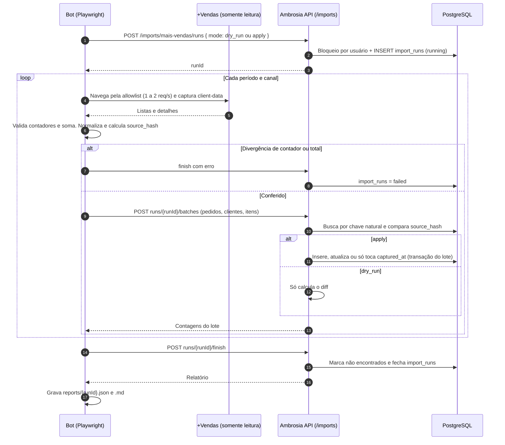

# 009 — Bot de migração idempotente do +Vendas para o Ambrosia

> Documento da história de usuário 009: bot Playwright, somente leitura no +Vendas, que migra vendas e clientes para o Ambrosia de forma idempotente, com dry-run e relatório por execução.

**Created:** 2026-10-25
**Last Updated:** 2026-10-25

| Campo | Valor |
|---|---|
| ID | 009 |
| Status | Planejada |
| Spec | — |
| Depende de | [001](001-api-cadastro-clientes-pedidos.md) (API, modelo e proteção do CPF) |
| Base | [Doc 01](../01-analise-sistema-mais-vendas.md) (análise do +Vendas), [doc 02](../02-modelo-de-dados.md) (modelo) e [doc 03](../03-bot-playwright.md) (bot) |
| Código previsto | `bot/` (Node.js + TypeScript + Playwright) e um endpoint de importação no `backend/` |

---

## 1. História

**Como** vendedora, **quero** que as minhas vendas e clientes do +Vendas sejam copiadas para o Ambrosia quantas vezes eu precisar, sem duplicar nada, **para** ter a minha base própria sempre atualizada, inclusive com as correções que o +Vendas faz até o fechamento do mês de cota.

## 2. Contexto e objetivo

- O [doc 03](../03-bot-playwright.md) já define o bot de coleta: Playwright, somente leitura, allowlist, ritmo lento, etapas de coleta e validação por contadores.
- O [doc 01](../01-analise-sistema-mais-vendas.md#3-tela-cota-cotapiloto) mostra que o +Vendas **altera vendas** até o fim do primeiro dia útil depois do fechamento, e que o mês de cota **fecha no dia 25**.
- Por isso o bot precisa ser **idempotente**: pode rodar de novo durante o mês de cota (e logo depois do fechamento) sem duplicar registros, atualizando só o que mudou.
- O Ambrosia da 001 já tem a chave natural de pedido `(user_id, order_number, order_date, kind)` e a unicidade de cliente `(user_id, cpf_hash)`, alinhadas ao [doc 02, princípio de idempotência](../02-modelo-de-dados.md#princípios) e ao [doc 01, ponto 4](../01-analise-sistema-mais-vendas.md#7-pontos-em-aberto) (número do pedido sozinho não é chave).

### O que se reaproveita do doc 03 sem mudança

| Tema | Decisão do doc 03 |
|---|---|
| Segurança | Nunca clicar em "Novo carrinho", "Sair" ou botões que criem ou alterem dados. Allowlist de rotas e seletores. Não seguir o menu BOX (`somabox`) |
| Credenciais | Só em variáveis de ambiente (`.env` fora do git). `auth/state.json` também fora do git |
| Ritmo | 1 a 2 requisições por segundo no máximo, com pausas aleatórias, fora do horário de pico |
| Termos de uso | Conferir os termos da Somalabs antes de automatizar |
| Etapa 0 | Escutar `POST /salesperson/orders/client-data` e usar a resposta quando ela trouxer os dados, raspando o DOM só para o que faltar |
| Coleta | Etapas 1 a 5 (login, períodos, lista da Cota, lista Omni e detalhe) |
| Validação | O contador da aba deve bater com as linhas lidas e o total exibido com a soma. Se divergir, falhar a execução |
| Normalização | Valores `R$` para decimal, CPF só com dígitos, ano deduzido pelo período e confirmado pela URL |
| Erros | Retry com backoff para "Erro ao carregar …" e abortar depois de 3 falhas |

---

## 3. Escopo

### Dentro do escopo

- Coleta conforme o doc 03 (etapas 0 a 5), para pedidos de venda, devolução e cancelamento, com itens e cliente.
- Gravação idempotente no Ambrosia (upsert por chave natural, detecção de mudança por `source_hash`).
- Modo **dry-run**: coleta e calcula o que seria inserido, atualizado ou mantido, sem gravar nada.
- **Log e relatório** de cada execução (arquivo e registro no banco).
- Períodos: mês de cota corrente, competência anterior enquanto estiver aberta e carga histórica mês a mês.
- Bloqueio de execuções simultâneas para o mesmo usuário.
- Agendamento (Task Scheduler ou cron) documentado.

### Fora do escopo

- KPIs de cota, supercota, PA, VA e TMA (`sales_period`, `period_kpi` do doc 02). Ficam para uma HU futura, porque a 001 não tem essas tabelas.
- Cópia das imagens dos produtos para o S3 ([doc 03, etapa 5b](../03-bot-playwright.md#etapa-5b-fotos-das-peças)). Fica para uma HU futura sobre a [003](003-armazenamento-imagens-s3.md). Nesta HU, `image_url` continua guardando a URL de origem.
- Pedidos Extras (lista vazia no levantamento) e Carrinhos.
- Qualquer escrita no +Vendas.

---

## 4. Critérios de aceite (a cumprir)

| # | Critério | Como verificar |
|---|---|---|
| 1 | Rodar duas vezes seguidas, sem mudança na origem, não cria nem altera nada na segunda vez (tudo "inalterado") | Relatório da 2ª execução |
| 2 | Um pedido com valor ou status alterado na origem é atualizado e aparece como "atualizado" no relatório, com os campos que mudaram | Simular mudança no payload capturado |
| 3 | O mesmo número de pedido em datas diferentes gera pedidos diferentes ([doc 01, ponto 4](../01-analise-sistema-mais-vendas.md#7-pontos-em-aberto)) | Pedido `41900001` em 28/set e 05/out |
| 4 | Uma venda e o cancelamento dela geram dois registros (`sale` positivo e `cancellation` negativo), como no +Vendas | Pedido cancelado |
| 5 | O mesmo CPF em vários pedidos gera um único cliente | Cliente com várias compras |
| 6 | Em dry-run, nenhuma linha é gravada no Ambrosia, e o relatório mostra o que seria inserido, atualizado e mantido | Comparar contagens antes e depois |
| 7 | Se o contador da aba divergir das linhas lidas ou o total divergir da soma, a execução falha sem gravar o período | Forçar divergência em teste |
| 8 | A execução interrompida no meio pode ser repetida e termina com o mesmo resultado de uma execução completa | Matar o processo no meio |
| 9 | Duas execuções simultâneas do mesmo usuário não acontecem: a segunda termina com "já existe execução em andamento" | Rodar em dois terminais |
| 10 | Cada execução gera um relatório com id, modo, períodos, contagens por período, canal e tipo (inseridos, atualizados, inalterados, com erro), duração e resultado | `bot/reports/` e `import_runs` |
| 11 | O total líquido do Ambrosia no período 26/09 a 25/10/2026 confere com a tela: R$ 123.300,58 em 49 pedidos ([doc 04, ordem de implementação](../04-mcp-consultas-llm.md#ordem-de-implementação)) | `GET /orders` ou GraphQL `salesSummary` |
| 12 | O bot nunca acessa rota fora da allowlist e nunca clica em seletor fora dela | Log de navegação e teste com rota proibida |
| 13 | O CPF nunca aparece em log, relatório ou arquivo do bot (só mascarado) | Busca por padrão de CPF em `bot/logs` e `bot/reports` |
| 14 | Pedidos que sumiram da origem não são apagados no Ambrosia. Aparecem no relatório como "não encontrados nesta execução" | Simular ausência |

---

## 5. Idempotência

| Elemento | Regra |
|---|---|
| Chave natural do pedido | `(user_id, order_number, order_date, kind)`, a mesma unicidade da 001 e do [doc 02](../02-modelo-de-dados.md#tabelas--fase-1-espelho-do-vendas) (`salesperson_id` vira `user_id`) |
| Chave natural do cliente | `(user_id, cpf_hash)`. O nome é atualizado se mudar na origem |
| `source_hash` | SHA-256 do payload **normalizado** do pedido (campos do pedido, cliente por `cpf_hash` e itens ordenados por `line_no`), em JSON canônico (chaves ordenadas, decimais com 2 casas, datas ISO). Não entra `captured_at` |
| `captured_at` | Data e hora (UTC) da última captura em que o pedido foi visto |
| `source_changed_at` | Data e hora da última vez em que o `source_hash` mudou |
| Upsert | Pedido inexistente: insere. Existe com o mesmo hash: só atualiza `captured_at`. Existe com hash diferente: atualiza os campos e **substitui** os itens, gravando a mudança |
| Itens | Sempre substituídos em bloco quando o hash muda (`line_no` 1, 2, …), dentro da mesma transação do pedido |
| Transação | Um lote por período e canal. Falha no lote desfaz o lote inteiro |
| Origem | `external_id` recebe o 4º segmento da URL de detalhe quando disponível ([doc 01, ponto 1](../01-analise-sistema-mais-vendas.md#7-pontos-em-aberto)). `source` = `mais-vendas` |
| Reexecução | Pode rodar quantas vezes quiser. Até 1 dia útil depois do dia 25, re-coleta também a competência anterior ([doc 03, etapa 6](../03-bot-playwright.md#etapa-6-persistência)) |

### Alterações de modelo propostas (sobre a 001)

| Tabela | Alteração |
|---|---|
| `orders` | Novas colunas `source` (int: `manual=1`, `mais_vendas=2`), `source_hash` (varchar 64, nulo para pedidos manuais), `captured_at`, `source_changed_at` |
| `import_runs` (nova) | `import_run_id`, `user_id`, `mode` (`dry_run=1`, `apply=2`), `status` (`running=1`, `succeeded=2`, `failed=3`), `started_at`, `finished_at`, `periods` (texto), contagens (`inserted`, `updated`, `unchanged`, `missing`, `failed`), `error_message`, `bot_version` |
| `import_run_changes` (nova) | `import_run_change_id`, `import_run_id`, `order_id` (nulo em dry-run), chave natural, `action` (`insert=1`, `update=2`, `missing=3`), `changed_fields` (texto) |

Payload bruto: o [doc 02](../02-modelo-de-dados.md#princípios) recomenda guardar o payload capturado (`raw_snapshot`). A proposta é guardar o JSON bruto de cada execução como arquivo **no bot** (`bot/data/raw/{runId}/`), fora do git, até que exista a [003](003-armazenamento-imagens-s3.md) para mandar ao storage. O bruto contém CPF, então precisa da mesma proteção do `.env`.

---

## 6. Decisões técnicas propostas

### O bot grava pela API do Ambrosia ou direto no banco?

| Critério | Pela API (endpoint de importação) | Direto no PostgreSQL |
|---|---|---|
| Proteção do CPF | A API já calcula `cpf_hash` (HMAC com *pepper*), `cpf_encrypted` (AES-256-GCM) e `cpf_masked`. O bot **não** precisa conhecer os segredos | O bot precisaria do *pepper* e da chave AES e de reimplementar a cifra em Node, com risco de divergência e de vazamento |
| Regras de domínio | Reaproveitadas: sinal do total, data não futura, itens obrigatórios, unicidade | Reimplementadas no bot ou ignoradas |
| Isolamento | `user_id` vem do token, como em toda a API | O bot escolhe o `user_id` sozinho |
| Desempenho | Lotes por período tornam o custo aceitável | Mais rápido |
| Acoplamento ao schema | Nenhum: o bot depende de um contrato | Qualquer migração quebra o bot |
| Dry-run | O servidor calcula o diff com as mesmas regras do modo real | O bot calcula o diff sozinho |

**Recomendação: gravar pela API**, por um endpoint de importação novo. A 001 não serve como está para isso: `POST /orders` responde 409 em duplicidade, `PUT /orders/{id}` só altera status e total, não há busca de cliente por CPF e não existem `source_hash` e `captured_at`.

Contrato proposto (detalhado na spec). As rotas são relativas à base da API, que em produção é `https://ambrosiaai.site/api` (por exemplo, `https://ambrosiaai.site/api/imports/mais-vendas/runs`):

| Método | Rota | Função |
|---|---|---|
| POST | `/imports/mais-vendas/runs` | Abre uma execução (`mode`), com bloqueio por usuário. Responde 409 se já houver outra em andamento |
| POST | `/imports/mais-vendas/runs/{runId}/batches` | Envia um lote (período, canal e pedidos com cliente e itens). Faz o upsert, ou só o diff em dry-run, numa transação |
| POST | `/imports/mais-vendas/runs/{runId}/finish` | Fecha a execução, calcula os "não encontrados" e devolve o relatório |
| GET | `/imports/mais-vendas/runs/{runId}` | Relatório de uma execução |

### Demais decisões

| Tema | Proposta |
|---|---|
| Stack do bot | Node.js + TypeScript + `playwright` + `zod`, como no [doc 03](../03-bot-playwright.md#stack). Sai o `pg`/`better-sqlite3`, porque o bot não grava no banco |
| Autenticação do bot na API | Token de longa duração do usuário, com escopo restrito à importação. Ver perguntas em aberto (o `dev-login` só existe em Development e o login Google não é viável sem interface) |
| CLI | `npm run migrate -- --mode=<dry-run ou apply> --periods=<current, previous ou AAAA-MM> --channel=<canal>` |
| Endereço da API | Variável `AMBROSIA_API_URL` no `.env` do bot (produção: `https://ambrosiaai.site/api`). O bot roda fora do navegador, então CORS não se aplica |
| Relatório | `bot/reports/{runId}.json` (máquina) e `bot/reports/{runId}.md` (resumo legível), além do registro em `import_runs`. Sem CPF, só mascarado |
| Log | Estruturado (JSON por linha) em `bot/logs/`, com rota visitada, contagens e tempos. Sem CPF e sem credenciais |
| Alertas | Saída com código diferente de zero em falha, para o agendador detectar. Alerta se a contagem cair em relação à execução anterior do mesmo período ([doc 03, etapa 7](../03-bot-playwright.md#etapa-7-execução)) |

### Fluxo de uma execução

---

## 7. Dependências

| HU | Tipo | Motivo |
|---|---|---|
| [001](001-api-cadastro-clientes-pedidos.md) | Obrigatória | Modelo, proteção do CPF e regras de pedido |
| Endpoint de importação | Obrigatória | Mudança no backend (fica com o `dotnet-senior-developer`) |
| [007](007-oauth-mcp-chatgpt.md) | Opcional | Se adotada, o AS pode emitir o token do bot com escopo próprio (por exemplo `imports:write`) |
| [003](003-armazenamento-imagens-s3.md) | Futura | Para guardar o payload bruto e, numa HU seguinte, as imagens dos produtos |

---

## 8. Riscos

| Risco | Impacto | Mitigação |
|---|---|---|
| Termos de uso da Somalabs restringem automação | Bloqueio da conta ou problema contratual | Conferir antes de rodar ([doc 03, regra 5](../03-bot-playwright.md#regras-de-segurança-do-bot)) |
| A interface do +Vendas muda sem aviso | Coleta quebra ou lê dado errado | Testes de fumaça dos seletores e validação por contadores (falhar em vez de gravar parcial) |
| Devolução não foi inspecionada em detalhe ([doc 01, seção 5](../01-analise-sistema-mais-vendas.md#5-tela-de-detalhe-detailorder)) | Mapeamento errado de datas ou valores | Inspecionar na primeira execução em dry-run |
| Data sem ano na listagem (`24 Out`) | Pedido na data errada vira duplicata (chave inclui a data) | Ano pela URL do detalhe, conferido com o período |
| Pedido manual (cadastrado na API) com a mesma chave natural de um pedido do +Vendas | O bot sobrescreve um registro manual | Regra a decidir (ver perguntas). Proposta: não sobrescrever `source = manual` e reportar conflito |
| Payload bruto e relatórios com dados pessoais no disco | LGPD | CPF mascarado em logs e relatórios, bruto fora do git e com retenção definida |
| Token do bot vaza | Escrita indevida na base | Escopo restrito à importação, validade limitada e revogação |

---

## 9. Perguntas em aberto

1. Como o bot se autentica na API em produção: token pessoal de longa duração emitido pela API, ou um cliente do AS da [007](007-oauth-mcp-chatgpt.md) com escopo `imports:write`?
2. Um pedido que some da origem antes do fechamento (ajuste do +Vendas) deve ser só reportado, marcado como "removido na origem" ou apagado?
3. Conflito com pedido cadastrado manualmente com a mesma chave natural: ignorar, sobrescrever ou reportar?
4. A API `client-data` do +Vendas traz tudo (cliente, CPF e itens)? Isso decide o quanto do DOM precisa ser raspado ([doc 01, ponto 2](../01-analise-sistema-mais-vendas.md#7-pontos-em-aberto)).
5. Quanto tempo guardar o payload bruto e os relatórios?
6. Quantos meses de histórico migrar na carga inicial?
