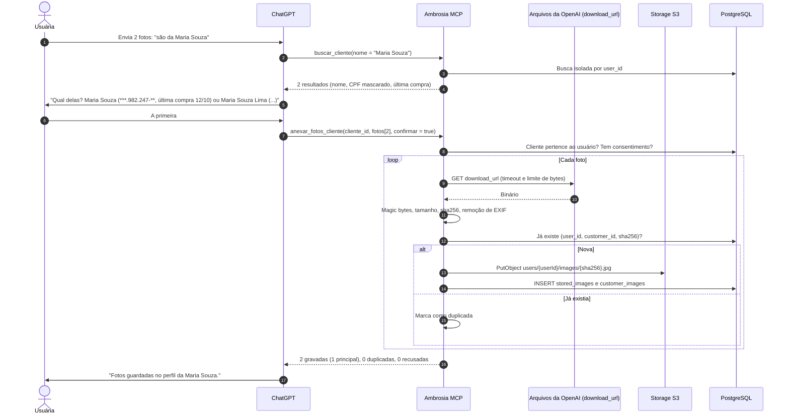
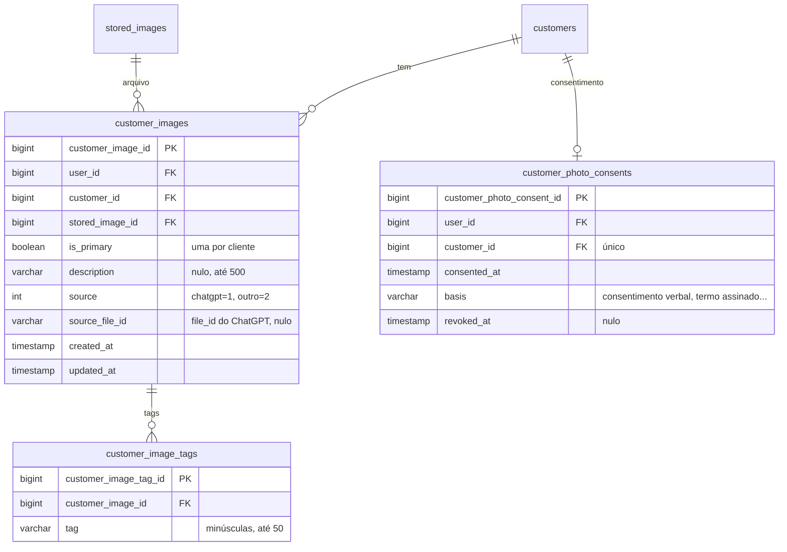

# 010 — Banco de imagens de clientes alimentado pelo ChatGPT

> Documento da história de usuário 010: a vendedora envia fotos no ChatGPT, o modelo associa cada foto à cliente certa e o MCP guarda as imagens no storage S3, com metadados, deduplicação e cuidados de LGPD.

**Created:** 2026-10-25
**Last Updated:** 2026-10-25

| Campo | Valor |
|---|---|
| ID | 010 |
| Status | Planejada |
| Spec | — |
| Depende de | [003](003-armazenamento-imagens-s3.md) (storage), [006](006-mcp-servidor-completo.md) (MCP), [007](007-oauth-mcp-chatgpt.md) (OAuth e escopo `images:write`) e [008](008-mcp-app-chatgpt.md) (app no ChatGPT) |
| Exibição | [002](002-frontend-web-perfil-cliente-pedidos.md) (perfil do cliente) |
| Código previsto | `backend/` (entidades, serviço e endpoints REST de leitura) e `backend/Ambrosia.Mcp/` (tools) |
| Referência | Documentação do Apps SDK da OpenAI (`_meta["openai/fileParams"]`), consultada em 25/10/2026 |

---

## 1. História

**Como** vendedora, **quero** mandar no ChatGPT as fotos das minhas clientes (por exemplo, provando uma peça) e dizer de quem são, **para** que fiquem guardadas no perfil certo e eu as veja depois no Ambrosia.

## 2. Contexto e objetivo

- O storage S3, os metadados e as URLs pré-assinadas vêm da [003](003-armazenamento-imagens-s3.md).
- As tools ficam no servidor MCP em `https://ambrosiaai.site/mcp` ([006](006-mcp-servidor-completo.md)), e os endpoints de leitura para o frontend ficam na API, em `https://ambrosiaai.site/api`.
- O ChatGPT entrega arquivos a uma tool quando ela declara `_meta["openai/fileParams"]` com o nome dos campos de arquivo. Cada campo recebe um objeto `{ download_url, file_id, mime_type, file_name }` (`download_url` e `file_id` obrigatórios) e pode ser um array, para vários arquivos.
- A `download_url` é **temporária**: o servidor precisa baixar o arquivo na hora da chamada e gravar no S3.
- A documentação **não informa** o tamanho máximo nem o prazo de validade da `download_url`.
- **Não** usar base64 nos argumentos da tool: há relatos de truncamento por volta de 2,5 MB.
- O [doc 02](../02-modelo-de-dados.md#armazenamento-de-fotos) já previa várias fotos com `position` (0 = principal) e deduplicação por `sha256` para imagens de produto. Esta HU aplica a mesma ideia às fotos de clientes.

---

## 3. Escopo

### Dentro do escopo

- Tool `anexar_fotos_cliente` com `_meta["openai/fileParams"]`, que baixa, valida, deduplica e grava as fotos de **uma** cliente por chamada.
- Tools `listar_fotos_cliente`, `definir_foto_principal`, `atualizar_foto` (descrição e tags) e `excluir_foto`, além de `excluir_todas_fotos_cliente` para pedidos de exclusão (LGPD).
- Desambiguação: o modelo usa `buscar_cliente` ([006](006-mcp-servidor-completo.md#5-tools)) e confirma com a usuária quando houver mais de uma cliente com o nome.
- Várias imagens por cliente, foto principal, descrição e tags.
- Deduplicação por `sha256`.
- Validação de mime pelos *magic bytes* e de tamanho.
- Remoção de EXIF (principalmente GPS).
- Registro de consentimento por cliente e exclusão completa.
- Endpoints REST de leitura para o frontend: lista de fotos e foto principal no detalhe do cliente, com URLs pré-assinadas.
- Ajuste da [002](002-frontend-web-perfil-cliente-pedidos.md) para mostrar a foto principal e a galeria.

### Fora do escopo

- Reconhecimento facial ou qualquer identificação automática da pessoa pela imagem.
- Upload de fotos pelo frontend.
- Fotos de produtos (imagens do +Vendas).
- Edição de imagem (recorte, filtros) e miniaturas (ver a [003](003-armazenamento-imagens-s3.md#9-perguntas-em-aberto)).
- Widgets de UI no ChatGPT para mostrar a galeria.

---

## 4. Critérios de aceite (a cumprir)

| # | Critério | Como verificar |
|---|---|---|
| 1 | `anexar_fotos_cliente` declara `_meta["openai/fileParams"]: ["fotos"]`, e o ChatGPT entrega as fotos anexadas na conversa como objetos `{ download_url, file_id, mime_type, file_name }` | Conversa no modo desenvolvedor e log da chamada |
| 2 | Com várias fotos numa só mensagem, para a mesma cliente, todas são gravadas numa única chamada | Enviar 3 fotos |
| 3 | O servidor baixa cada `download_url` durante a chamada e grava no S3 antes de responder | Log e `HeadObject` |
| 4 | Arquivo acima do limite, ou com tipo fora de JPEG, PNG e WebP (pelos *magic bytes*), é recusado com mensagem clara, sem afetar as outras fotos da chamada | Enviar um PDF renomeado |
| 5 | A mesma foto enviada de novo para a mesma cliente não gera outro registro. A resposta informa "já existia" | Reenviar |
| 6 | A mesma foto enviada para outra cliente do mesmo usuário gera aviso ao modelo, para confirmar com a usuária | Enviar para duas clientes |
| 7 | Com nome ambíguo (duas "Maria"), o modelo mostra as opções (nome, CPF mascarado e última compra) e só anexa depois da escolha | Base com homônimas |
| 8 | Com nome não encontrado, nada é gravado, e o modelo pergunta se a cliente deve ser cadastrada (`cadastrar_cliente`, com confirmação) | Nome inexistente |
| 9 | A primeira foto de uma cliente vira a principal. `definir_foto_principal` troca a principal, e só existe uma por cliente | Duas chamadas |
| 10 | Descrição e tags podem ser informadas no envio e alteradas depois | `atualizar_foto` |
| 11 | O EXIF (incluindo GPS) é removido do arquivo guardado | `exiftool` no objeto baixado |
| 12 | Uma cliente sem consentimento registrado não recebe fotos: a tool pede ao modelo para confirmar o consentimento com a usuária | Cliente nova |
| 13 | `excluir_foto` e `excluir_todas_fotos_cliente` removem o objeto do S3 e os metadados, com confirmação | `HeadObject` responde 404 |
| 14 | Sem o escopo `images:write`, as tools de escrita disparam a religação (`_meta["mcp/www_authenticate"]`, [008](008-mcp-app-chatgpt.md)) | Token sem o escopo |
| 15 | Fotos de uma cliente de outro usuário nunca são listadas nem alteradas (404) | Ana e Bia |
| 16 | O perfil do cliente na [002](002-frontend-web-perfil-cliente-pedidos.md) mostra a foto principal e a galeria, com URLs pré-assinadas | Navegador |
| 17 | A `download_url` e o `file_id` não aparecem em log de nível informativo | Revisão de log |

---

## 5. Tools

| Tool | Parâmetros | Escopo | Anotações | Observações |
|---|---|---|---|---|
| `anexar_fotos_cliente` | `cliente_id`, `fotos` (array de arquivos, via `openai/fileParams`), `descricao?`, `tags?`, `principal?`, `confirmar` | `images:write` | `readOnlyHint: false`, `destructiveHint: false`, `openWorldHint: true` (baixa de URL externa) | Uma cliente por chamada |
| `listar_fotos_cliente` | `cliente_id` | `customers:read` | `readOnlyHint: true` | Metadados, descrição, tags e URL pré-assinada curta |
| `definir_foto_principal` | `foto_id` | `images:write` | `readOnlyHint: false`, `destructiveHint: false`, `idempotentHint: true` | — |
| `atualizar_foto` | `foto_id`, `descricao?`, `tags?` | `images:write` | `readOnlyHint: false`, `destructiveHint: true`, `idempotentHint: true` | Sobrescreve descrição e tags |
| `excluir_foto` | `foto_id`, `confirmar` | `images:write` | `readOnlyHint: false`, `destructiveHint: true` | Exclusão física |
| `excluir_todas_fotos_cliente` | `cliente_id`, `confirmar` | `images:write` | `readOnlyHint: false`, `destructiveHint: true` | Atende pedido de exclusão da titular |

Descritor ilustrativo da tool principal:

```json
{
  "name": "anexar_fotos_cliente",
  "title": "Anexar fotos à cliente",
  "description": "Guarda no perfil de UMA cliente as fotos que a usuária enviou na conversa. Antes, use buscar_cliente para obter o cliente_id e, se houver mais de uma cliente com o nome, pergunte qual é. Se as fotos forem de clientes diferentes, faça uma chamada por cliente.",
  "inputSchema": {
    "type": "object",
    "required": ["cliente_id", "fotos"],
    "properties": {
      "cliente_id": { "type": "integer" },
      "fotos": {
        "type": "array",
        "items": {
          "type": "object",
          "required": ["download_url", "file_id"],
          "properties": {
            "download_url": { "type": "string" },
            "file_id": { "type": "string" },
            "mime_type": { "type": "string" },
            "file_name": { "type": "string" }
          }
        }
      },
      "descricao": { "type": "string" },
      "tags": { "type": "array", "items": { "type": "string" } },
      "principal": { "type": "boolean" },
      "confirmar": { "type": "boolean" }
    }
  },
  "annotations": { "readOnlyHint": false, "destructiveHint": false, "openWorldHint": true },
  "securitySchemes": [{ "type": "oauth2", "scopes": ["images:write"] }],
  "_meta": { "openai/fileParams": ["fotos"] }
}
```

### Fluxo com desambiguação



---

## 6. Modelo de dados proposto

Reaproveita `stored_images` da [003](003-armazenamento-imagens-s3.md#5-regras-de-negócio).



| Regra | Detalhe |
|---|---|
| Deduplicação | Única por `(user_id, customer_id, stored_image_id)`. Como `stored_images` já é única por `(user_id, sha256)`, o mesmo arquivo em duas clientes reaproveita o objeto e gera o aviso do critério 6 |
| Foto principal | Índice único parcial `(customer_id) WHERE is_primary`. A primeira foto vira principal |
| Exclusão | Apagar `customer_images`. Se o `stored_image` ficar sem vínculo, apagar o objeto do S3 e o metadado. FKs `ClientSetNull`, sem cascade (constituição, Princípio V): a exclusão é feita pelo serviço |
| Consentimento revogado | Revogar implica excluir todas as fotos da cliente |

### Endpoints REST de leitura (para a 002)

Rotas relativas à base da API (`https://ambrosiaai.site/api` em produção). As URLs pré-assinadas apontam para o endpoint do bucket, outra origem, coberta pelo CORS do bucket e pela CSP descritos na [003](003-armazenamento-imagens-s3.md#6-decisões-técnicas-propostas).

| Método | Rota | Resposta |
|---|---|---|
| GET | `/customers/{id}` | Campo novo `primaryPhoto` (`url`, `expiresAt`) ou `null` |
| GET | `/customers/{id}/images` | Lista com `id`, `url`, `expiresAt`, `description`, `tags`, `isPrimary`, `createdAt` |

---

## 7. LGPD

| Tema | Regra proposta |
|---|---|
| Natureza do dado | Foto de pessoa é **dado pessoal**. Se usada para identificar a pessoa por características faciais, vira **dado biométrico** (sensível). Por isso o reconhecimento facial fica explicitamente fora do escopo |
| Base legal | Consentimento da cliente, registrado em `customer_photo_consents` (data e forma). A tool só grava com consentimento registrado |
| Finalidade | Uso interno da vendedora para atendimento. Sem compartilhamento e sem uso em marketing sem novo consentimento |
| Operadores | As fotos passam pelo ChatGPT (OpenAI) antes de chegar ao Ambrosia. Isso precisa constar na política de privacidade ([008](008-mcp-app-chatgpt.md#10-perguntas-em-aberto)) |
| Minimização | Remoção de EXIF e GPS. Sem guardar a `download_url` |
| Exclusão | `excluir_todas_fotos_cliente` e revogação do consentimento apagam objetos e metadados. Backups seguem a política da [003](003-armazenamento-imagens-s3.md#9-perguntas-em-aberto) |
| Acesso | URLs pré-assinadas curtas, isolamento por usuário e escopo `images:write` para escrita |
| Cache local | O PWA ([004](004-frontend-pwa.md)) guarda imagens no aparelho e limpa no logout |

---

## 8. Decisões técnicas propostas

| Tema | Proposta |
|---|---|
| Download | `HttpClient` com *timeout* (proposta: 20 s), leitura em stream com corte em `MaxUploadBytes` da 003, sem seguir redirecionamento para IP privado e só `https` |
| Allowlist de domínio | Restringir a `download_url` aos domínios de arquivos da OpenAI, se a documentação os informar (pergunta em aberto). Sem isso, aplicar as proteções contra SSRF acima |
| Processamento | Validação de *magic bytes*, cálculo do `sha256` sobre o arquivo **depois** da remoção de EXIF (para deduplicar o que de fato é guardado) e regravação sem metadados com uma biblioteca de imagem .NET (a definir na spec) |
| Gravação | `IObjectStorageAppService.PutAsync` da 003, com `source = chatgpt` |
| Erros parciais | Cada foto tem resultado próprio (`gravada`, `duplicada`, `recusada` com motivo). A chamada só falha inteira se a cliente não existir ou não houver consentimento |
| Confirmação | Mesmo padrão da [006](006-mcp-servidor-completo.md#demais-decisões): `confirmar` e anotações. No anexo, a confirmação pode vir da própria desambiguação |
| Resposta ao modelo | Texto curto em português e `structuredContent` com os resultados por foto, sem a URL pré-assinada (o modelo não precisa dela) |

---

## 9. Dependências

| HU | Tipo | Motivo |
|---|---|---|
| [003](003-armazenamento-imagens-s3.md) | Obrigatória | Storage, `stored_images`, validação e URLs pré-assinadas |
| [006](006-mcp-servidor-completo.md) | Obrigatória | Servidor MCP e `buscar_cliente` |
| [007](007-oauth-mcp-chatgpt.md) | Obrigatória | Escopo `images:write` |
| [008](008-mcp-app-chatgpt.md) | Obrigatória | App no ChatGPT, `securitySchemes` e `_meta` |
| [002](002-frontend-web-perfil-cliente-pedidos.md) | Para exibição | Perfil com foto e galeria |

---

## 10. Riscos

| Risco | Impacto | Mitigação |
|---|---|---|
| A `download_url` expira antes do download | Foto perdida | Baixar logo no início da chamada e responder ao modelo pedindo reenvio quando falhar |
| Limite de tamanho desconhecido do lado da OpenAI | Fotos grandes falham sem explicação | Limite próprio claro (`MaxUploadBytes` da 003) e teste com fotos de câmera de celular (5 a 12 MB) |
| O modelo associa a foto à cliente errada | Dado pessoal no perfil errado | Desambiguação obrigatória, resposta com o nome da cliente e exclusão fácil |
| O modelo tenta passar base64 nos argumentos | Truncamento | Descrição da tool proíbe e o schema só aceita o objeto de arquivo |
| `openai/fileParams` só funciona no ChatGPT | Outros clientes MCP não conseguem anexar | Aceitável no escopo. Avaliar depois um fluxo com URL de upload pré-assinada da 003 |
| Fotos de menores ou de terceiros | Risco jurídico maior | Orientação na política e na descrição da tool. Consentimento do responsável |
| O SDK C# não repassa `_meta` personalizado no descritor | `fileParams` não chega ao ChatGPT | Mesmo filtro de `tools/list` proposto na [008](008-mcp-app-chatgpt.md#6-decisões-técnicas-propostas) |

---

## 11. Perguntas em aberto

1. Qual é o tamanho máximo de arquivo que o ChatGPT entrega à tool? A documentação não informa.
2. Qual é o prazo de validade da `download_url`? A documentação não informa.
3. De quais domínios vêm as `download_url`? Isso permite uma allowlist.
4. `openai/fileParams` aceita campos aninhados, ou só campos de primeiro nível (o que impede um array `[{ cliente_id, foto }]` numa chamada só)?
5. Como o consentimento é coletado na prática: a vendedora declara na conversa ("ela autorizou"), ou é preciso um termo assinado com registro?
6. Aceitar HEIC (fotos de iPhone) convertendo no servidor?
7. A leitura de fotos fica em `customers:read` ou ganha um `images:read` próprio ([007](007-oauth-mcp-chatgpt.md#10-perguntas-em-aberto))?
