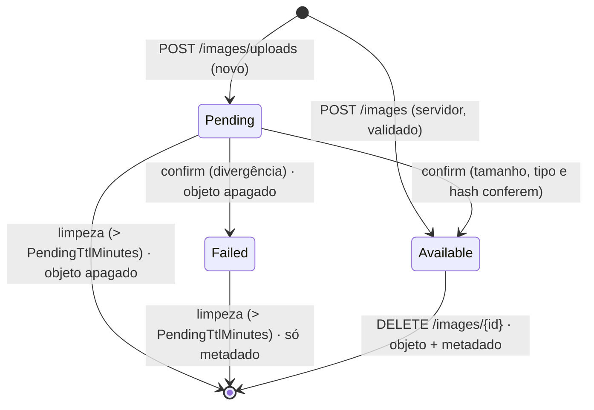

# Data Model: Armazenamento de imagens em storage compatível com S3

**Feature**: `004-s3-image-storage` | **Date**: 2026-10-26 | **Spec**: [spec.md](./spec.md) | **Research**: [research.md](./research.md)

## Tabela nova: `stored_images`

Convenções da constituição §V (snake_case, PK `bigint identity`, `timestamp without time zone`, enums `integer`, FK `ClientSetNull`, sem cascata). Migração EF Core: `AddStoredImages`.

| Coluna | Tipo | Nulo | Regra |
|---|---|---|---|
| `stored_image_id` | `bigint` identity always | não | PK `stored_images_pkey` |
| `user_id` | `bigint` | não | FK `fk_user_stored_image` → `users.user_id`, `ClientSetNull` |
| `storage_key` | `varchar(260)` | não | `ambrosio/users/{userId}/images/{sha256}.{ext}` |
| `sha256` | `varchar(64)` | não | hex minúsculo, 64 caracteres |
| `mime_type` | `varchar(100)` | não | um dos `AllowedMimeTypes` |
| `size_bytes` | `bigint` | não | 1..`MaxUploadBytes` |
| `width` | `integer` | sim | preenchido quando o cabeçalho permite |
| `height` | `integer` | sim | idem |
| `status` | `integer` | não | `DEFAULT 1`; `1 = pending`, `2 = available`, `3 = failed` |
| `source` | `integer` | não | `1 = upload`, `2 = server`, `3 = chatgpt`, `4 = bot` |
| `created_at` | `timestamp without time zone` | não | UTC (`IClock`) |
| `updated_at` | `timestamp without time zone` | não | UTC; muda a cada transição de status |

**Índices**

| Nome | Colunas | Tipo | Motivo |
|---|---|---|---|
| `ux_stored_images_user_sha256_active` | `(user_id, sha256)` | único, parcial `WHERE status IN (1, 2)` | deduplicação por usuário (FR-011); `failed` não participa (clarificação 5) |
| `ux_stored_images_storage_key_active` | `(storage_key)` | único, parcial `WHERE status IN (1, 2)` | uma chave ativa por objeto |
| `ix_stored_images_status_created_at` | `(status, created_at)` | comum | varredura da limpeza (FR-018) |

`users` não muda (nenhuma coluna nova). A navegação `User.StoredImages` é opcional; o repositório sempre filtra por `user_id`.

## Entidade de domínio: `StoredImage` (`Ambrosia.Domain/Models`)

```text
StoredImage
  Id, UserId, StorageKey, Sha256, MimeType, SizeBytes, Width?, Height?,
  Status (ImageStatus), Source (ImageSource), CreatedAt, UpdatedAt, User?

  static CreatePending(userId, sha256, mimeType, sizeBytes, source, now)   → Status = Pending, StorageKey montada
  static CreateAvailable(userId, sha256, mimeType, sizeBytes, width, height, source, now)  → envio pelo servidor
  MarkAvailable(width?, height?, now)      Pending → Available
  MarkFailed(now)                          Pending → Failed
  static BuildStorageKey(userId, sha256, mimeType) → "ambrosio/users/{userId}/images/{sha256}.{ext}"
```

Extensões: `image/jpeg → jpg`, `image/png → png`, `image/webp → webp`. A tabela de extensões vive no Domain, junto da regra de chave.

### Transições de status



Regras:
- `Available` e `Failed` são finais para a confirmação: confirmar `Available` devolve a imagem (idempotente); confirmar `Failed` → 400.
- Confirmar `Pending` sem objeto no storage → 400 e o status **não** muda.
- A exclusão pelo dono vale para qualquer status (apaga o objeto se existir).

## Enums (`Ambrosia.DTO/Enums`)

| Enum | Valores (int) | JSON (camelCase string) |
|---|---|---|
| `ImageStatus` | `Pending = 1`, `Available = 2`, `Failed = 3` | `"pending"`, `"available"`, `"failed"` |
| `ImageSource` | `Upload = 1`, `Server = 2`, `ChatGpt = 3`, `Bot = 4` | `"upload"`, `"server"`, `"chatGpt"`, `"bot"` |

## DTOs (`Ambrosia.DTO/Images`)

Todas as propriedades com `[JsonPropertyName("camelCase")]` (constituição §IV). Nenhum DTO de entrada carrega `userId`.

**`ImageUploadInsertInfo`** (entrada de `POST /images/uploads`)

| Campo | Tipo | Validação (`ImageUploadInsertInfoValidator`) |
|---|---|---|
| `mimeType` | string | obrigatório; está em `AllowedMimeTypes` |
| `sizeBytes` | long | > 0 e ≤ `MaxUploadBytes` |
| `sha256` | string | exatamente 64 caracteres hex (normalizado para minúsculas) |

**`ImageUploadResult`** (saída de `POST /images/uploads`)

| Campo | Tipo | Observação |
|---|---|---|
| `imageId` | long | |
| `alreadyExists` | bool | `true` quando já havia imagem `available` com o mesmo hash |
| `uploadUrl` | string? | só quando `alreadyExists = false` |
| `uploadMethod` | string? | `"PUT"` |
| `contentType` | string? | valor exato a enviar no cabeçalho `Content-Type` |
| `uploadExpiresAt` | DateTime? | UTC |
| `image` | `ImageInfo`? | só quando `alreadyExists = true` |

**`ImageInfo`** (saída de confirmar, gravar, consultar)

| Campo | Tipo | Observação |
|---|---|---|
| `imageId` | long | |
| `mimeType` | string | |
| `sizeBytes` | long | |
| `sha256` | string | |
| `width`, `height` | int? | |
| `status` | `ImageStatus` | |
| `source` | `ImageSource` | |
| `url` | string? | URL de leitura pré-assinada; só quando `status = available` |
| `urlExpiresAt` | DateTime? | UTC |
| `createdAt` | DateTime | |

`storage_key` não é exposta (detalhe interno).

## Configuração: `ObjectStorageSettings` (`Ambrosia.DTO/Settings`)

Campos e faixas em [research.md §12](./research.md#12-configuração-e-validação-no-startup). Consumido via `IOptions<ObjectStorageSettings>` pela Infra, pelo `ImageService` (limites e tipos) e pelo serviço de limpeza.

## Contratos internos (Infra.Interfaces)

```text
IObjectStorageAppService
  Task PutAsync(string key, Stream content, string contentType, CancellationToken ct)
  Task<ObjectHead?> HeadAsync(string key, CancellationToken ct)                // null = não existe
  Task<Stream> OpenReadAsync(string key, CancellationToken ct)
  Task DeleteAsync(string key, CancellationToken ct)                           // ignora inexistente
  Task DeletePrefixAsync(string prefix, CancellationToken ct)
  PresignedUrl GetPresignedReadUrl(string key, DateTime now)
  PresignedUrl GetPresignedUploadUrl(string key, string contentType, DateTime now)

IImageProcessingAppService
  Task<ImageInspection?> InspectAsync(Stream content, CancellationToken ct)    // null = formato não reconhecido
  Task<ProcessedImage> SanitizeAsync(Stream content, CancellationToken ct)     // auto-orient + remove EXIF/IPTC/XMP + re-encode

IStoredImageRepository<TModel>
  Task<TModel?> GetByIdAsync(long imageId, long userId)
  Task<TModel?> GetActiveByHashAsync(long userId, string sha256)               // pending ou available
  Task<TModel> InsertAsync(TModel entity)                                      // DuplicateException em 23505
  Task<TModel> UpdateAsync(TModel entity)
  Task DeleteAsync(TModel entity)
  Task<List<TModel>> ListStaleAsync(DateTime pendingBefore, DateTime failedBefore, int take)   // uso da limpeza
  Task DeleteAllByUserAsync(long userId)
```

`ObjectHead { long ContentLength; string? ContentType }`, `PresignedUrl { string Url; DateTime ExpiresAt }`, `ImageInspection { string MimeType; int? Width; int? Height }`, `ProcessedImage { byte[] Content; string MimeType; int Width; int Height }` ficam em `Ambrosia.DTO/Images` (tipos de transporte entre camadas).

`ListStaleAsync` é a única leitura sem `userId`: é usada só pelo job de limpeza (nunca por endpoint) e devolve registros de todos os usuários por definição. Registrada como exceção justificada no plano.

## Serviço de domínio: `IImageService` (`Ambrosia.Domain`)

```text
Task<(ImageUploadResult Result, bool Created)> RequestUploadAsync(long userId, ImageUploadInsertInfo info)
Task<ImageInfo> ConfirmUploadAsync(long userId, long imageId)
Task<(ImageInfo Image, bool Created)> StoreFromServerAsync(long userId, Stream content, ImageSource source)
Task<ImageInfo> GetByIdAsync(long userId, long imageId)
Task DeleteAsync(long userId, long imageId)
Task DeleteAllForUserAsync(long userId)
Task<int> PurgeStaleAsync(DateTime now)
```

Exceções de domínio: `NotFoundException` (404), `ValidationException` do FluentValidation (400), nova `ImageRejectedException` (400, com motivo `tamanho`/`tipo`/`hash`/`não enviado`/`falhou`), nova `StorageUnavailableException` (503).
