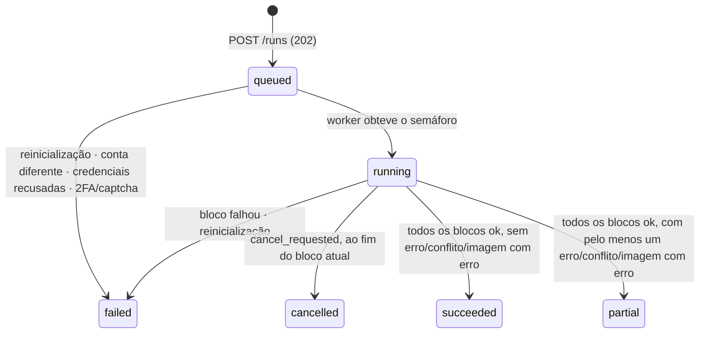

# Data Model: Importação do +Vendas pelo frontend

**Feature**: `006-mais-vendas-import` | **Date**: 2026-10-27 | **Spec**: [spec.md](./spec.md) | **Research**: [research.md](./research.md)

Convenções da constituição §V: snake_case plural, PK `{entidade}_id bigint identity always`, constraint `{tabela}_pkey`, FKs `fk_{pai}_{filho}` com `ClientSetNull` (nunca cascata), `timestamp without time zone` em UTC, `varchar(n)`, enums como `integer`. Migração EF Core única: `AddMaisVendasImport`.

## 1. Tabelas alteradas

### `orders` (+4 colunas, +1 índice)

| Coluna | Tipo | Nulo | Regra |
|---|---|---|---|
| `source` | `integer` | não | `DEFAULT 1`; `1 = manual`, `2 = maisVendas` (`OrderSource`). Linhas existentes recebem 1 |
| `source_hash` | `varchar(64)` | sim | SHA-256 hex do conteúdo normalizado (research §6); nulo em pedidos manuais |
| `captured_at` | `timestamp without time zone` | sim | última captura em que o pedido foi visto na origem (FR-030) |
| `source_changed_at` | `timestamp without time zone` | sim | última vez em que `source_hash` mudou (FR-030) |

Índice novo: `ix_orders_user_source_date (user_id, source, order_date DESC)` — atende `GET /defaults` (research §11) e a listagem de chaves do intervalo (research §17).

### `order_items` (+1 coluna, +1 FK, +1 índice)

| Coluna | Tipo | Nulo | Regra |
|---|---|---|---|
| `image_id` | `bigint` | sim | FK `fk_stored_image_order_item` → `stored_images.stored_image_id`, `ClientSetNull`. `image_url` continua com a URL de origem (FR-037) |

Índice: `ix_order_items_image (image_id)`.

## 2. Tabelas novas

### `import_runs`

| Coluna | Tipo | Nulo | Regra |
|---|---|---|---|
| `import_run_id` | `bigint` identity | não | PK `import_runs_pkey` |
| `user_id` | `bigint` | não | FK `fk_user_import_run` → `users`, `ClientSetNull` |
| `mode` | `integer` | não | `1 = dryRun`, `2 = apply` (`ImportRunMode`) |
| `status` | `integer` | não | `DEFAULT 1`; `1 = queued`, `2 = running`, `3 = succeeded`, `4 = failed`, `5 = partial`, `6 = cancelled` (`ImportRunStatus`) |
| `start_date` / `end_date` | `date` | não | período inclusivo (FR-004) |
| `block_days` | `integer` | não | tamanho de bloco vigente na execução |
| `blocks_total` | `integer` | não | calculado no início |
| `cancel_requested` | `boolean` | não | `DEFAULT false` |
| `requested_at` | `timestamp without time zone` | não | criação (`202`) |
| `started_at` | `timestamp without time zone` | sim | saída da fila |
| `finished_at` | `timestamp without time zone` | sim | status final |
| `inserted_count`, `updated_count`, `unchanged_count`, `missing_count`, `failed_count`, `conflict_count`, `customers_created_count`, `images_stored_count`, `images_failed_count` | `integer` | não | `DEFAULT 0`; totais da execução (FR-047) |
| `error_message` | `varchar(500)` | sim | motivo quando `failed`/`cancelled`; **nunca** contém login, senha ou CPF |
| `collector_version` | `varchar(40)` | não | ex.: `playwright-1.0`, `fake-1.0` |

Índices: `ix_import_runs_user_requested (user_id, requested_at DESC)` (histórico paginado); `ux_import_runs_user_active (user_id) UNIQUE WHERE status IN (1, 2)` (uma execução ativa por vendedora, FR-016); `ix_import_runs_user_period (user_id, start_date, end_date, finished_at DESC)` (aviso de queda, research §18).

### `import_run_blocks`

| Coluna | Tipo | Nulo | Regra |
|---|---|---|---|
| `import_run_block_id` | `bigint` identity | não | PK `import_run_blocks_pkey` |
| `import_run_id` | `bigint` | não | FK `fk_import_run_import_run_block`, `ClientSetNull` |
| `block_no` | `integer` | não | 1-based |
| `start_date` / `end_date` | `date` | não | fatia do período |
| `status` | `integer` | não | `DEFAULT 1`; `1 = pending`, `2 = running`, `3 = succeeded`, `4 = failed`, `5 = notExecuted` (`ImportBlockStatus`) |
| contagens (as mesmas 9 de `import_runs`) | `integer` | não | `DEFAULT 0` |
| `error_message` | `varchar(500)` | sim | motivo da falha do bloco |
| `started_at` / `finished_at` | `timestamp without time zone` | sim | |

Índice único: `ux_import_run_blocks_run_no (import_run_id, block_no)`.

### `import_run_changes`

Rastro de cada pedido tocado (FR-048). Guarda só a chave natural — **nunca** CPF nem nome do cliente (FR-052).

| Coluna | Tipo | Nulo | Regra |
|---|---|---|---|
| `import_run_change_id` | `bigint` identity | não | PK |
| `import_run_id` | `bigint` | não | FK `fk_import_run_import_run_change`, `ClientSetNull` |
| `import_run_block_id` | `bigint` | não | FK `fk_import_run_block_import_run_change`, `ClientSetNull` |
| `order_id` | `bigint` | sim | FK `fk_order_import_run_change`, `ClientSetNull`; nulo em simulação, em `missing` só quando o pedido existe, em `error` |
| `order_number` | `varchar(60)` | não | chave natural |
| `order_date` | `date` | não | chave natural |
| `kind` | `integer` | não | `OrderKind` |
| `channel` | `varchar(60)` | sim | para o agrupamento canal × tipo do relatório |
| `origin` | `integer` | sim | `OrderOrigin` (cota/omni) |
| `action` | `integer` | não | `1 = inserted`, `2 = updated`, `3 = unchanged`, `4 = missing`, `5 = conflict`, `6 = error` (`ImportChangeAction`) |
| `changed_fields` | `varchar(500)` | sim | lista separada por vírgula (`total,status,items`) em `updated` |
| `error_message` | `varchar(500)` | sim | em `error` (ex.: "CPF ausente ou inválido na origem") |
| `created_at` | `timestamp without time zone` | não | |

Índices: `ix_import_run_changes_run (import_run_id)`, `ix_import_run_changes_block (import_run_block_id)`.

### `mais_vendas_accounts`

| Coluna | Tipo | Nulo | Regra |
|---|---|---|---|
| `mais_vendas_account_id` | `bigint` identity | não | PK |
| `user_id` | `bigint` | não | FK `fk_user_mais_vendas_account`, `ClientSetNull`; único (`ux_mais_vendas_accounts_user`) |
| `account_hash` | `varchar(64)` | sim | HMAC-SHA256 hex do identificador da conta (research §8); nulo até o primeiro vínculo |
| `linked_at` | `timestamp without time zone` | sim | |
| `failed_login_count` | `integer` | não | `DEFAULT 0` |
| `locked_until` | `timestamp without time zone` | sim | bloqueio de novos inícios (FR-008a) |
| `created_at` / `updated_at` | `timestamp without time zone` | não | |

Nenhuma coluna de login ou senha existe em tabela alguma (FR-006).

## 3. Enums (`Ambrosia.DTO/Enums`)

| Enum | Valores (int → JSON camelCase) |
|---|---|
| `OrderSource` | `Manual = 1 → manual`, `MaisVendas = 2 → maisVendas` |
| `ImportRunMode` | `DryRun = 1 → dryRun`, `Apply = 2 → apply` |
| `ImportRunStatus` | `Queued = 1 → queued`, `Running = 2 → running`, `Succeeded = 3 → succeeded`, `Failed = 4 → failed`, `Partial = 5 → partial`, `Cancelled = 6 → cancelled` |
| `ImportBlockStatus` | `Pending = 1`, `Running = 2`, `Succeeded = 3`, `Failed = 4`, `NotExecuted = 5` |
| `ImportChangeAction` | `Inserted = 1`, `Updated = 2`, `Unchanged = 3`, `Missing = 4`, `Conflict = 5`, `Error = 6` |

## 4. Entidades de domínio (`Ambrosia.Domain/Models`)

```text
ImportRun
  Id, UserId, Mode, Status, StartDate, EndDate, BlockDays, BlocksTotal, CancelRequested,
  RequestedAt, StartedAt?, FinishedAt?, Counts (9 inteiros), ErrorMessage?, CollectorVersion,
  Blocks: List<ImportRunBlock>, User?
  static Create(userId, mode, startDate, endDate, blockDays, collectorVersion, now) → Queued, Blocks planejados (Pending)
  Start(now)                        Queued → Running
  RequestCancel()                   CancelRequested = true (válido em Queued/Running)
  AccumulateBlock(block)            soma as contagens do bloco
  FailBeforeBlocks(reason, now)     Queued/Running → Failed; blocos → NotExecuted
  Finish(now)                       aplica FR-047a (research §18); blocos Pending → NotExecuted
  DurationSeconds (calculado)

ImportRunBlock
  Id, ImportRunId, BlockNo, StartDate, EndDate, Status, Counts, ErrorMessage?, StartedAt?, FinishedAt?
  Start(now) · Succeed(now) · Fail(reason, now) · MarkNotExecuted()
  Record(action)                    incrementa a contagem correspondente

ImportRunChange
  Id, ImportRunId, ImportRunBlockId, OrderId?, OrderNumber, OrderDate, Kind, Channel?, Origin?,
  Action, ChangedFields?, ErrorMessage?, CreatedAt

MaisVendasAccount
  Id, UserId, AccountHash?, LinkedAt?, FailedLoginCount, LockedUntil?, CreatedAt, UpdatedAt
  IsLocked(now) · Link(hash, now) · Matches(hash) · RegisterRefusedLogin(now, max, lockoutMinutes) · RegisterAcceptedLogin(now)

Order (alterações)
  Source (OrderSource), SourceHash?, CapturedAt?, SourceChangedAt?
  ApplyImported(snapshot, hash, now) → lista de campos alterados; substitui Items (regra da clarificação 2)
  Touch(now)                           só CapturedAt
OrderItem (alteração)
  ImageId? (+ navegação Image?)
```

### Transições de status da execução



Blocos: `pending → running → succeeded | failed`; `pending → notExecuted` quando a execução para antes deles.

## 5. Regras de validação (FluentValidation, `Ambrosia.Domain/Validators`)

`ImportRunStartInfoValidator` (depende de `IClock` e `IOptions<MaisVendasSettings>`):

| Campo | Regra | Mensagem (nunca ecoa o valor) |
|---|---|---|
| `login` | não vazio, ≤ 120 chars | "Informe o login do +Vendas." |
| `password` | não vazio, ≤ 200 chars | "Informe a senha do +Vendas." |
| `startDate` | obrigatória; ≤ `endDate` | "A data inicial deve ser anterior ou igual à data final." |
| `endDate` | obrigatória; ≤ hoje (America/Sao_Paulo) | "A data final não pode estar no futuro." |
| período | `endDate - startDate + 1 ≤ MaxRangeDays` | "O período não pode ultrapassar {MaxRangeDays} dias." |

`ImportRunListQueryValidator`: `page ≥ 1`, `pageSize` 1–50.

## 6. DTOs (`Ambrosia.DTO/Imports`, `[JsonPropertyName]` camelCase)

| DTO | Papel |
|---|---|
| `ImportRunStartInfo` | entrada do `POST /runs`: `login`, `password` (`[DataType(DataType.Password)]`), `startDate`, `endDate`, `dryRun` |
| `ImportDefaultsInfo` | `suggestedStartDate?`, `suggestedEndDate`, `blockDays`, `maxRangeDays`, `lockedUntil?` |
| `ImportRunCountsInfo` | as 9 contagens |
| `ImportRunInfo` | resumo para listagem/`202`: id, mode, status, período, blockDays, blocksTotal, blocksFinished, currentBlockNo?, requestedAt, startedAt?, finishedAt?, durationSeconds?, counts, errorMessage? |
| `ImportRunBlockInfo` | bloco com status, período, counts, errorMessage?, startedAt?, finishedAt? |
| `ImportRunChangeInfo` | orderId?, orderNumber, orderDate, kind, channel?, origin?, action, changedFields[]?, errorMessage? |
| `ImportRunBreakdownInfo` | `channel?`, `origin?`, `kind`, `action`, `count` (agrupamento do relatório, FR-049) |
| `ImportRunDetailInfo : ImportRunInfo` | `blocks[]`, `changes[]`, `breakdown[]`, `previousRunOrdersCount?`, `countDropWarning` |
| `ImportRunListQuery` | `page`, `pageSize` |
| `MaisVendasSettings` (`Settings/`) | research §13 |

Transporte interno do coletor (`Ambrosia.DTO/Imports/Collector`): `MaisVendasCredentials` (login, password — só em memória), `MaisVendasLoginResult` (`Outcome`: Accepted/Refused/UnsupportedStep; `AccountIdentifier?`), `CollectedBlock` (`Orders[]`, `TabCounters`, `TabTotals`), `CollectedOrder` (chave natural, canal, origem, status, total, datas, externalId, `CustomerName`, `CpfDigits`, `Items[]`), `CollectedOrderItem` (productName, skuRef, size, price, imageUrl), `CollectedImage` (`Content` stream, `MimeType`, `SizeBytes`).

`OrderInfo`/`OrderDetailInfo` ganham `source` (`OrderSource`) para a tela marcar pedidos importados; `OrderItemInfo` ganha `imageId?`.

## 7. Interfaces

**Domain (`Ambrosia.Domain/Interfaces`)**

- `IImportRunService`: `GetDefaultsAsync(userId)`, `StartAsync(userId, ImportRunStartInfo)` (valida, checa bloqueio → `ImportLockedException`, cria a execução → `DuplicateException` se já houver ativa, enfileira), `GetCurrentAsync(userId)`, `GetByIdAsync(userId, runId)`, `ListAsync(userId, query)`, `CancelAsync(userId, runId)`.
- `IImportExecutionService`: `ExecuteAsync(ImportJob job, CancellationToken)` — orquestra login, vínculo, blocos, validação, gravação pedido a pedido, imagens, não encontrados e fechamento. Chamado só pelo worker.
- `IImportRunQueue`: `Enqueue(ImportJob)` / `ReadAllAsync(ct)` (implementado na Application sobre `Channel`).

**Infra.Interfaces**

- `Repository/IImportRunRepository<TRun, TBlock, TChange>`: `GetByIdAsync(runId, userId)` (com blocos), `GetCurrentAsync(userId)`, `ListAsync(userId, page, pageSize)`, `ListChangesAsync(runId, userId)`, `GetBreakdownAsync(runId, userId)`, `GetPreviousRunOrdersCountAsync(userId, runId, start, end)`, `InsertAsync(run)`, `UpdateAsync(run)`, `UpdateBlockAsync(block)`, `AddChangeAsync(change)`, `RequestCancelAsync(runId, userId)`, `MarkInterruptedAsync(now)` → `Task<int>` (**somente escrita em lote** via `ExecuteUpdateAsync`, sem leitura nem retorno de dados de usuário — §VI), `GetSuggestedStartDateAsync(userId)`, `ListImportedKeysInRangeAsync(userId, from, to)`, `UpsertImportedOrderAsync(userId, CollectedOrder, cpfHash, cpfEncrypted, cpfMasked, sourceHash, imageIdsByUrl, now)` → `UpsertOutcome` (ação, orderId, campos alterados, clienteCriado) em transação própria.
- `Repository/IMaisVendasAccountRepository<TModel>`: `GetOrCreateAsync(userId, now)`, `UpdateAsync(entity)`.
- `AppServices/IMaisVendasCollectorAppService`: `OpenSessionAsync(MaisVendasCredentials, ct)` → `IMaisVendasCollectorSession` (`IAsyncDisposable`): `Login`, `CollectBlockAsync(from, to, ct)`, `DownloadImageAsync(url, maxBytes, ct)`, `CollectorVersion`.
- `AppServices/IAccountHashAppService`: `Hash(accountIdentifier)`.

**Exceções novas (Domain)**: `ImportLockedException` (→ 429, carrega `LockedUntil`), `ImportRunNotCancellableException` (→ 409).
