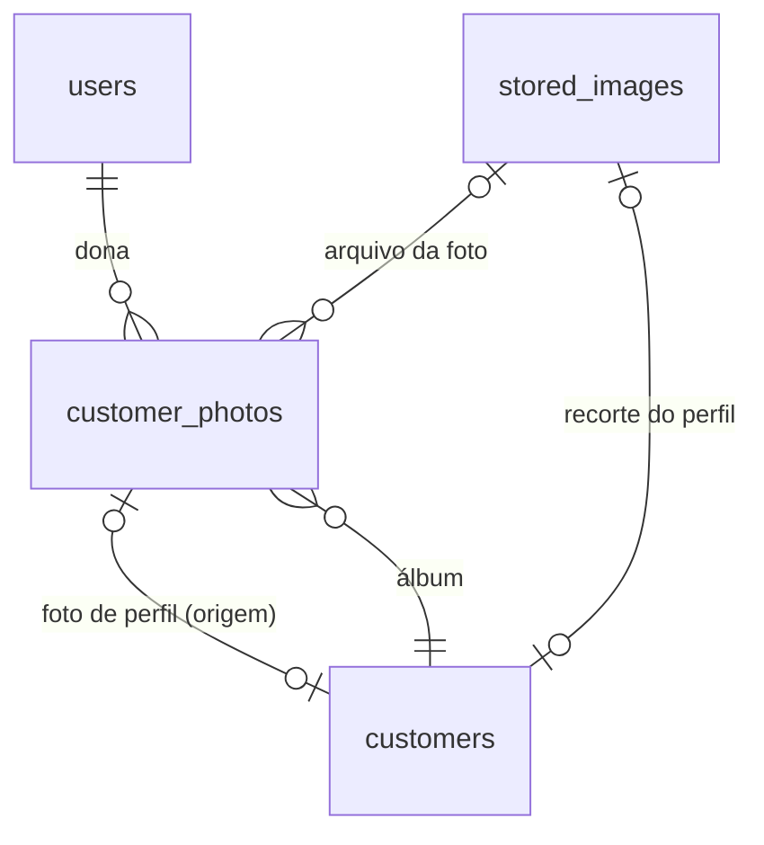

# Data Model: Fotos de clientes no estilo rede social

**Feature**: `009-customer-photos` | **Date**: 2026-10-29
**Revisão**: 2026-10-29 — sem processamento de imagem no servidor (ver [research.md](research.md)). Caiu a
miniatura por foto, caiu o enquadramento persistido, `stored_images` continua sem decodificação.

Migração EF Core: **`AddCustomerPhotos`** (skill `dotnet-architecture`, mesmo `AmbrosioContext`).
Convenções do Princípio V: snake_case, PK `{entidade}_id` bigint identity, `timestamp without time zone`,
enums como `integer`, FKs `fk_{pai}_{filho}` com `ClientSetNull` (nunca cascata), índice de FK declarado
explicitamente em snake_case.



---

## 1. `customer_photos` (nova): `CustomerPhoto`

Uma linha por foto do álbum. **Uma linha = um arquivo** (o original como chegou): não existe coluna de
miniatura nem de recorte.

| Coluna | Tipo | Nulo | Regra |
|---|---|---|---|
| `customer_photo_id` | bigint identity | não | PK `customer_photos_pkey` |
| `user_id` | bigint | não | FK `fk_user_customer_photo` → `users`. Vem só do claim `sub` (§VI) e é igual ao `user_id` da cliente |
| `customer_id` | bigint | não | FK `fk_customer_customer_photo` → `customers` |
| `image_id` | bigint | não | FK `fk_stored_image_customer_photo` → `stored_images`. Arquivo da foto, sempre `available` (R2) |
| `description` | varchar(500) | sim | Texto livre com `Trim`. Vazio ou só espaços é gravado como `NULL` (FR-007) |
| `is_favorite` | boolean | não | `DEFAULT false` (FR-008) |
| `source` | integer | não | `CustomerPhotoSource` (R12) |
| `created_at` | timestamp | não | UTC de `IClock`. Ordena a grade |
| `updated_at` | timestamp | não | Muda em descrição e favorita |

**Índices e restrições**

| Nome | Definição | Motivo |
|---|---|---|
| `ux_customer_photos_customer_image` | `UNIQUE (customer_id, image_id)` | Sem foto repetida no álbum de uma cliente (FR-006). Corrida → `DuplicateException` → devolve a existente |
| `ix_customer_photos_user` | `(user_id)` | FK em snake_case (a convenção do EF geraria `IX_customer_photos_user_id`) |
| `ix_customer_photos_customer` | `(customer_id)` | Idem |
| `ix_customer_photos_image` | `(image_id)` | Checagem de órfão na exclusão (R6) |
| `ix_customer_photos_feed` | `(user_id, customer_id, created_at DESC, customer_photo_id DESC)` | Listagem por cursor (R8); `user_id` primeiro (§VI) |
| `ix_customer_photos_favorites` | `(user_id, customer_id, created_at DESC, customer_photo_id DESC) WHERE is_favorite` | Filtro "só favoritas" (FR-010) |

**Domínio** (`Ambrosio.Domain/Models/CustomerPhoto.cs`):

- `static CustomerPhoto Create(long userId, long customerId, long imageId, string? description, CustomerPhotoSource source, DateTime now)`
- `void UpdateDescription(string? description, DateTime now)` — normaliza vazio para `null`
- `void SetFavorite(bool favorite, DateTime now)` — idempotente; não muda `updated_at` se o valor já é o mesmo

## 2. `customers` (alterada): foto de perfil

| Coluna nova | Tipo | Nulo | Regra |
|---|---|---|---|
| `profile_photo_id` | bigint | sim | FK `fk_customer_photo_customer` → `customer_photos`. Foto do álbum de onde o perfil saiu (FR-014). Precisa ser da **mesma** cliente — conferido no serviço, porque a FK sozinha não garante |
| `profile_image_id` | bigint | sim | FK `fk_profile_image_customer` → `stored_images`. Recorte quadrado de até 512 × 512 **gerado no navegador** (R4). Nulo quando o perfil veio de um canal sem navegador: o círculo usa a própria foto |

**Índices**: `ix_customers_profile_photo`, `ix_customers_profile_image` (checagem de órfão, R6).

**Invariante (regra de serviço, não de banco)**: `profile_image_id` só tem valor quando
`profile_photo_id` tem. O perfil "existe" quando `profile_photo_id` está preenchido.
Não há check constraint: a dependência é escrita só por `CustomerPhotoService`, e uma constraint que o
banco não consegue exprimir contra outra tabela daria falsa segurança (a 004 também não usa).

**Domínio** (`Customer`):

- `void SetProfilePhoto(long photoId, long? profileImageId, DateTime now)`
- `void ClearProfilePhoto(DateTime now)`

## 3. `stored_images` (existente, **sem mudança de esquema**)

- O arquivo da foto é uma linha `available` como qualquer imagem da 004: `source` = `Upload` (tela, via
  `POST /images`), `Server` (servidor grava — não usado por esta feature) ou `ChatGpt` (conversa).
- `width` e `height` continuam **nulos**: a 004 não decodifica, e nada nesta feature precisa (R2).
- A deduplicação `(user_id, sha256)` vale: a mesma foto em duas clientes reaproveita a linha (R6).
- **Nenhum motivo novo** em `ImageRejectionReason`: o limite de megapixels saiu do escopo junto com o
  decodificador.

## 4. Enum novo (`Ambrosio.DTO/Enums`)

```csharp
public enum CustomerPhotoSource
{
    Web = 1,     // tela do Ambrosio
    Api = 2,     // integração pela API REST
    ChatGpt = 3  // conversa no ChatGPT (MCP)
}
```

Serializado como string em camelCase (`"web"`, `"api"`, `"chatGpt"`), igual aos outros enums da API.

## 5. Regras de exclusão (sem cascata, R6)

| Operação | Passos (uma transação) | Depois do commit |
|---|---|---|
| Excluir foto | 1. Se `customers.profile_photo_id` = foto → `ClearProfilePhoto`. 2. Apaga `customer_photos`. 3. Marca `image_id` como candidato a órfão | `DeleteIfOrphan(image_id)`: apaga metadado e objeto se ninguém mais referencia |
| Trocar perfil | 1. `SetProfilePhoto(photoId, imageId?)`. 2. Marca o `profile_image_id` anterior como candidato a órfão | Idem (o recorte antigo quase sempre é órfão: não está na lista) |
| Remover perfil | 1. `ClearProfilePhoto`. 2. Marca o recorte como candidato a órfão | Idem |
| Excluir conta (`DeleteAllForUserAsync`, existente) | 1. Zera colunas de perfil das clientes do usuário. 2. Apaga `customer_photos` do usuário. 3. Segue o fluxo atual de `stored_images` | Idem (já existente) |

`DeleteIfOrphan(imageId)` só remove se não restar referência em `customer_photos.image_id`,
`customers.profile_image_id` nem `order_items.image_id`.

## 6. DTOs (`Ambrosio.DTO/CustomerPhotos`)

Propriedades com `[JsonPropertyName]` em camelCase (§IV). Nenhum DTO de entrada carrega `userId` (§VI).

| DTO | Campos | Uso |
|---|---|---|
| `CustomerPhotoInfo` | `photoId`, `customerId`, `imageId`, `description?`, `isFavorite`, `isProfile`, `source`, `createdAt`, `updatedAt`, `url`, `urlExpiresAt` | Item da grade e foto do visualizador |
| `CustomerPhotoPage` | `items: CustomerPhotoInfo[]`, `nextCursor?: long` | `GET .../photos` |
| `CustomerPhotoListQuery` | `cursor?`, `pageSize` (1 a 60, padrão 24), `favorites` (bool, padrão false) | Query string |
| `CustomerPhotoInsertInfo` | `imageId`, `description?` (até 500), `source?` (`web`/`api`) | `POST .../photos` |
| `CustomerPhotoInsertResult` | `photo: CustomerPhotoInfo`, `created: bool`, `alsoInOtherCustomers: bool` | Resposta da inclusão |
| `CustomerPhotoDescriptionInfo` | `description?` (até 500) | `PUT .../description` |
| `ProfilePhotoUpdateInfo` | `photoId`, `imageId?` (recorte do navegador) | `PUT .../profile-photo` |
| `CustomerProfilePhotoInfo` | `photoId`, `imageId`, `url`, `urlExpiresAt`, `originalImageId`, `originalUrl?` | Embutido em `CustomerInfo` (sem `originalUrl`) e em `CustomerDetailInfo` (com) |

`imageId` da foto e `url` convivem: o `imageId` é o que a tela usa para renovar a URL por
`GET /images/{imageId}` (R10); a `url` é a conveniência da listagem.

**Alterações em DTOs existentes**:

- `CustomerInfo` (listagem, detalhe, e `OrderDetailInfo.customer`): `profilePhoto?: CustomerProfilePhotoInfo`.
  Na listagem vem sem `originalUrl`, para não assinar duas URLs por linha.
- `CustomerDetailInfo`: `photoCount: int` (contagem do álbum, calculada por `COUNT`, sem coluna
  desnormalizada).

## 7. Validadores (FluentValidation, skill `dotnet-fluent-validation`)

| Validador | Regras |
|---|---|
| `CustomerPhotoListQueryValidator` | `pageSize` entre 1 e 60; `cursor > 0` quando informado |
| `CustomerPhotoInsertInfoValidator` | `imageId > 0`; `description` com no máximo 500 após `Trim`; `source` ∈ {`web`, `api`} |
| `CustomerPhotoDescriptionInfoValidator` | `description` com no máximo 500 caracteres após `Trim` |
| `ProfilePhotoUpdateInfoValidator` | `photoId > 0`; `imageId > 0` quando informado |

O que **não** há mais: validador de enquadramento (`ProfileCropInfo`), porque o recorte chega como arquivo
pronto (R4). A existência e a situação `available` da imagem são conferidas no serviço, que conhece o
banco — não no validator.
